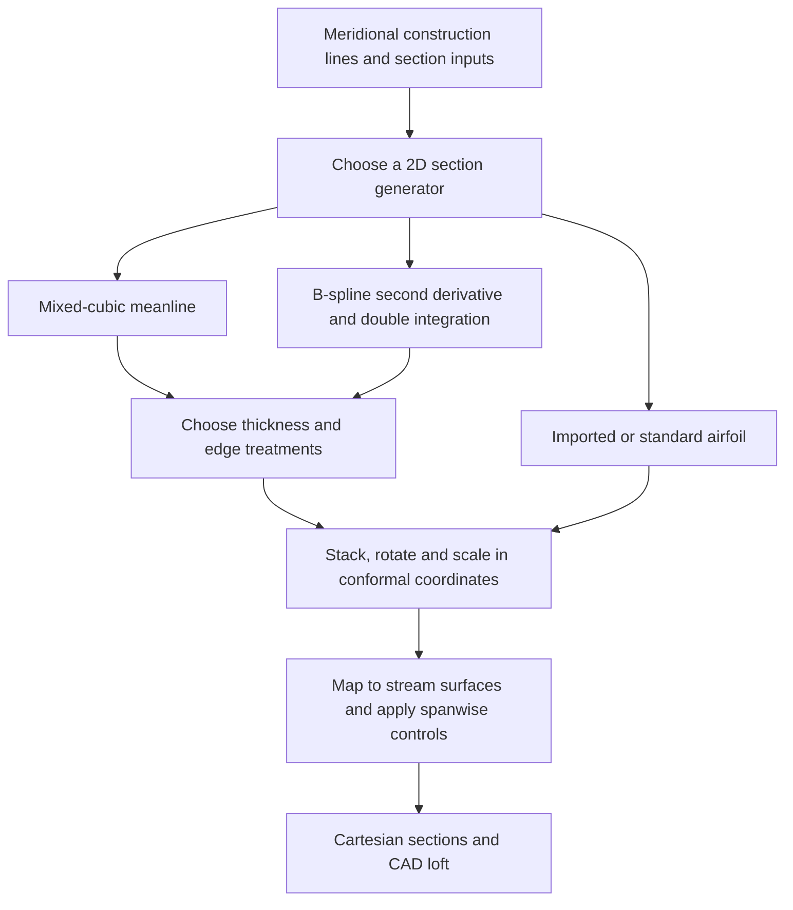

# Turner / 3DBGB / T-Blade3 blade parametrization

The four supplied papers describe **an evolving family within one geometry framework**, developed by Mark G. Turner and collaborators. The shared architecture is to construct two-dimensional blade sections, map them onto prescribed axisymmetric stream surfaces, and stack and loft them into a three-dimensional blade. The most distinctive developed section generator prescribes the meanline's second derivative with B-splines, integrates twice, and adds a separate thickness distribution.

The papers are not four unrelated methods. Neither are they four interchangeable descriptions of exactly the same algorithm. The 2014 paper adds a substantial section-generation capability to the earlier framework; later work adds thickness and CAD capabilities while retaining earlier options. Accordingly, these notes present a common formulation and separate the alternative meanline, thickness, and edge constructions.

“Final form” here means **the consolidated framework documented by the supplied 2022 paper**, not a claim about the latest software release. Equations below use consistent notation rather than reproducing conflicting symbols or typographical errors. Explicitly identified *derivations* and *critical assessments* are interpretations made in these notes.

## 1. Sources, chronology, and how to read the family

The file names do not always give the date of the document actually supplied. Page references below refer to printed PDF pages; for the ESP paper, page 3 means V02CT35A048-3.

| Key | Supplied document | Contribution and relationship |
| --- | --- | --- |
| **P12** | Siddappaji, Turner and Merchant, *General Capability of Parametric 3D Blade Design Tool for Turbomachinery*, **GT2012-69756**, 2012; local filename says 2013 | Establishes the general 3DBGB architecture: section generation, conformal coordinates, streamwise mapping, stacking, sweep/lean, external/standard airfoils, and CAD construction. The default meanline is partly cubic, with straight end portions. |
| **P14** | Nemnem, Turner, Siddappaji and Galbraith, *A Smooth Curvature-Defined Meanline Section Option for a General Turbomachinery Geometry Generator*, **GT2014-26363**, 2014 | Adds a second-derivative-controlled meanline, constrained quartic thickness, a thickness modifier, and a quartic replacement nose. This is the principal mathematical source for the developed section method. |
| **P20** | Sharma, Dannenhoffer, Holder and Turner, *Integration of an Open Source Blade Geometry Generator Using a Physics Based Parameterization With the Engineering Sketch Pad*, **GT2020-15943**, 2020; local filename says 2021 | Explicitly identifies T-Blade3 as formerly 3DBGB. Uses the same meanline concept with continuous modified NACA thickness; documents spanwise parameter counts, ESP solid construction, and a structural-analysis application. |
| **P22** | Siddappaji and Turner, *Versatile Tool for Parametric Smooth Turbomachinery Blades*, **Aerospace 9, 489**, 2022 | Consolidates the framework and illustrates its broad range of applications. Retains mixed-cubic, curvature-driven, and imported section options, and several thickness laws. |

Local source files:

- [P12: general capability](<../papers/Turner/Siddappaji et al. - 2013 - General capability of parametric 3D blade design tool for turbomachinery.pdf>).
- [P14: curvature-defined meanline](<../papers/Turner/Nemnem et al. - 2014 - A smooth curvature-defined meanline section option for a general turbomachinery geometry generator.pdf>).
- [P20: ESP integration](<../papers/Turner/Sharma et al. - 2021 - Integration of an open source blade geometry generator using a physics based parameterization with t.pdf>).
- [P22: consolidated method](<../papers/Turner/Siddappaji and Turner - 2022 - Versatile tool for parametric smooth turbomachinery blades.pdf>); [publisher record and DOI](https://doi.org/10.3390/aerospace9090489).

The grouping is supported by explicit statements: P14 introduces a new section **option** for the existing generator; P20, p. 2, states the name change; P22, Sections 2.3 and 4, describes retained options and development over several years. The method should be attributed to this collaborative sequence, rather than to Turner alone.

The most useful reading order is P22 for the architecture, P14 for the meanline and edge equations, P12 for the original mapping and section alternatives, and P20 for parameter organization and CAD integration.

## 2. Consolidated construction and design rationale

| Choice | Purpose in the papers | Qualification |
| --- | --- | --- |
| Build a normalized 2D section first | Reuse section construction for axial, radial and unducted devices | This construction plane is not generally a physical-distance plane |
| Control meanline second derivative | Distribute turning with fewer, smoother controls than editing many surface points | It is a proxy for geometric curvature, and only indirectly controls loading |
| Integrate twice | Obtain slope and position while retaining a smooth shape description | Endpoint angles and closure couple the solution globally |
| Specify thickness independently | Make thickness and material distribution explicit, instead of hoping independently drawn surfaces give acceptable thickness | Positive nominal thickness alone does not prove a valid or structurally adequate blade |
| Use cubic and quartic B-splines | Provide local control and useful continuity with relatively few inputs | Continuity depends on knots, joins, parameterization, and later CAD fitting |
| Use a separate smooth nose option | Control nose droop, elongation, and blends with the two sides | It is a different operation from simply scaling the two half-thicknesses |
| Interpolate design parameters spanwise | Separate the number of geometric sections from the number of design variables | Controls need not be mathematically independent |
| Keep section generation and CAD lofting separate | Support multiple CAD/analysis workflows and special geometry | CAD approximation can change the generated section slightly |

The main mature branch can therefore be summarized as **second-derivative-controlled meanline + selectable thickness and edge construction + conformal mapping + spanwise parameter control**. Selecting the modified NACA thickness is one branch of that description, not the definition of the whole family. [P14, pp. 2–9; P20, pp. 2–5; P22, Sections 2.1–2.6.]

## 3. Coordinates, units, and angles

| Symbol used here | Meaning |
| --- | --- |
| $x,r$ | Axial position and radius on a prescribed meridional construction line |
| $m$ | Physical meridional arc length |
| $m'$ | Dimensionless transformed distance, $\int dm/r$ |
| $\theta$ | Circumferential angle in radians |
| $u\in[0,1],v$ | Unit-chord section coordinates before stagger rotation |
| $v_c(u)$ | Meanline in that section plane |
| $q(u)$ | Input shape distribution for the meanline second derivative |
| $k$ | Amplitude determined by endpoint constraints, with $v_c''=kq$ |
| $h(u)$ | Half-thickness normal to the meanline in the unit-chord plane |
| $\chi(u)$ | Meanline tangent angle relative to the section chord |
| $\beta^*_{\rm in},\beta^*_{\rm out}$ | Metal angles relative to increasing meridional direction |
| $\zeta$ | Stagger: angle from increasing $m'$ to the chord |
| $C$ | Chord length in the dimensionless $(m',\theta)$ plane; papers use `chrd` |
| $\lambda\in[0,1]$ | Normalized span coordinate |
| $t$ | Local spline parameter; not generally identical to $u$ |

All trigonometric formulas here use radians. The papers also use degrees in input tables. Metal angles and flow angles are distinct; incidence and deviation relate them but are not solved by the geometry generator. These notes take metal angles as the section boundary data.

For a construction line $(x(s),r(s))$,

$$
dm=\sqrt{dx^2+dr^2},\qquad
m'(s)=\int_{s_0}^{s}\frac{\sqrt{x_s^2+r_s^2}}{r}\,ds.
$$

Revolving this line around the engine axis creates a stream surface. “Streamline” in these papers can mean a line supplied by an axisymmetric calculation or a smooth construction line between endwalls. It need not be a streamline of the eventual 3D viscous flow. [P12, pp. 3, 6–7; P22, Sections 2.1–2.2.]

The reason for this transformation follows from the surface metric:

$$
d\ell^2=dm^2+r^2d\theta^2
=r^2\left(dm'^2+d\theta^2\right).
$$

Thus the transformation preserves **local angles**, with local length scale $r$. In particular,

$$
\tan\beta=r\frac{d\theta}{dm}=\frac{d\theta}{dm'}.
$$

For constant radius, $m'=(x-x_0)/r$ on a straight axial path. For a purely radial path, $m'=\varepsilon\ln(r/r_0)$ with $\varepsilon=\operatorname{sgn}(r_{\rm out}-r_{\rm in})$ when $m$ increases downstream. The same mapping framework can therefore handle radial inflow and outflow with consistent orientation. These metric and radial formulas are geometric derivations, not additional empirical assumptions.

**Length warning:** $m'$ and $C$ are dimensionless. At constant radius, the developed physical chord is $rC$. With varying radius there is no single global radius factor that converts every section-plane distance into an exact physical distance.

## 4. The distinctive meanline: second derivative and double integration

### 4.1 What is prescribed

P14, Eqs. (8)–(18), distinguishes the meanline second derivative from its exact planar curvature:

$$
\kappa_{uv}(u)=\frac{v_c''(u)}{[1+v_c'(u)^2]^{3/2}}.
$$

Write the input distribution as

$$
q(u)=\sum_j Q_j N_{j,3}(u),\qquad v_c''(u)=kq(u).
$$

Here $N_{j,3}$ denotes a cubic B-spline basis in a graph representation. The original papers also use a parametric representation $(u(t),q(t))$; Section 5 explains the distinction. Calling $q$ “curvature” is shorthand. It has the sign of the resulting curvature when $k>0$, but its magnitude is not that curvature. The final physical surface curvature is another quantity again.

**Why this choice?** P14 explicitly chooses second derivatives to avoid the nonlinear arc-length dependence of exact curvature integration. Exact planar curvature would instead require, for example,

$$
\frac{d\chi}{ds_{uv}}=\kappa_{uv},\qquad
\frac{du}{ds_{uv}}=\cos\chi,\qquad
\frac{dv_c}{ds_{uv}}=\sin\chi.
$$

Controlling $q$ makes double integration straightforward while retaining a useful influence on where the meanline turns. The price is that a chosen $q$ does not specify a chosen exact curvature distribution.

### 4.2 Boundary conditions and the stagger solve

In a consistent positive-angle convention,

$$
\beta^*_{\rm in}=\zeta+\chi_{\rm in},\qquad
\beta^*_{\rm out}=\zeta+\chi_{\rm out}.
$$

The normalized meanline must join the chord endpoints:

$$
v_c(0)=v_c(1)=0,
$$

with endpoint slopes

$$
a=\tan(\beta^*_{\rm in}-\zeta),\qquad
b=\tan(\beta^*_{\rm out}-\zeta).
$$

The following definite-integral form is a **derivation of P14's coupled construction**, useful because it exposes the constraints and avoids ambiguous integration constants:

$$
Q_1(u)=\int_0^u q(w)\,dw,\qquad
Q_2(u)=\int_0^u(u-w)q(w)\,dw,
$$

$$
\boxed{v_c'(u)=a+kQ_1(u),\qquad v_c(u)=au+kQ_2(u).}
$$

Define two moments,

$$
I_0=\int_0^1q(w)\,dw,\qquad
I_1=\int_0^1(1-w)q(w)\,dw.
$$

Then the two remaining conditions are simply

$$
\boxed{kI_0=b-a,\qquad a+kI_1=0.}
$$

If $I_0\ne0$, eliminate $k$ and solve one scalar equation for stagger:

$$
F(\zeta)=
\tan(\beta^*_{\rm in}-\zeta)
+\frac{I_1}{I_0}
\left[\tan(\beta^*_{\rm out}-\zeta)
-\tan(\beta^*_{\rm in}-\zeta)\right]=0,
$$

$$
k=\frac{b-a}{I_0}.
$$

P14 uses a secant iteration enforcing trailing-edge closure and starts from the average metal angle, equivalent to initially assuming $\chi_{\rm in}+\chi_{\rm out}=0$. The converged stagger is a **result of the meanline shape and constraints**, not generally the arithmetic mean of the two metal angles. [P14, pp. 6–7.]

### 4.3 Consequences for parameter interpretation

- Multiplying all values of $q$ by a nonzero common factor can be absorbed into $k$. The normalized shape distribution matters; its overall amplitude is not an additional independent control when the endpoint constraints are enforced.
- A local change in $q$ changes its integral downstream. It can also change $k$ and $\zeta$. Local support of a B-spline therefore does **not** imply a strictly local change in the finished blade.
- A sign-changing $q$ permits inflected and S-shaped meanlines. P14 demonstrates this for a transonic compressor section; it is a useful extension beyond a simple monotonic turning blend.
- If $I_0$ is zero or nearly zero, dividing by it is invalid or ill-conditioned. The original two equations must be considered. For example, a zero-integral $q$ cannot produce unequal finite endpoint slopes through a single amplitude $k$.
- The graph representation requires a usable single-valued $v_c(u)$ and finite endpoint slopes relative to the chord. A solver must avoid tangent poles and select a physically meaningful angle branch.

As a check, for $q=1$, $I_0=1$, $I_1=1/2$, and closure gives $a+b=0$. On the usual angle branch, $\zeta=(\beta^*_{\rm in}+\beta^*_{\rm out})/2$, and the meanline is parabolic. This average-stagger result is a special case, not the general rule.

## 5. B-spline construction and smoothness

A parametric spline segment has the form

$$
\mathbf{S}_i(t)=\sum_{j=0}^{p}\mathbf{P}_{i+j}B_{j,p}(t),\qquad 0\le t\le1.
$$

For the uniform cubic segments used in the papers, a convenient basis is

$$
B_0=\frac{(1-t)^3}{6},\quad
B_1=\frac{3t^3-6t^2+4}{6},\quad
B_2=\frac{-3t^3+3t^2+3t+1}{6},\quad
B_3=\frac{t^3}{6}.
$$

Each segment uses four neighboring control points. The curvature input can be represented by $\mathbf{P}_j=(U_j,Q_j)$ so that both the chordwise position and ordinate are adjustable. P20 counts both coordinates as possible inputs. A monotonic $u(t)$ is needed to interpret this curve as $q(u)$.

When using the parametric form, integration must respect

$$
\int q(u)\,du=\int q(t)\frac{du}{dt}\,dt.
$$

Integrating $q(t)$ with respect to $t$ alone is generally wrong. If $q$ is piecewise cubic **in $u$**, double integration produces piecewise quintic $v_c(u)$, as described in P14 and P22. With freely varying, non-affine $u(t)$, that degree statement does not automatically hold in $u$, although the integral construction remains valid. This is an implementation distinction not resolved by simply calling both representations “cubic B-splines.”

P22, Section 2.4, uses extrapolated endpoint or *phantom* controls to make its cubic construction pass through the first and last specified points:

$$
\mathbf{P}_0=2\mathbf{P}_1-\mathbf{P}_2,\qquad
\mathbf{P}_{n+1}=2\mathbf{P}_n-\mathbf{P}_{n-1}.
$$

These are derived controls rather than extra user inputs. They should not be confused with clamping a general B-spline knot vector; a reimplementation should choose one endpoint convention explicitly.

For ordinary interior knots of multiplicity $\mu$, a degree-$p$ B-spline has continuity $C^{p-\mu}$. Thus a cubic spline with simple knots is $C^2$, and a quartic spline with simple knots is $C^3$. If $q(u)$ is $C^2$, its twice-integrated meanline is $C^4$ in the interior. For a regular curve, continuous curvature needs second derivatives; continuous derivative of curvature needs third derivatives.

**Critical assessment:** P22's broad statements about $C^2$ and superiority to $G^2$ need qualification. $C^2$ is a stronger requirement on a chosen parameterization, whereas $G^2$ describes geometric matching. A regular $C^2$ curve need not have continuous slope of curvature. Also, the Fig. 5 caption's inclusion of degree-two splines as universally $C^2$ is not the general B-spline continuity rule. Evaluate the actual curve and its joins rather than relying on these labels. [P14, pp. 5–8; P22, pp. 9–10.]

## 6. Thickness laws: related alternatives, not one replacement sequence

### 6.1 The common thickness convention

Thickness is prescribed against **$u$, the unit-chord section coordinate before rotation**, and is applied normal to the meanline in that plane. It is not a function of physical meridional fraction or normalized meanline arc length.

Write $T_{uv}(u)=2h(u)$ for full thickness. P14's prose sometimes uses `thk` for total thickness, but explicitly says that `thk` in its offset Eq. (21) is **half** the actual thickness. Keeping $h$ and $T_{uv}$ separate prevents a factor-of-two error.

After stagger rotation, points at a particular $u$ do not generally share a particular meridional station. Even the meanline station is

$$
m'_c=C[(u-u_{\rm stack})\cos\zeta
-(v_c-v_{\rm stack})\sin\zeta]+\text{offset}.
$$

Consequently, a thickness-maximum input at $u=0.4$ means 40% of the normalized section chord coordinate. It does not mean 40% of physical meridional path length. [P14, Eqs. (19)–(22); P20, p. 3; P22, Section 2.3.]

### 6.2 Wennerstrom distribution

P14 identifies a third-order-polynomial Wennerstrom thickness option, paired by default with an elliptical leading edge. P22 retains it. This is the simpler established thickness branch; the later spline and modified NACA branches broaden the choices rather than proving this one universally unsuitable.

The supplied papers refer to Wennerstrom's book for its coefficients and construction details. They do not provide a complete standalone specification from which to reproduce that particular law. An arbitrary cubic satisfying a few endpoint conditions should not be labelled “the Turner/Wennerstrom law.”

### 6.3 Constrained quartic B-spline thickness

P14, Appendix A, constructs a symmetric thickness outline using **18 control points**, determined by constraints rather than treating all their coordinates as independent design inputs. Its six principal inputs are:

| Paper input | Meaning and caution |
| --- | --- |
| `mxthk` | Full maximum thickness in the normalized section plane |
| `umxthk` | Chord-coordinate location assigned to that maximum |
| `lethk`, `tethk` | Thicknesses at designated near-edge stations; not the thickness at the closed tip itself |
| `lecurv`, `tecurv` | Parametric second-derivative controls associated with edge shape; not automatically physical inverse radii |

In compact form the construction is

$$
\begin{pmatrix}u(t)\\v_t(t)\end{pmatrix}
=\sum_j\begin{pmatrix}U_j\\V_j\end{pmatrix}N_{j,4}(t),
$$

with a symmetric lower outline. The equations impose closed tip positions, designated edge thicknesses, the maximum-thickness location and value, stationarity there, and additional derivative and intermediate-point conditions to close the algebraic systems. In these notes the intended maximum constraint is written consistently as

$$
u(t_m)=u_m,\qquad v_t(t_m)=\frac{T_{\max}}{2},\qquad
\frac{dv_t}{dt}(t_m)=0.
$$

Provided $du/dt\ne0$, this gives $dh/du=0$ at the prescribed station. To certify a global maximum also requires checking the rest of the distribution for overshoot. The paper's extra constraints aim to reduce user inputs and produce useful shapes; a stationary-point equation alone is not such a certificate.

For the tip curvature of a parametric outline,

$$
\kappa_t=
\frac{u_t v_{tt}-v_t u_{tt}}
{(u_t^2+v_t^2)^{3/2}}.
$$

At a regular vertical tangent, $u_t=0$, so $|\kappa_t|=|u_{tt}|/v_t^2$. This explains why an input labelled `lecurv`, defined in Appendix A through $u_{tt}$, cannot generally be read as an independently specified physical nose curvature. Its meaning depends on the other derivatives and subsequent scaling.

**Why quartic?** A regular quartic spline with simple knots can give continuous third derivatives, hence continuous curvature variation. The parametric outline also accommodates a rounded tip with vertical tangent without requiring a globally regular thickness graph at the endpoint. P22 lists sharp- and blunt-TE quartic variants; these are closure choices within the thickness branch. [P14, pp. 7–8 and Appendix A, pp. 17–19; P22, pp. 6–8.]

### 6.4 Continuous modified NACA four-digit thickness

This is the thickness branch used in P20 and listed as a later addition in P22. It retains the same integrated meanline, symmetric section-plane thickness addition, and 3D mapping. Its introduction therefore changes the thickness submodel rather than introducing a different overall blade method.

The dedicated source is **Sharma and Turner (2021), “Continuous Modified NACA Four-Digit Thickness Distribution for Turbomachinery Geometries,” AIAA Journal 59, 1501–1505**, cited as reference 28 in P22. That paper is **not** one of the four supplied PDFs. The supplied ESP paper is a different publication, despite its local 2021 filename.

The four supplied papers do not give the complete modified-NACA coefficient system or sufficient matching details to reconstruct that branch faithfully. Thus these notes do not substitute the familiar fixed-coefficient NACA four-digit equation or assert an unverified continuity order for this modification. P20's parameter table assigns $6n_{\rm span,thk}-2$ inputs to the thickness description, including span locations; it is not itself a derivation of the thickness law. [P20, pp. 1–4; P22, Sections 1 and 2.3, reference 28.]

### 6.5 Multiplicative thickness modifier

P14 additionally supplies a quartic spline modifier $M(u)$:

$$
M(u)=\sum_j M_jN_{j,4}(u),\qquad
\boxed{h(u)=h_0(u)[1+M(u)].}
$$

The purpose is extra chordwise thickness control without rebuilding the underlying thickness law. The modifier can increase or decrease thickness; its plot in P14 includes negative ordinates. Nonnegative thickness requires $1+M(u)\ge0$ wherever $h_0>0$.

The modifier generally changes the actual maximum and its location:

$$
h'=h_0'(1+M)+h_0M'.
$$

Even if $h_0'(u_m)=0$, the modified distribution is stationary at $u_m$ only if $h_0(u_m)M'(u_m)=0$. Consequently, maximum-thickness constraints on the base distribution should not be reported as exact constraints on the modified one. This consequence is a derivation from P14, Eqs. (19)–(20).

## 7. Applying thickness and constructing the edges

### 7.1 Normal offsets in the section plane

With

$$
\chi(u)=\arctan v_c'(u),\qquad
\mathbf n=(-\sin\chi,\cos\chi),
$$

the symmetric body surfaces are

$$
\boxed{
\begin{aligned}
u_+&=u-h\sin\chi,&v_+&=v_c+h\cos\chi,\\
u_-&=u+h\sin\chi,&v_-&=v_c-h\cos\chi.
\end{aligned}}
$$

These are exact normal offsets in the Euclidean $(u,v)$ plane. The gap between paired points is $2h$. Plus and minus are geometric labels; pressure/suction identification requires the blade and flow orientation. [P12, Eqs. (20)–(23); P14, Eq. (21).]

Symmetric thickness does not imply equal finished-surface curvature. For a planar meanline parameterized by arc length $s$, a variable offset $d(s)$ obeys

$$
\frac{d}{ds}(\mathbf c+d\mathbf n)
=(1-d\kappa_c)\mathbf t+d_s\mathbf n.
$$

This geometric identity shows the interaction between camber curvature and thickness. Positivity of $h$ does not rule out folds, self-intersections, or excessive curvature. For a constant offset, the familiar local regularity problem occurs at $1-d\kappa_c=0$; variable thickness also brings in $d_s$ and higher derivatives. This is directly relevant to the leading-edge issue considered in v3.

### 7.2 Three leading-edge constructions in P14

| Option | Construction | Main reason to retain it |
| --- | --- | --- |
| Elliptical nose | Separate ellipse associated with the Wennerstrom branch | Simple traditional edge construction |
| Nose implicit in quartic thickness | Edge included in the constrained thickness outline | Shared thickness and edge shape control |
| Replacement quartic nose | Remove the existing nose after constructing the section and attach a new parametric spline to its two sides | More direct control of shape and smooth blends, including droop and elongation |

The third option is described in P14, pp. 8–9 and Appendix B. It uses **nine control points** and nine user shape parameters: `lethk`, droop, elongation, and six additional controls. Appendix B identifies the latter as two interpolation controls for the third/seventh points and four coordinate controls for the fourth/sixth points. The construction is performed in a locally rotated, zero-camber frame and then rotated back.

The intended contact conditions are position matching plus matching the first three derivatives of the adjoining side curves. In a regular local graph coordinate $U$, these can be expressed as

$$
\mathbf r_{\rm nose}(t_a)=\mathbf r_{{\rm body},a},\qquad
\left.\frac{d^jV}{dU^j}\right|_{{\rm nose},a}
=\left.\frac{d^jV}{dU^j}\right|_{{\rm body},a},
\quad j=1,2,3,
$$

at each contact $a$. Position, tangent, curvature, and curvature-slope matching address different geometric requirements; attaching a nose with a common tangent alone does not guarantee a smooth curvature distribution.

Droop changes the nose's transverse position; elongation changes its longitudinal extent. The appendix writes a tip relation of the form

$$
U_{\rm tip}=U_{\rm join}-c_{\rm LE},\qquad
V_{\rm tip}=s_s c_{\rm LE}.
$$

Its prose inconsistently calls $s_s$ elongation, whereas the nomenclature and main text call it droop. The displayed relation establishes its transverse role. Exact input naming should be checked against the implementation before reproducing this option.

**Comparison with v3:** this is a separately reconstructed nose with its own contact and tip constraints. It is not the v3 rule that transfers half-thickness between two sides while preserving the original paired-point total thickness. The existence of droop in P14 does not establish an equivalent thickness-conservation property.

### 7.3 Trailing-edge options

P14 allows corresponding edge options at the trailing edge, together with circular and blunt closures. P22 also lists sharp/blunt thickness variants. These options do not all have identical global smoothness: a deliberately blunt or sharp edge has its own endpoint geometry, and a circular cap needs its joins checked. A continuity statement about one smooth-nose branch cannot be applied to every possible trailing-edge selection.

## 8. Stacking, rotation, and mapping into 3D

### 8.1 Section placement

Translate by the selected stacking point and rotate with a consistent sign convention:

$$
\begin{pmatrix}m'_b\\\theta_b\end{pmatrix}
=C
\begin{pmatrix}\cos\zeta&-\sin\zeta\\\sin\zeta&\cos\zeta\end{pmatrix}
\begin{pmatrix}u_b-u_{\rm stack}\\v_b-v_{\rm stack}\end{pmatrix}.
$$

Here $(u_b,v_b)$ is any perimeter point. This convention gives $\beta^*=\zeta+\chi$, consistent with Section 4. P12 and P22 express the same rotation using trigonometric functions of $-\zeta$.

For a prescribed projected chord in the transformed meridional direction,

$$
C_m'=|m'_{s,\rm TE}-m'_{s,\rm LE}|,\qquad
C=\frac{C_m'}{|\cos\zeta|}.
$$

This becomes singular near $90^\circ$ stagger. P12, p. 13, explicitly introduces a direct chord-input option for highly staggered wind-turbine sections. That is a practical branch of the method, not a reason to abandon the general mapping.

Stacking may use a selected chord fraction, the section centroid, or spanwise-varying stacking locations. Changing the stacking point changes how stagger, scaling, and spanwise modifications position the section. [P12, pp. 5–8; P22, Sections 2.3 and 2.5.]

### 8.2 Streamwise registration and mapping

The generator represents the meridional construction line using splines $x_s(m')$ and $r_s(m')$. It obtains the leading-edge station by inverse evaluation of $x_s$ for an axial-type edge or $r_s$ for a radial-type edge. The appropriate inverse must be unambiguous on the chosen interval.

Register a section to that station and apply the chosen offsets:

$$
\delta m'_{\rm offset}=m'_{s,\rm LE}-m'_{b,\rm LE},
$$

$$
m'_{3D}=m'_b+\delta m'_{\rm offset}+\delta m'_{\rm sweep},\qquad
\theta_{3D}=\theta_b+\delta\theta_{\rm lean}.
$$

The exact registration convention matters when applying sweep. P22, Section 2.3, describes using the hub leading-edge reference for its sweep convention to avoid leading-edge wiggles; simply re-registering every swept section back to its original station would cancel an intended displacement.

Evaluate the **offset surface point's** station:

$$
x_{3D}=x_s(m'_{3D}),\qquad r_{3D}=r_s(m'_{3D}),
$$

then use the engine axis as Cartesian $X$:

$$
\boxed{(X,Y,Z)=
\left(x_{3D},\ r_{3D}\cos\theta_{3D},\ r_{3D}\sin\theta_{3D}\right).}
$$

If the meridional geometry was normalized by a reference length $L_{\rm ref}$, multiply these three coordinates by $L_{\rm ref}$. Do not scale $\theta$ as a length. Construction lines extend upstream and downstream so that thickness and sweep displacements can still be mapped. [P12, pp. 6–8; P22, pp. 6–7.]

### 8.3 What happens to thickness under mapping

Before mapping, the two sides are exact normal offsets in a dimensionless plane. Rotation and uniform scaling preserve this fact in $(m',\theta)$. The final conformal transformation preserves infinitesimal angles, but **not finite distances**.

At a meanline point of radius $r$, a small half-thickness corresponds to physical length approximately $rCh$. When radius varies, a finite mapped segment is not generally a straight normal displacement of that length, nor an exact geodesic normal offset. At constant radius the relation is exact in the unwrapped cylindrical surface, though an ambient Cartesian chord across the cylinder is still a different distance.

The mapping is exact as a prescribed coordinate construction on the stream surface. The approximation arises only if its thickness input is interpreted as a specified finite physical normal distance. This distinction follows from the metric in Section 3 and is not explicitly developed in the papers.

## 9. Spanwise controls, sweep, lean, and blade rows

A generic spanwise scalar parameter is represented schematically by

$$
p(\lambda)=\sum_jP_jN_{j,3}(\lambda).
$$

The same idea applies to metal-angle modifiers, chord multipliers, thickness parameters, meanline-shape controls, sweep, and lean. Different quantities can have different numbers and locations of spanwise control points. The number of sampled blade sections is a separate resolution choice. P12 uses normalized leading-edge radial span in its examples; other machine configurations require a suitable consistent span coordinate.

P22, Section 2.9, distinguishes two sweep/lean conventions:

- **Meridional sweep and tangential lean:** shifts in $m'$ and $\theta$.
- **True sweep and true lean:** shifts along and normal to the section chord.

In the present normalized-plane notation the two components are related by the same rotation:

$$
\begin{pmatrix}\delta m'\\\delta\theta\end{pmatrix}
=\begin{pmatrix}\cos\zeta&-\sin\zeta\\\sin\zeta&\cos\zeta\end{pmatrix}
\begin{pmatrix}\delta s'\\\delta n'\end{pmatrix}.
$$

This is a coordinate identity; inputs expressed in physical length require the appropriate normalization. “Sweep” without its direction and units is therefore not a complete parameter definition.

For $N$ equally spaced blades, copies are generated with $\theta_j=\theta_0+2\pi j/N$. Splitters can use different sections and a chosen fraction of pitch; P22 demonstrates half-pitch placement. Bent and split tips additionally use spanwise controls and, for some concepts, CAD Boolean operations. They are applications of the framework rather than new meanline theories.

P20, pp. 3–4, gives a useful measure of design-space size. For $n_{\rm cp}$ chordwise controls on each second-derivative distribution and $n_{\rm span,curv}$ spanwise controls, its input count is

$$
n_{\rm inputs,curv}=(2n_{\rm cp}-1)n_{\rm span,curv}-2.
$$

This includes adjustable chordwise abscissae and span locations, with endpoints fixed. For seven chordwise controls and five spanwise controls per parameter family, the paper reports **133 variable inputs for one blade row**. There is a small accounting discrepancy: summing the entries marked “Yes” for ESP in its Table 1 gives $63+28+5(8)=131$, not 133. The text does not explain the difference. The authors report that this design space was too large for their genetic-algorithm approach, so they sometimes fix chordwise positions or optimize groups sequentially. “Few parameters” is relative to dense surface-point editing, not a guarantee of a tiny optimization problem.

## 10. The original meanline and the CAD branch

### 10.1 The retained mixed-cubic section

P12's default meanline has straight inlet/outlet portions joined by a cubic middle. A clean equivalent representation of that middle is cubic Hermite interpolation. If its endpoints are $(u_1,v_1)$ and $(u_2,v_2)$, their slopes are $s_1,s_2$, $L=u_2-u_1$, and $w=(u-u_1)/L$,

$$
v_c=H_{00}(w)v_1+LH_{10}(w)s_1
+H_{01}(w)v_2+LH_{11}(w)s_2,
$$

$$
H_{00}=2w^3-3w^2+1,\quad H_{10}=w^3-2w^2+w,
$$

$$
H_{01}=-2w^3+3w^2,\quad H_{11}=w^3-w^2.
$$

This is an algebraic restatement of the cubic endpoint construction, not a new Turner formula. P12, Eqs. (5)–(18), defines its end stations from the straight-portion length controls and angle data. Matching position and slope does not generally match the zero curvature of the straight portions. The later second-derivative construction offers more direct control of turning distribution and smoothness.

P22 still describes the mixed-cubic option as a default. It also accepts imported airfoils such as wind-turbine sections and circular root sections. Such imported profiles share the mapping and stacking machinery; they need not have been created by double integration. A discussion that labels every T-Blade3 output “curvature generated” would therefore be inaccurate.

### 10.2 ESP integration

P20 principally extends the workflow around the geometry. ESP user-defined primitives execute T-Blade3, read the section coordinates, fit sectional B-splines by least squares, skin a surface through them, and cap the blade using the end surfaces of revolution. The common knot sequence permits skinning without an additional section-fit approximation, but the preceding least-squares fit remains an approximation. Nose fidelity must therefore be checked after CAD fitting, not only in the analytic generator. [P20, pp. 4–5.]

The paper also creates hub blends called *flends* and demonstrates structural analysis under centrifugal and pressure loads. These operations do not change the definition of the meanline method. Sensitivity-enabled optimization is discussed, but the paper describes further coupling to a gradient-based optimization process as future work. It should not be cited as proof that the entire geometry-to-analysis chain already had exact analytic derivatives. [P20, pp. 5–8.]

## 11. Critical assessment and corrections to the printed equations

### 11.1 Smooth geometry helps flow quality, but does not prescribe loading

P14 motivates curvature control through normal momentum balance, with $n$ directed away from the streamline's center of curvature:

$$
\frac{\partial p}{\partial n}=\rho\frac{V^2}{R}.
$$

This relates the **normal** pressure gradient to streamline curvature. It is not an equation determining the streamwise blade-surface pressure distribution from the meanline's $v_c''$. Thickness, passage geometry, neighboring blades, incidence, compressibility, boundary layers, and operating conditions also affect the solution.

P14 gives MISES examples with smooth Mach distributions and a controlled-diffusion modification with slightly lower loss and slightly more turning; it explicitly says that example was not optimized. P22 demonstrates a wide range of geometries and selected CFD/design studies. These support usefulness and flexibility. They do not establish that every parameter combination is valid, attached, efficient, or globally smooth, or that this parameterization outperforms other families under equal optimization effort.

Similarly, thickness control is useful structural input; it is not proof that a section carries its loads safely. P20's separate structural analysis is consistent with that distinction.

### 11.2 P14 Eq. (23): higher derivative conversion is incorrect as printed

The printed page was checked visually, not only through text extraction. Its first derivative relation is correct, but its ratios of second and third parametric derivatives are not valid chain rules.

For a regular graph represented by $(U(t),V(t))$, with dots meaning differentiation in $t$,

$$
\frac{dV}{dU}=\frac{\dot V}{\dot U},\qquad
\frac{d^2V}{dU^2}=
\frac{\dot U\ddot V-\dot V\ddot U}{\dot U^3},
$$

$$
\frac{d^3V}{dU^3}=
\frac{\dot U^2\dddot V-\dot U\dot V\dddot U
-3\dot U\ddot U\ddot V+3\dot V\ddot U^2}{\dot U^5}.
$$

These require $\dot U\ne0$. At a vertical tangent, use the parametric curvature formula or another local graph coordinate. The nose-joining concept remains meaningful, but copying Eq. (23) into code would not correctly impose its intended conditions. This observation concerns the publication; the current implementation has not been audited here.

### 11.3 P22 p. 7: two visible transcription errors

The displayed surface equations give $v_{\rm top}=v+h\sin(\arctan v')$. That factor must be **cosine** for a normal offset, as correctly given in P12 and P14. A flat meanline makes the error obvious: sine would give zero upper thickness. The corrected equations are in Section 7.

The last Cartesian conversion is also labelled $x_{3D}$ a second time; it should be the third Cartesian coordinate, $z_{3D}$ in the paper's naming. Section 8 writes the conversion explicitly. Both errors were checked against the rendered PDF page.

### 11.4 Other interpretation hazards

- **Rotation signs:** P14 Eq. (24) displays a rotation with the opposite sign to the convention used by its stated angle addition and by P12/P22. Use a declared convention and verify that the mapped tangent has the requested metal angle.
- **Curvature versus derivative:** `lecurv`, `tecurv`, and the meanline “curvature controls” are not interchangeable with physical curvature or radius inputs.
- **Positivity and monotonicity:** a positive thickness input does not alone prove a positive, nonfolding spline everywhere, particularly after modifiers and free control-point movement. Parametric $u(t)$ also needs a usable inverse.
- **Continuity versus polynomial degree:** degree alone does not certify join smoothness; repeated knots and separate edge joins matter.
- **Global smoothness:** smooth 2D sections and smooth parameter variation help construct a smooth blade, but sharp closures, special CAD unions, and surface fitting require their own checks.

## 12. Relation to parametrization_v3

The following compares the developed Turner branch with the actual conventions in [v3 theory notes](../parametrization_v3/theory_notes.md), not with every possible T-Blade3 option.

| Aspect | Current v3 | Turner family |
| --- | --- | --- |
| Meridional geometry | Straight axial or purely radial paths | General supplied meridional construction lines and inverse spline mapping |
| Angle-preserving coordinate | $m'=\int dm/r$ | Same geometric transformation |
| Meanline controls | A prescribed blend of angle or slope against normalized $m'$ | A B-spline second derivative against unit-chord $u$, followed by constrained double integration |
| Stagger | Consequence of the integrated path and its endpoint displacement | Solved together with curvature amplitude to close the unit-chord meanline |
| Shape freedom | Low-dimensional turning location and concentration | Multiple local shape controls, including sign changes and S-shaped sections |
| Thickness station | Physical meridional fraction $m/c_m$ | Unit-chord coordinate $u$ before stagger rotation |
| Thickness normalization | Full thickness divided by physical meridional chord | Unit-chord section thickness; offset equations use half-thickness |
| Thickness law | Denton body and edge factors | Wennerstrom, constrained quartic, or continuous modified NACA, with an optional modifier |
| Leading-edge adjustment | Transfers thickness between sides with a prescribed window | Separate quartic nose, droop, elongation, and contact constraints among the options |
| Normal-offset construction | Local physical metric offsets, then coordinate conversion | Normal offsets in $(u,v)$, then rotation/scaling and stream-surface mapping |
| Finite physical thickness | First-order interpretation when radius varies | Also not exactly distance preserving under a variable-radius conformal mapping |
| Spanwise geometry | Not a full 3D blade loft | Parameter splines, stacking, sweep/lean, section lofting |

This resolves the two literature questions explicitly left open in v3:

1. **Where is Turner thickness defined?** Against section chord coordinate $u$, not physical meridional distance, transformed meridional fraction, or camberline arc length.
2. **How is thickness applied?** As a normal offset in the normalized section plane, followed by conformal mapping. It is not an exact finite physical normal offset on a varying-radius surface.

A useful extension to the present work would be to borrow the second-derivative meanline controls and explicit smooth edge-contact constraints as separate features. Replacing v3's thickness station with $u$, however, would be a substantive modeling change. Likewise, a Turner-style drooped replacement nose should not be presented as mathematically equivalent to v3's thickness-preserving redistribution.

## 13. What is sufficiently specified, and what remains to check

The supplied papers support a coherent implementation of the architecture, the constrained meanline equations, normal offsets, conformal mapping, spanwise controls, and the distinctions between edge options. P14 also supplies detailed algebraic systems for its quartic thickness and replacement nose, but those appendices should be checked against the corrected chain rules and consistent parameter meanings before transcription.

The papers do **not**, by themselves, provide a clean implementation specification for every branch of the 2022 framework. In particular, reproducing the continuous modified NACA law requires its dedicated paper or the corresponding documented implementation; the Wennerstrom coefficients are also deferred to another reference. The full current software may contain fixes, conventions, or additional options beyond these publications.

The authors' [T-Blade3 repository](https://github.com/GTSL-UC/T-Blade3) is the appropriate implementation reference for that follow-up. These notes reviewed the supplied PDFs, checked key printed equations visually, and used public records to confirm the publication/repository references. They do not claim to reproduce or validate a particular software revision.

For a future implementation, the meaningful checks would be endpoint metal angles and chord closure; invariance to a common rescaling of $q$; section-plane offset orthogonality; derivatives at spline and edge joins; monotonic spline coordinates and nonnegative thickness; known constant-radius and radial mappings; and the difference between generated and CAD-fitted sections. Aerodynamic and structural suitability remain separate analysis tasks.
