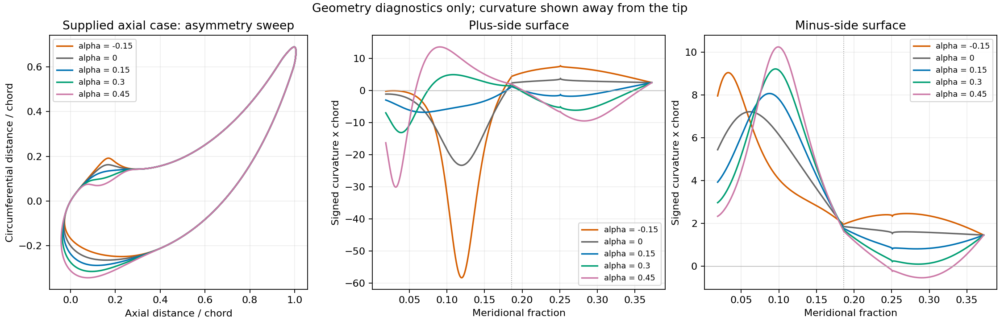

# Blade parametrization after meanline design: Korakianitis and v3

Review date: 19 September 2026. Scope: the three supplied 1993 papers, the v3 geometry and demos, and the relevant meanline-to-geometry interface in turbodash. This is an assessment and proposed development direction, not an implementation of a replacement geometry model.

## Recommendation

**Do not replace v3 with the original Korakianitis prescribed-surface-curvature interface as the default preliminary blade generator.** It is a poor direct match for a small set of meanline inputs plus portable sliders. Its additional variables are strongly coupled to surface placement, thickness, and closure, and the published design process relies on repeated adjustment informed by geometry and flow plots.

**Keep the meanline-driven architecture, but improve the mathematical construction and impose curvature requirements on the final blade surfaces.** The most useful part to borrow immediately is the separate leading-edge construction with high-order matching to the blade body. The papers' curvature argument is persuasive motivation for better surfaces; it does not require curvature control points to become the user interface.

A curvature method can be automated without a control-point GUI. However, a robust meanline-compatible wrapper would need its own default-shape model, constraint solver, and feasibility handling. Those are substantial parts of the implementation, not details supplied by these papers. I would consider that a later alternative backend if a simpler constrained construction proves inadequate.

## Sources and what each contributes

The references below use **printed journal page numbers**. The PDFs begin at the first journal page listed, so, for example, K2 p. 330 is PDF page 6. The three papers overlap substantially; they are not three independent curvature parametrizations.

| Reference | Supplied paper | Role in this assessment |
| --- | --- | --- |
| K1 | T. Korakianitis, **Hierarchical Development of Three Direct-Design Methods for Two-Dimensional Axial-Turbomachinery Cascades**, *Journal of Turbomachinery* 115(2), 314–324 (1993). [PDF](<../papers/Korakianitis - 1993 - Hierarchical development of three direct-design me.pdf>) | Develops the polynomial, parametric-spline, and prescribed-curvature alternatives; explains their shared leading-edge treatment. |
| K2 | T. Korakianitis, **Prescribed-Curvature-Distribution Airfoils for the Preliminary Geometric Design of Axial-Turbomachinery Cascades**, *Journal of Turbomachinery* 115(2), 325–333 (1993). [PDF](<../papers/Korakianitis - 1993 - Prescribed-curvature-distribution airfoils for the.pdf>) | Main implementation reference for the third method, including its inputs and iterative use. |
| K3 | T. Korakianitis and P. Papagiannidis, **Surface-Curvature-Distribution Effects on Turbine-Cascade Performance**, *Journal of Turbomachinery* 115(2), 334–341 (1993). [PDF](<../papers/Korakianitis and Papagiannidis - 1993 - Surface-curvature-distribution effects on turbine-.pdf>) | Evidence about geometry sensitivity and boundary-layer behavior; not a new geometry generator. |

The assessment concerns these 1993 formulations, not every later development of CIRCLE. The supplied copies were read as text, with K2 pp. 330–331 also checked visually for equations and the parameter table.

### K1: three constructions of increasing control over curvature

**Method 1: surface coordinates and analytic polynomials** (pp. 317–318).

Each pressure/suction surface is specified through five points and two slopes, in addition to the trailing-edge geometry. Cubic front and rear body segments are connected by a quintic that matches position and the first two derivatives. This produces continuous curvature at the body joins, but generally not continuous slope of curvature. A seventh-degree connector could match third derivatives, but the paper reports unwanted inflections with that choice. The throat is an output of this method.

This is not a camberline-plus-single-thickness parametrization. Its free surface points would need a new mapping from meanline quantities. I would not adopt this particular construction: it carries the surface-placement burden without meeting the intended curvature-slope requirement automatically.

**Method 2: fourth-degree parametric surface splines** (pp. 318–320).

The two surfaces are represented by piecewise quartics, `x(u), y(u)`, with first-, second-, and third-derivative continuity at joins. The illustrated surfaces each have four nodes, with more possible. End conditions encode surface direction and curvature; the suction-side throat node is constrained to lie on a throat circle with the appropriate tangent. The authors search node locations for desirable curvature and passage-area distributions, describing the process as computationally demanding.

The useful idea is **constructing smooth surfaces directly with geometric constraints**. A modern implementation need not reproduce either the old search procedure or its runtime. But continuity alone does not choose a sensible shape, and free node positions still need defaults and constraints. This is a useful basis for a redesigned internal representation, not a ready-to-use parameter interface.

**Method 3: prescribed body-surface curvature plus separate nose and tail regions** (pp. 320–322).

This is the method developed in K2. It makes curvature easier to manipulate than in method 2, but introduces curvature-space variables and a surface reconstruction problem.

### K2: what the prescribed-curvature method actually specifies

The method works independently on the two blade surfaces and uses three regions:

| Region | Representation | Additional geometric choices |
| --- | --- | --- |
| Rear body / trailing-edge region | Cubic `y(x)` | Trailing-edge position and surface angle. On the suction side: throat diameter and throat-circle orientation. On the pressure side: another surface point and its tangent. |
| Main body | A Bézier curve in the `(x, curvature)` plane, followed by reconstruction of the surface | Curvature control-point locations and values on each side; compatibility with the rear segment and desired forward surface position/slope. |
| Leading edge | Separate thickness laws normal to two parabolic construction lines | Common inlet construction-line direction, separate construction-line bending and nose thickness coefficients, plus a matching station on each side. |

The cascade inputs include flow angles, exit Mach number, pitch/loading, stagger, throat opening, and trailing-edge thickness (pp. 328–330). These are physically meaningful and partly available from meanline design. **It is incorrect to say that all of the method's inputs are unintuitive.** The difficulty is in the extra surface-curvature and construction-line variables needed to complete the shape.

For the body, the curvature Bézier segment ends on the rear cubic's curvature distribution. Its final control-polygon direction matches the rear segment's curvature slope. The other control points are adjusted to obtain an acceptable forward surface position, direction, and curvature distribution. The paper's main reconstruction marches upstream from the rear segment; an alternative position-boundary-value iteration helps locate suitable curvature inputs, but the paper reports a join defect that must then be removed by further adjustment (p. 330).

The workflow is explicitly iterative. The leading-edge wedge is initially a consequence of the reconstructed surfaces, and the curvature inputs are adjusted to obtain the desired wedge. The user then examines the loading and changes curvature again (p. 331). Table 1 lists separate pressure/suction construction-line and curvature variables. Its example values and reported curvature ranges are useful historical examples, **not universal bounds transferable to arbitrary axial and radial designs**.

For the nose, the construction is

\[
P(\omega)=e_0+e_1\omega+e_2\omega^2,
\qquad
T_{s,p}(\omega)=d_{s,p}\sqrt{\omega}
+c_1\omega+c_2\omega^2+c_3\omega^3+c_4\omega^4.
\]

The designer chooses the square-root coefficient; the four polynomial coefficients follow from matching the value and first three derivatives to the downstream surface, expressed relative to the construction line. The construction-line directions coincide at the nose. **The leading edge is not obtained by simply integrating the body's prescribed curvature through the tip.** This separate high-order match is the most directly relevant idea for the v3 nose problem (K2 p. 330, Eqs. 11–12; K1 p. 322).

Do not blindly copy independent nose coefficients and assume complete smoothness across the shared tip: a replacement must also verify the two one-sided physical tip curvatures and curvature derivatives. Matching each side to its downstream body is a different condition from joining the two sides to one another.

### K3: strong motivation, limited claims

K3 compares almost identical shapes with different curvature-slope behavior, and another set with more substantial geometry changes but smooth curvature distributions. It finds important changes in computed surface Mach number and boundary-layer development. In one comparison, the coordinate differences are approximately four orders of magnitude smaller than axial chord (p. 337), illustrating why a clean-looking outline is insufficient.

The study uses steady inviscid UNSFLO calculations and a separate boundary-layer program, with comparisons against known cascade measurements. It supports monitoring curvature, its variation, and aerodynamic response. It does **not** establish that every smooth-curvature blade has low loss, that curvature determines pressure independently of the rest of the cascade, or that the original parametrization is a universally robust optimizer search space.

There is a particularly useful qualification: at positive incidence of 10 degrees, both the smooth reference and the perturbed comparison blade exhibit separation in the reported calculations (pp. 337–338). Smoothness cannot guarantee attached flow. Likewise, the recommendation of intermediate loading in these examples is not a universal optimum for all Reynolds numbers, Mach numbers, or blade families.

## What v3 does well, and where its guarantees stop

The relevant functions are `compute_camberline`, `compute_denton_thickness`, `distribute_leading_edge_thickness`, and `apply_thickness` in [blade_geometry.py](blade_geometry.py). The comparison uses [case.yaml](case.yaml) and the curvature differentiation in [demo_asymmetry.py](demo_asymmetry.py).

The architecture is appropriate for this application:

- Size, metal angles, and thickness scales have direct geometric meaning.
- Turning location/concentration and thickness-shape controls complete the information absent from meanline design.
- Axial and radial examples share the reference-camberline construction in `(m', theta)`.
- A single total-thickness distribution is retained; v3 adds only one local redistribution amplitude.

However, the standalone module requires every parameter explicitly. It has a particular default YAML case, not a tested automatic default-selection law across blade families. Mathematical input validity also does not imply a nonintersecting or aerodynamically sensible blade throughout the displayed slider ranges.

### Smoothness defects versus large but continuous curvature

These are separate problems. Removing a discontinuity will not necessarily remove the large shoulder peak caused by turning and thickness interacting.

| v3 feature | Mathematical observation | Consequence for the proposed workflow |
| --- | --- | --- |
| Turning concentration | Values below one can give singular reference-angle derivatives at the endpoints. | The existing `[0.05, 10]` slider interval is not a smoothness guarantee. |
| Denton body hump | It contains `abs(2*xi**p - 1)**n`. For the supplied `n=2.216`, its second derivative is continuous at the nominal peak, but the third is generally unbounded. | The supplied case does not have bounded curvature slope everywhere, even away from edge joins. Fixed even powers or a smooth polynomial basis avoid this particular defect. |
| Leading-edge factor | The cubic factor under the square root joins the body with two continuous derivatives, but generally a jump in the third. | At a regular shoulder the construction supports continuous surface curvature, not automatically continuous curvature slope. |
| Trailing-edge factor | The quadratic factor joins with one continuous derivative and generally a jump in the second. | A curvature jump can remain at the trailing shoulder. |
| Asymmetry window | `q*(1-q)**3`, set to zero downstream, is C2 at its downstream join but generally not C3. | It avoids adding a curvature jump there but can add a curvature-slope jump. |
| Normal thickness mapping | Finished curvature depends on the reference curvature and thickness derivatives together. | Smooth scalar thickness does not bound physical surface curvature. |

These are deductions from the implemented formulas, not results attributed to the papers. A finite numerical plot can conceal an unbounded derivative. The table concerns generic nondegenerate cases; special cancellation can improve regularity.

For an exact planar normal offset, with reference arc length `s`, signed reference curvature `k`, and signed offset `d`, define

\[
\mathbf r=\mathbf c+d\mathbf n,\quad A=1-kd,
\qquad
\kappa_{\mathbf r}
=\frac{kA^2+A d''+d d'k'+2k(d')^2}
{[A^2+(d')^2]^{3/2}}.
\]

Primes here mean derivatives with respect to reference arc length. This follows by differentiating the Frenet frame. It explains why modifying only the camberline curvature cannot directly prescribe both surface curvatures. On a constant-offset regular branch it reduces to `k/(1-k*d)`: thickness amplifies curvature on the inside of a bend. A small `A` is a useful warning, although nonzero `d'` can keep the individual surface regular; global self-intersection remains a separate issue.

The radial construction has an additional limitation: it applies a finite increment in `(m, theta)` using the local metric. That is only a first-order normal offset in the physical radial plane. An exact Cartesian normal offset is available for the purely radial planar case. More general stream surfaces require a deliberate surface-constrained construction. Curvature must be checked after mapping: conformal coordinates preserve angles locally, not physical curvature or finite lengths.

### Reproduced numerical observations

I swept only the local asymmetry of the supplied axial case, using 10,001, 20,001, and 40,001 uniform stations. The curvature interval is the existing demo's `0.01862 <= m/c_m <= 0.3724`; it excludes the sensitive nose tip and the trailing region. Values below are sampled maxima of `abs(curvature)*c_m` on the finest grid.

| Asymmetry | Plus-side peak | Minus-side peak | Larger of the two |
| ---: | ---: | ---: | ---: |
| -0.15 | 58.301 | 9.051 | 58.301 |
| 0 | 23.255 | 7.220 | 23.255 |
| 0.15 | 6.731 | 8.075 | 8.075 |
| 0.30 | 13.064 | 9.224 | 13.064 |
| 0.45 | 30.056 | 10.256 | 30.056 |

The reported peaks change by less than 0.0002 between the coarsest and finest grids. This supports the conclusion that the shoulder behavior in this interval is geometric, rather than a coarse-grid artifact. It is not a convergence study of tip curvature or curvature derivatives.



The sampled actual maximum total thickness is **0.427124 times meridional chord at station 0.143675**, against nominal inputs **0.4016 at 0.2509**: approximately 6.36% greater thickness. All asymmetry settings preserve this result. In the body formula, the derivative at the nominal peak is `E-L` for `n>1`; consequently unequal endpoint thicknesses move the maximum. Edge blending further changes it.

For meanline coupling this matters at least as much as the nose appearance. An input called maximum thickness should either impose that maximum under a stated measurement convention, or be explicitly labeled a nominal shape parameter.

Reproduction:

```powershell
.\.venv\Scripts\python.exe demos/parametrization_v3/review/diagnose_v3.py
```

See [script](review/diagnose_v3.py), [CSV](review/v3_diagnostics.csv), and [vector figure](review/v3_asymmetry_sweep.svg). No aerodynamic calculation or new geometry formulation was implemented for this review.

## How much of the geometry is actually available from meanline?

The existing [core_turbine.py](../../turbodash/core_turbine.py), `compute_blade_row_geometry` around lines 381–498, already supplies meridional chord, blade count/pitch, an estimated opening, thickness quantities, wedge angles, and fields named metal angles. That makes your proposed integration natural, but the definitions need an explicit adapter:

| Quantity | Current status | Recommended treatment |
| --- | --- | --- |
| Inlet/outlet angles | The function returns its input flow angles in the metal-angle fields. | State the incidence/deviation convention. Do not silently assume flow angle and metal angle are generally identical. |
| Maximum thickness | Derived from a prescribed thickness/chord ratio. | Carry as an exact geometric target if the meanline loss model relies on it. It is an assumed design input, not uniquely predicted by the velocity triangles. |
| Leading-edge radius | Derived from a radius/maximum-thickness ratio. | Use as a target/default when available. It is not the same quantity as v3's unrounded leading-end thickness. |
| Trailing-edge thickness and wedge | Present in the meanline geometry dictionary. | Define physical measurement locations. A rounded terminal point has zero separation; the engineering thickness normally refers to a cap/shoulder measure. |
| Throat opening | Obtained from a cosine-rule estimate, including a radial correction. | Compare with the actual adjacent-blade geometric opening. If exact agreement is required, reserve a shape degree of freedom for it. |
| Stagger | Approximated by the average input angles in the current turbine function. | Do not also impose it as an independent exact constraint unless the camberline has the necessary freedom. |
| Blade count | Rounded to an integer before geometry construction. | Hold it fixed within a smooth shape-optimization run, or handle it in a separate discrete outer search. |

Use meridional chord consistently in normalization. The old stage and turbine interfaces do not use every `chord` field identically, while v3 explicitly uses `c_m`. Also specify whether maximum thickness means paired separation along reference normals, a projected thickness, or another engineering measure.

**There is no unique sensible detailed airfoil determined by metal angles and maximum thickness alone.** Every approach needs an explicit shape prior. V3 makes that prior relatively interpretable; the Korakianitis method encodes it through surface and curvature choices.

## Can curvature inputs work without a GUI?

Yes. The obstacle is compatible geometry, not the existence of Bézier control points.

For a body segment represented as `y(x)`, let `theta` be its tangent angle, with `cos(theta)>0`, and prescribe signed curvature `kappa(x)`. A useful exact identity is

\[
\frac{d(\sin\theta)}{dx}=\kappa(x),\qquad
z(x)=\sin\theta(x_m)+\int_{x_m}^{x}\kappa(v)\,dv,
\]
\[
y(x)=y(x_m)+\int_{x_m}^{x}\frac{z(v)}{\sqrt{1-z(v)^2}}\,dv.
\]

This is an explanatory derivation, not the finite-difference algorithm used in K2. It shows the coupling: integrated curvature fixes the slope, another integration fixes position, and admissibility requires `abs(z)<1` on this graph segment. Arbitrary curvature sliders cannot independently preserve both endpoint positions, both slopes, maximum thickness, and throat.

An arc-length formulation, `dtheta/ds=kappa`, `dx/ds=cos(theta)`, `dy/ds=sin(theta)`, avoids the graph restriction, but endpoint closure, length, and thickness still impose constraints. It does not make the independent-parameter problem disappear.

An automated version could derive a baseline from the meanline inputs, expose a few normalized shape modes, and solve for internal coefficients to satisfy the geometric constraints. It would need deterministic initialization, a chosen solution branch, rejection of infeasible shapes, and suitable derivatives for optimization. A GUI is optional; a well-designed closure and feasibility strategy is essential.

The existing `turbodash/geom_blade.py::_curvature_core` is also a different concept: it integrates a spline twice to construct a reference camberline and adjusts its scale to match endpoint angles. That is a second-derivative-controlled camberline, not direct prescription of the two physical blade-surface curvatures. Improving or reusing that component would not by itself solve the nose issue.

## Suggested next construction

### 1. Retain the external parameter hierarchy

Use the meanline quantities as primary data. Complete them with a small, fixed-dimensional set of normalized controls whose coefficients are generated internally:

| Parameter group | Suggested exposed controls | Default policy |
| --- | --- | --- |
| Turning | Turning location and one concentration/fullness control | Smooth monotone angle law; calibrate the initial values across the intended blade families. |
| Body thickness | Exact maximum and its station when applicable; one fullness control | Separate explicit single-maximum and constant-body modes, using the same edge treatment. |
| Nose | Nose radius or a radius/fullness ratio; nose extent; optional asymmetry | Derive a baseline from thickness and available radius. Use zero asymmetry initially or a deterministic geometry-based fit, not a fixed signed correction for every case. |
| Tail | Engineering thickness and wedge when specified | Derive the remaining transition coefficients. |
| Cascade | Actual blade count/pitch; optional throat target | Measure the final opening and reconcile it with the meanline target if needed. |

Some entries are already meanline inputs, so they are not all additional degrees of freedom. Some must be derived if radius, wedge, extent, maximum, and throat are simultaneously prescribed. The exact independent set should follow a constraint count, not an assumption that every attractive slider can be independent.

Normalized sliders can have the same names and numerical domains across cases while their internal amplitude limits depend smoothly on the case. A universal rectangular box guaranteeing all combinations of angles, thickness, nose extent, and pitch is not realistic. Keep explicit geometry feasibility constraints; report infeasible combinations rather than silently clipping the requested geometry.

### 2. Replace the weak smoothness mechanisms, not just their sampling

Use a fixed-degree smooth basis for turning and thickness, with coefficients determined from endpoint angles, thickness conditions, and a few shape controls. Avoid varying exponents through values that create corners or unbounded derivatives. A simple illustration is blending even-power thickness humps with a bounded fullness parameter instead of continuously varying the absolute-value exponent; that removes one regularity defect but does not alone enforce an exact maximum.

Target exact body-thickness constraints and monotone growth/decay for the single-maximum family, with a constant-body mode where required. Use enough differentiability in both the camberline and its normal field to obtain the intended surface regularity. The final physical curves, rather than a scalar thickness graph, determine whether the construction succeeds.

### 3. Construct a dedicated nose with automatic high-order matching

Use the meanline-based body to generate the forward matching points and geometric conditions. Construct the nose with internal polynomial/spline coefficients determined by those conditions and the nose controls. Two credible prototype options are:

- Adapt K2's square-root-plus-polynomial thickness treatment, expressing the matching conditions against the actual mapped body surfaces and controlling compatibility across the nose.
- Use two regular parametric nose segments with automatically generated shared tip conditions and high-order matching to the body shoulders. Septic Hermite segments, for example, can match position and three parameter derivatives at each end once compatible endpoint derivative vectors have been specified. Their control points remain internal.

The second option avoids representing a rounded nose as a graph with infinite thickness slope. Neither option automatically guarantees positivity, a prescribed maximum, or absence of loops. High polynomial degree is not a substitute for constraints; K1 itself warns of unwanted inflections in a high-degree connector.

Aim for matching position, tangent direction, signed curvature, and its arc-length derivative at smooth joins. Parametric C3 continuity is one sufficient way to obtain the last two for a regular curve, but compatible geometric matching is also possible. Enforce the pressure/suction tip match as well as both body joins. Do not demand third-derivative continuity of `h(x)` at a square-root nose in a singular graph coordinate.

A local replacement can alter the true maximum, especially in this case where the maximum lies inside the nose blend region. Exact thickness and throat targets must therefore be included in the construction or a small coupled solve; they cannot be assumed preserved by splicing a smooth cap.

### 4. Use curvature internally as a constraint and shape-quality measure

A possible internal solve minimizes deviation from the meanline-generated baseline plus a dimensionless curvature-variation penalty, subject to geometric equalities and feasibility constraints. With `u=s/c_m` and `K=c_m*kappa`, one possible regularizer is

\[
E_{\kappa}=\sum_{\text{sides}}\int w(u)\left(\frac{dK}{du}\right)^2du.
\]

This is a proposed geometric regularizer, not an aerodynamic objective or a method demonstrated by the supplied papers. Treat the intended nose radius separately: minimizing the largest curvature over the entire closed profile would mostly penalize the rounded tip. Penalize unwanted shoulder peaks/oscillations and impose continuity explicitly. Smooth but badly distributed curvature can still be undesirable.

Do not impose constant-sign curvature everywhere on both sides as a universal rule. Pressure-side inflections may be intentional, while single-maximum monotone thickness is a separate, useful design restriction. Distinguish unwanted local wiggles from legitimate global curvature changes.

### 5. Validate the parameter family before a broad optimization run

Start with the supplied thick, highly turning example, a symmetric impulse-like case, an asymmetric reaction-like case, a thin constant-body case, radial inflow/outflow, and nearly zero turning. Sweep the intended normalized controls using a fixed topology. Check angle compatibility, true thickness, tip and join continuity, physical curvature, self-intersections, neighbor clearance, and actual throat. Use regular tip coordinates and analytic/automatic derivatives where practical; the existing uniform-station finite-difference plots are useful diagnostics, not a complete continuity certificate.

Only then use blade-to-blade flow analysis to test whether the improved geometry improves the loading or losses. No CFD result is needed to establish a curvature discontinuity, but geometry alone cannot establish an efficiency benefit. If this is still only a meanline optimization, most detailed shape variables may not affect its objective at all; they need a geometry-quality objective or a higher-fidelity aerodynamic model to be identifiable.

For later gradient-based work, retain fixed spline topology and integration nodes, separate blade-count rounding from continuous variables, and handle inner-solve convergence and sensitivities explicitly. A successful scalar slider demo does not establish those properties.

## Choice among approaches

| Approach | Fit to the requested workflow | Assessment |
| --- | --- | --- |
| Current v3 unchanged | Direct meanline connection, fast evaluation | Useful baseline and visual prototype; not a sufficiently constrained smooth geometry family yet. |
| Full original K2 interface | Physical cascade inputs plus many coupled surface-curvature choices | Not recommended as the default. Requires substantial automation to meet the requested slider behavior. |
| K1-style smooth parametric surfaces with derived coefficients | Can retain physical inputs and hide all control points | Promising internal representation, provided shape constraints and defaults are added. |
| Meanline-driven body with a constrained high-order nose and final-surface curvature checks | Preserves the existing integration concept and targets the observed difficulty | **Recommended next prototype.** Benefit and feasible parameter ranges remain to be demonstrated. |
| Reduced curvature modes plus an automatic closure solver | Could give a useful later optimization backend without a GUI | Worth revisiting if direct geometric constraints cannot provide sufficient control of surface loading. |

The decisive distinction is between **curvature as an internal geometric requirement** and **raw curvature control points as the external design variables**. The former should be adopted now. The latter is not justified for this preliminary, meanline-driven workflow by the three papers or by the current v3 evidence.
