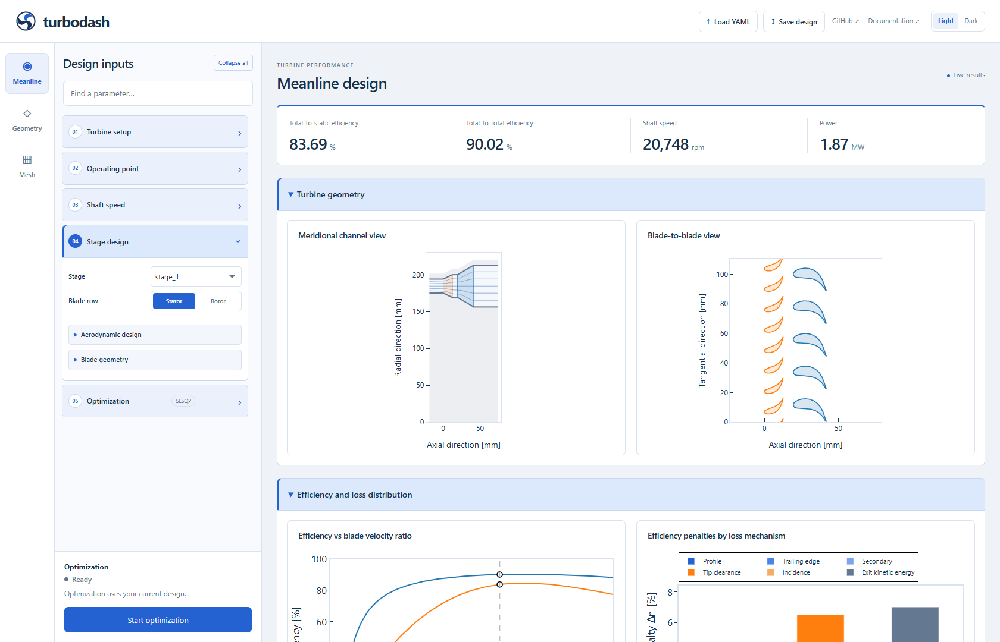

# Current application reference gallery

These are curated captures of the running **optimization edition** of Turbodash.
Read the [blueprint index](../README.md), [visual style](../visual-style.md) and
[implementation map](../implementation-map.md) for the specification, source
locations and reviewed source fingerprints. The
[HTML style guide](../style_guide.html) presents the same design as an offline
visual reference.

The **10 references were refreshed on 21 October 2026** in one headless Chrome
application run, with zero page errors recorded. Desktop captures used a
1680 × 1080 viewport; the mobile capture used 390 × 844. Inspector and chart
images are element crops from the desktop view. This refresh exercised visual
presentation; it did not run optimization, native mesh generation or a full
numerical regression. The tree reference was subsequently refreshed on the same day after grouping all stage-level design variables under Stage inputs, alongside Stator geometry and Rotor geometry.

Displayed numbers and selected values illustrate a saved view. They are not
required solver results, defaults or regression expectations. Follow the written
specifications when reconstructing behavior; screenshots show appearance and
spatial relationships at the recorded viewports.

## Workbench and results

| Reference | Image size | What to reproduce |
| --- | --- | --- |
| [Blueprint light workbench](workbench_light_blue.png) | 1680 × 1080 | Header, labelled workspace rail, pale inspector, blue disclosure headers, white editing surfaces, overview metrics and paired geometry plots. |
| [Graphite dark workbench](workbench_dark.png) | 1680 × 1080 | The same shell and hierarchy using layered dark surfaces, readable borders and restrained blue accents. |
| [Mobile parameter drawer](workbench_mobile.png) | 390 × 844 | Wrapped header, compact rail, drawer-contained inspector and optimization action. |
| [Efficiency and loss plots](workbench_performance.png) | 1190 × 485 | Paired plot cards, blue/orange efficiency curves, readable legends and percentage-point loss penalties with a gray final-exit contribution. |
| [Velocity triangles](workbench_velocity_triangles.png) | 1190 × 489 | Display-mode selector, a wide plot card, vector arrowheads and consistent semantic colors. |



## Inspector components

All inspector crops are **348 × 1008 px** and include the fixed optimization
footer. They record the current contained editor styling and persistent internal
field labels.

| Reference | What to reproduce |
| --- | --- |
| [Configuration](editor_configuration.png) | Three contained tabs, labelled objective, goal selection, iteration limit, expert toggle and scientific-notation tolerance. |
| [Expert settings](editor_expert.png) | Additional tolerance and step controls revealed inline inside Configuration. |
| [Design variables](editor_variables.png) | Quantity selector above three aligned Lower / Initial / Upper fields; empty Initial shows the current design value as a placeholder. |
| [Constraints](editor_constraints.png) | The same row structure with Comparison / Target / Scale fields. |
| [Quantity tree](editor_tree.png) | Search field, scope branches, connector lines and checkbox leaves within a scrollable menu above the action footer. |

## Refreshing the references

From the repository root, run the app in an environment with the project
dependencies:

```powershell
poetry run app_turbine_optimization --open-browser
```

Capture both themes and the mobile drawer from the same implementation and
representative design. Use 1680 × 1080 for the desktop view and 390 × 844 for
mobile; retain the 348 px inspector width for component crops. Open each
Configuration/expert/variables/constraints/tree state deliberately, then capture
the inspector or plot element. Check text, focus, clipping and image dimensions
before replacing a reference.

Optional browser helpers produce additional captures and reports:

```powershell
# Use the already running app; the workbench suite also opens served docs.
poetry run python tests/browser_workbench.py --url http://127.0.0.1:8050 --browser "C:/Program Files/Google/Chrome/Application/chrome.exe"
poetry run python tests/browser_compact_sidebar.py --url http://127.0.0.1:8050

# This precision check starts and stops its own app.
poetry run python tests/browser_numeric_format.py --browser "C:/Program Files/Google/Chrome/Application/chrome.exe"
```

These helpers write to ignored `development/app_design/output_workbench/`,
`output_compact_sidebar/` and `output_numeric/` directories. They do not overwrite
this curated gallery. Copy only reviewed PNGs into `implemented/`, using the
filenames above, and update captions, refresh date and
[source fingerprints](../implementation-map.md#reviewed-source-fingerprint)
together. The helpers may produce other views and filenames; their raw output
is not automatically a current design reference. See the
[test instructions](../../../tests/README.md) for prerequisites and regression
scope, including documentation setup.

Earlier screenshots, logo variations and execution reports have been removed
from the blueprint. A local recovery archive is available at
`C:/Users/roagr/git_projects/.codex_backups/turbodash-app-design-20261021`; it is
outside this repository and is not needed to reproduce the current style.
