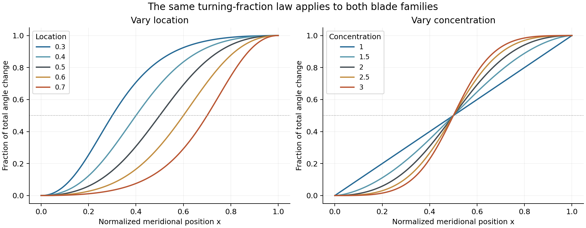
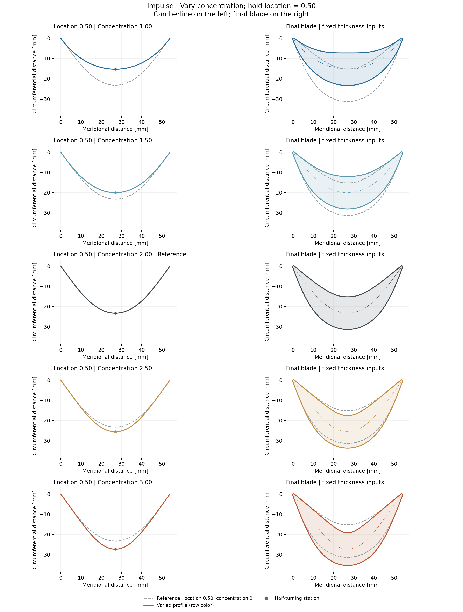
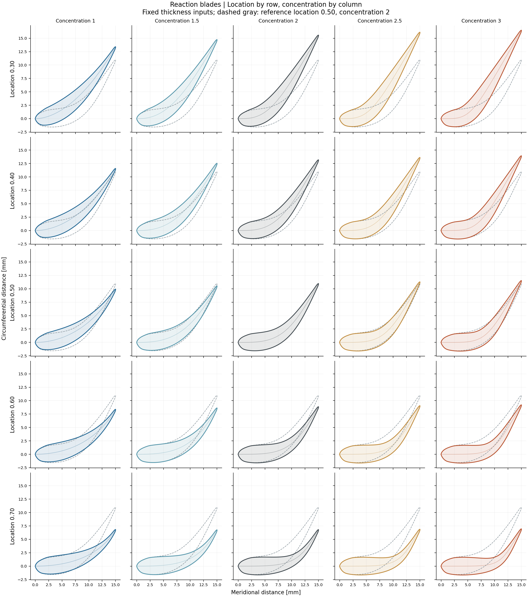
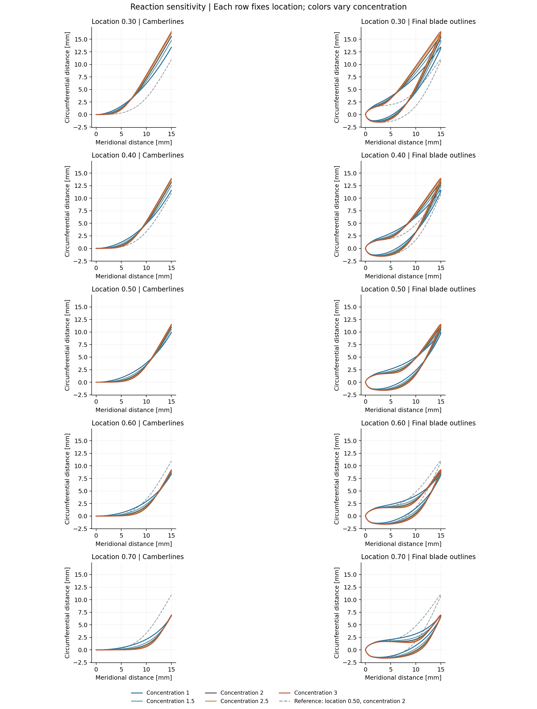

# Camberline parametrization from metal angles

The camberline is defined by its **inlet and outlet metal angles**, a **half-turning location**, and a **turning concentration**. This note explains the existing angle-interpolation law, varies only concentration for impulse blades, and varies both location and concentration for reaction blades. The thickness inputs remain fixed, using the same [section builder as the app](../parametrization_blades/README.md).

## 1. From the endpoint angles to a turning distribution

Let $x$ be normalized meridional position in the conformal plane:

$$
x=\frac{m'-m'_{LE}}{c'},\qquad 0\le x\le1,
$$

where $c'=m'_{TE}-m'_{LE}$. The metal angle $\beta$ is measured from the positive $m'$ direction. Define the fraction of the total angle change as

$$
\boxed{
w(x)=\frac{[x(1-\ell)]^q}
{[x(1-\ell)]^q+[(1-x)\ell]^q}
}
$$

and interpolate the angle:

$$
\boxed{
\beta(x)=\beta_{LE}+
(\beta_{TE}-\beta_{LE})\,w(x).
}
$$

Here $\ell$ is the **half-turning location**, with $0<\ell<1$, and $q$ is the **concentration**, with $q\ge1$ in the current implementation. The four inputs correspond to `inlet_metal_angle_deg`, `outlet_metal_angle_deg`, `turning_location`, and `turning_concentration`. Angles are converted to radians for calculation. These examples use the presets' `angle` interpolation mode.

The endpoints and half-turning condition follow directly:

$$
\beta(0)=\beta_{LE},\qquad
\beta(1)=\beta_{TE},\qquad
\beta(\ell)=\frac{\beta_{LE}+\beta_{TE}}{2}.
$$

**Location controls where half of the angle change has occurred.** Smaller $\ell$ moves turning toward LE; larger $\ell$ delays it toward TE. It is not generally the location of maximum curvature.

**Concentration controls how tightly the angle change is gathered around that location.** Higher $q$ keeps the angle closer to its inlet and outlet values for longer, with a sharper transition between them. When $q=1$ and $\ell=0.5$, $w=x$: the angle varies linearly with $x$. For $q>1$, the angle gradient tends to zero at both endpoints. Neither control changes the prescribed endpoint angles or total angle change.


[Open vector figure](figures/turning_fraction.svg). Left holds $q=2$; right holds $\ell=0.5$.

## 2. Integrating the camberline

The local slope is the tangent of the metal angle. With the leading edge as origin,

$$
\boxed{
m'(x)=c'x,\qquad
\theta(x)=c'\int_0^x\tan\beta(\xi)\,d\xi.
}
$$

The code evaluates this integral numerically. For the axial, constant-radius sections used here, multiplying both conformal coordinates by radius gives the developed physical coordinates plotted in millimetres:

$$
M(x)=cx,\qquad
Y(x)=c\int_0^x\tan\beta(\xi)\,d\xi,
\qquad c=Rc'.
$$

Consequently, **the trailing-edge circumferential offset is an output**, not a separately fixed constraint. Changing location or concentration can change $Y(1)$ and camberline length. The plots retain the original leading-edge origin and orientation; they do not rotate or reposition the curves to force their trailing edges together.

The concentration effect can also be seen from

$$
\frac{d\beta}{dx}
=(\beta_{TE}-\beta_{LE})
\frac{q\,w(1-w)}{x(1-x)},
\qquad
\left.\frac{d\beta}{dx}\right|_{x=\ell}
=\frac{(\beta_{TE}-\beta_{LE})q}{4\ell(1-\ell)}.
$$

For these axial sections, physical camberline curvature is

$$
\kappa(x)=\frac{d\beta}{ds}
=\frac{\cos\beta(x)}{c}\frac{d\beta}{dx}.
$$

Thus maximum angle gradient, maximum curvature, and the half-turning station need not coincide. Location also affects the gradient: the two controls have clear meanings but do not independently prescribe every geometric property.

## 3. Fixed thickness representations

Use the existing **rationally modified Denton thickness**, with $n=2$ and mild shoulder thinning. This retains the established camberline-plus-thickness design model. The [thickness note](../parametrization_thickness/README.md) gives the complete thickness equation and meaning of the fullness inputs.

| Fixed input | Impulse example | Reaction example |
|---|---:|---:|
| Meridional chord | 54 mm | 15 mm |
| Inlet / outlet metal angles | −54.289° / +54.289° | 0° / 60° |
| Nominal maximum full thickness | 16.100 mm | 3.300 mm |
| Nominal thickness station | 0.50 | 0.30 |
| Unrounded LE / TE thickness ratios | 0.0145433 / 0.0145433 | 0.060 / 0.015 |
| LE / TE fullness | −0.10 / −0.10 | 0 / −0.10 |
| LE / TE rounding fractions | 0.005 / 0.005 | 0.10 / 0.025 |
| LE / TE rounding exponents | 3 / 3 | 3 / 3 |
| LE / TE relief strengths | 0 / 0 | 0.15 / 0 |

For impulse, this gives a symmetric thickness distribution with mildly leaner shoulders. For reaction, it retains the forward thickness maximum and original leading-edge relief, with a mildly leaner aft shoulder. These are representative geometry choices, not aerodynamically optimized designs. Existing blade count, radius, pitch, and pressure-side convention are retained.

The final surfaces are formed by applying the side offsets $h_+$ and $h_-$ normal to the camberline:

$$
\mathbf n=(-\sin\beta,\cos\beta),\qquad
\mathbf P_+=\mathbf C+h_+\mathbf n,\qquad
\mathbf P_-=\mathbf C-h_-\mathbf n.
$$

**Thickness is fixed as a function of $x$**, including rounding and relief. Its normal direction changes with the camberline. Camber arclength also changes, so a thickness plot against arclength would not remain identical even though its inputs and offsets at each $x$ are unchanged.

## 4. Sensitivity analysis

For a common reference, both families use $\ell=0.50$, $q=2$. This reference is chosen for the study rather than changing the saved presets. The impulse study keeps location fixed and varies concentration:

$$
\ell=0.50,\qquad q\in\{1,1.5,2,2.5,3\}.
$$

The reaction study evaluates all 25 combinations:

$$
\ell\in\{0.30,0.40,0.50,0.60,0.70\},\qquad
q\in\{1,1.5,2,2.5,3\}.
$$

All geometry panels use 1:1 axes and common limits within each blade family. Dashed gray is the reference at $\ell=0.50$, $q=2$. The 601 base stations are supplemented by edge stations, with line simplification disabled. SVG versions support closer inspection.

### Impulse: vary concentration


[Open vector figure](figures/impulse_concentration.svg).

Increasing concentration creates longer, nearly straight inlet and outlet portions and a tighter central bend. Symmetry and zero endpoint offset remain intact. Camberline length increases from **64.56 to 78.93 mm** over $q=1$ to 3. The thick inner surface becomes more sensitive to that tighter bend; high concentration should be assessed on the complete blade, not just its camberline.

The left panels show camberlines and the right panels show the final blades; the dot identifies the half-turning station. **Location remains 0.50 throughout**, preserving the symmetric impulse design.

### Reaction: location by row, concentration by column


[Open vector figure](figures/reaction_grid.svg).

Each row holds location fixed; moving across it increases concentration from 1 to 3. Each column holds concentration fixed; moving down it delays the turning from location 0.30 to 0.70. The dotted line inside each blade is its camberline. This grid shows all 25 combinations with the same thickness inputs and scale.

Earlier turning increases the circumferential displacement and changes how the bend aligns with the forward thickness maximum. In the $q=2$ column, the endpoint offset falls from **15.57 to 6.81 mm** as location moves from 0.30 to 0.70. The inlet and outlet angles remain exactly 0° and 60° throughout the grid.

### Reaction: compare concentrations within each location


[Open vector figure](figures/reaction_overlays.svg).

Each row again fixes location. The five colored curves vary concentration, with camberlines on the left and complete blade outlines on the right. Higher concentration extends the nearly axial inlet portion, concentrates the bend, and brings the aft portion closer to the outlet slope sooner. In the $\ell=0.50$ row, the endpoint offset changes from **9.93 to 11.53 mm**, while camberline length increases from **18.86 to 20.77 mm**. The response depends on location: at $\ell=0.70$, the endpoint offset changes little and is not strictly monotonic with concentration. The fixed forward thickness maximum makes the effect visible on both blade surfaces.

## 5. Interpretation and checks

Location is useful for moving turning forward or aft; concentration is useful for controlling how distributed or localized that turning is. Endpoint metal angles remain available directly from the meanline model. A useful geometric starting point is $\ell=0.50$, $q\approx2$, with concentration reduced if the full blade develops excessive curvature. These examples support exploration around that point, not a universal optimum or a guarantee of constant passage area.

All **30 cases (5 impulse and 25 reaction)** passed positive thickness, a single unrounded thickness maximum, positive normal-map margin, and sampled self/neighbor intersection checks. The minimum normal-map margin was about **0.1525**, in the impulse case with $q=3$; increased concentration is therefore moving that thick profile closer to offset folding. The reaction grid's minimum margin was **0.615**. The thickness-offset arrays were verified to remain exactly unchanged across each family's cases.

Intersections are checked at the plotted resolution; thickness extrema and normal-map margin use a separate dense section with 16001 base stations. The script also checks the endpoint angles and half-turning condition, compares the written turning equation against the implementation, and verifies the endpoint integral using independent adaptive quadrature. The maximum endpoint discrepancy was below $4.1\times10^{-7}$ mm. These are geometric checks; aerodynamic loading and passage area require their own assessment.

## Reproduce

From the TurboDash repository root:

```powershell
poetry run python development/blade_parametrization/parametrization_camberline/sensitivity_study.py
```

The [script](sensitivity_study.py) calls the shared `parametrization_blades.blade_geometry` section builder and analysis helpers. It generates all four PNG/SVG figures embedded above and [numerical results](results/sensitivity.json), including the complete reference parameters and per-case checks.
