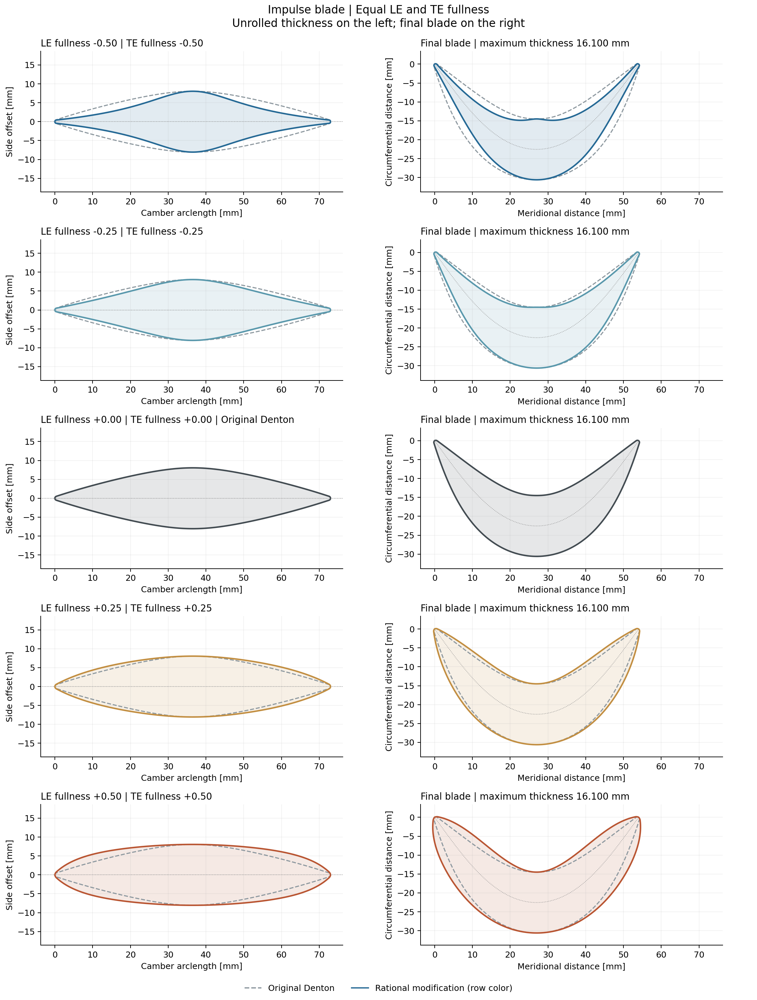
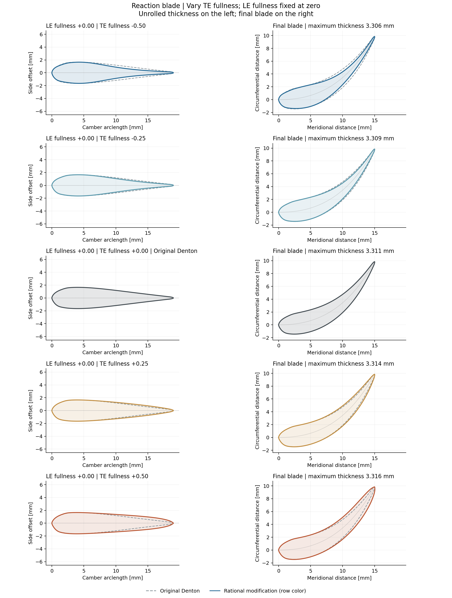

# Denton thickness modification — investigation V5

This note condenses the final rational modification and its sensitivity for impulse and reaction blades. It retains the existing parametrization: **camberline plus thickness, with separately specified leading- and trailing-edge fullness**. The app and this study now use the same implementation in [parametrization_blades](../parametrization_blades/README.md). The study's baseline cases retain zero fullness. The integrated app uses the impulse row with **LE = TE = -0.25** and the reaction row with **LE = TE = 0** as its shape-preset endpoints, including their turning, rounding, and leading-relief settings. App dimensions, maximum thickness, leading-edge radius target, and trailing-edge thickness still come from meanline; intermediate shapes interpolate between these endpoints.

## 1. Original Denton thickness

The unrounded full thickness ratio, $t=T/c$, is

$$
\boxed{
t_D(x)=t_{LE}+x(t_{TE}-t_{LE})+A\left(1-|z|^n\right)
}
$$

where

$$
z=2x^p-1,\qquad
p=\frac{\ln(1/2)}{\ln x_p},\qquad
A=t_M-\left[t_{LE}+x_p(t_{TE}-t_{LE})\right].
$$

Here $x$ runs from 0 at the leading edge to 1 at the trailing edge. The inputs $t_{LE}$ and $t_{TE}$ are the **unrounded** endpoint thickness ratios; $t_M$ is the nominal maximum thickness ratio, $x_p$ its specified station, and $n$ the shape exponent. Both examples use $n=2$.

The law adds a central thickness bump to a linear baseline. The coordinate transformation places $z=-1$ at LE, $z=0$ at $x_p$, and $z=1$ at TE. Consequently,

$$
t_D(0)=t_{LE},\qquad t_D(x_p)=t_M,\qquad t_D(1)=t_{TE}.
$$

For $n>1$, the bump is concave in $z$. Changing the exponent adjusts its fullness but cannot create convex end shoulders in that coordinate. This motivates an additional shape control. Concavity measured against actual camber arclength can differ because of the coordinate transformation.

## 2. Rational modification with two fullness inputs

Retain the baseline and modify only the bump:

$$
\boxed{
t(x)=t_{LE}+x(t_{TE}-t_{LE})
+A\frac{1-|z|^n}{1-a(z)|z|^n}
}
$$

The user specifies **$f_{LE}$ and $f_{TE}$**, not the internal coefficients $a_{LE}$ and $a_{TE}$. Convert the two fullness values using

$$
a_{LE}=\frac{2f_{LE}}{1+f_{LE}},\qquad
a_{TE}=\frac{2f_{TE}}{1+f_{TE}},\qquad
r=2^{-1/n}.
$$

Then interpolate the coefficient smoothly across the profile:

$$
\boxed{
a(z)=\frac{a_{LE}+a_{TE}}{2}
+\frac{a_{TE}-a_{LE}}{2r}\,z.
}
$$

**Negative fullness narrows a shoulder; positive fullness fills it.** The reference shoulders lie at $z=-r$ and $z=+r$, where the original bump has half its maximum height. The modified factor satisfies

$$
F(-r)=\frac{1+f_{LE}}{2},\qquad
F(+r)=\frac{1+f_{TE}}{2}.
$$

Thus $f_{TE}=0.20$ increases the **bump contribution at the trailing reference shoulder** by 20%. It does not increase the complete thickness everywhere by 20%.

### Exact recovery of Denton

When both inputs are zero,

$$
f_{LE}=f_{TE}=0
\quad\Longrightarrow\quad
a_{LE}=a_{TE}=0
\quad\Longrightarrow\quad a(z)=0.
$$

Therefore,

$$
\frac{1-|z|^n}{1-a(z)|z|^n}=1-|z|^n,
\qquad \boxed{t(x)=t_D(x).}
$$

The same existing rounding and relief are then applied, so the **complete blade profile also returns to the original Denton result**.

The modification preserves the endpoint body thicknesses and $t(x_p)=t_M$. With unequal endpoint thicknesses, the actual maximum can remain slightly displaced from $x_p$, as in the original law. The smooth coefficient avoids introducing a curvature jump at the nominal peak for $n=2$. No wedge angle or blending extent is required.

## 3. Sensitivity analysis

Only the fullness inputs change. Camber, nominal thickness, thickness station, pitch, rounding, and relief retain their existing preset values. Both plots show **unrolled thickness on the left and final blade shape on the right**, using true 1:1 axes and the same millimetre scale throughout each figure. Dashed gray is the original Denton profile.

The unrolled view shows the actual positive and negative side offsets against camber arclength, including rounding and relief. It is the full flattened profile rather than just the unrounded analytical bump. Plots use 601 base stations plus the kernel's additional edge stations; line simplification is disabled, and SVG versions are provided.

### Impulse blade: equal LE and TE fullness

$$
f_{LE}=f_{TE}\in\{-0.50,-0.25,0,+0.25,+0.50\}.
$$


[Open vector figure](figures/impulse_sensitivity.svg).

Negative values narrow both shoulders, while positive values increase shoulder fullness. The distribution remains symmetric, and maximum thickness stays **16.100 mm** in all five cases. For equal inputs and $n=2$, internal-coordinate convex shoulders appear below $f=-1/7$, so both negative settings demonstrate that capability. The stronger narrowing at $-0.50$ concentrates the bend near the central thick region. A narrower shoulder therefore does not imply a uniformly straighter blade wall.

### Reaction blade: vary only the TE fullness input

$$
f_{LE}=0,\qquad
f_{TE}\in\{-0.50,-0.25,0,+0.25,+0.50\}.
$$


[Open vector figure](figures/reaction_sensitivity.svg).

Negative TE fullness makes the aft portion leaner; positive values fill it. The asymmetric thickness station and original leading-edge relief remain intact. The actual maximum changes only slightly, from **3.306 to 3.316 mm**, compared with **3.311 mm** at zero fullness. The nominal thickness at $x_p$ remains 3.300 mm.

Holding $f_{LE}=0$ fixes the leading **reference target**. The correction has global support, so changing TE fullness can still slightly affect other points on the leading half; the two inputs are independently specified but their geometric influence is not spatially isolated.

## 4. Why this is useful

The correction provides a direct way to make shoulders narrower or fuller while retaining the familiar camberline, thickness level, thickness station, and rounded-edge inputs. It supports broad concave-to-convex changes without prescribing physical wedge angles or introducing local joining regions. Setting both fullness inputs to zero restores the existing design exactly.

The regenerated ten cases passed positive thickness, a single unrounded thickness maximum, positive normal-map margin, and sampled self/neighbor intersection checks. Intersections are checked at the plotted resolution; thickness extrema and normal-map margin use a separate dense section with 16001 base stations. The script also checks endpoint and nominal-station preservation, neutral recovery, impulse symmetry, and plot scaling. These geometric checks support the examples; they do not establish aerodynamic performance or constant passage area. Passage lines remain useful postprocessing.

### Input range

The app input range is

$$
-0.5\le f_{LE}\le0.5,\qquad
-0.5\le f_{TE}\le0.5,
$$

with both generic kernel defaults zero and each value specified separately. The integrated impulse preset uses -0.25 at both shoulders as described above. The formula and its admissibility condition remain unchanged:

$$
\frac{a_{LE}+a_{TE}}{2}
+\frac{|a_{TE}-a_{LE}|}{2r}<1.
$$

This keeps the rational denominator positive and the bump monotone toward its central peak. Some strongly opposed values inside the requested input limits violate this condition; the limits therefore do not imply that every pair is usable. The sensitivity study now covers $[-0.50,+0.50]$ along the two specified sweeps. The shared kernel and app enforce both the individual range and the combination check.

## Reproduce

From the TurboDash repository root:

```powershell
poetry run python development/blade_parametrization/parametrization_thickness/sensitivity_study.py
```

The [script](sensitivity_study.py) calls the production `turbodash.geometry.blade_parametrization` section builder and rational law. It generates the two PNG/SVG figures and [numerical results](results/sensitivity.json), including the resolved preset inputs. This single note contains the formulation, motivation, sensitivity results, and discussion; no new parametrization is introduced.
