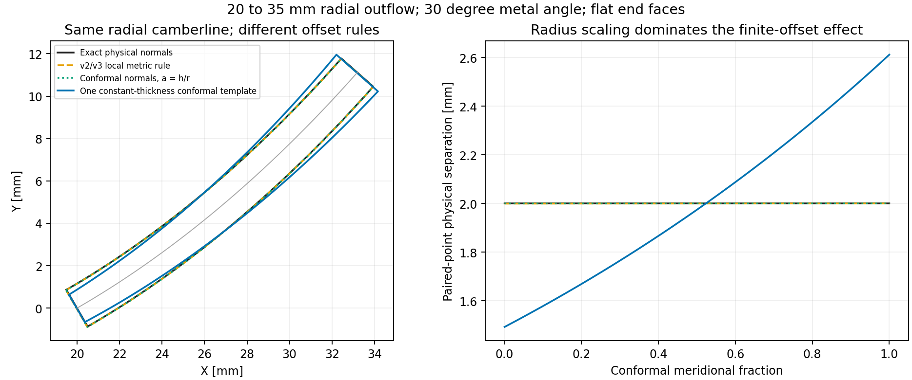

# Blade parametrization: status and way forward

Reviewed on **21 October 2026**, against the working files in this directory and the local sibling checkouts, including the current uncommitted directory reorganization. TurboDash HEAD: `0e333d5778611e550e80341adcd9f33693c2bbaa` (working package 0.7.0); TurboMOC HEAD: `c857ac6` (package 1.2.1). These commit IDs provide context, not a complete snapshot of the working files. “Current implementation” below means these local sources. TurboDash's optional dependency still specifies published `turbo_moc==1.2.0`, so an installed application need not use the sibling checkout.

## 1. Recommendation

**Define the camberline and complete section boundary in the conformal plane $(m',\theta)$, then place and map the complete section onto the stream surface.** This fits the intended preliminary modeler and the architecture already implemented in TurboMOC. Keep physical thickness, radius, throat and clearance measurements as outputs and, where necessary, calibration targets.

This choice does not introduce arbitrary local stretching in one direction: the mapping has the same local scale in both directions. It does introduce **radius-dependent physical size** and changes finite distances and curvature. A constant conformal thickness is approximately a constant **thickness-to-radius ratio**, not constant physical thickness. That distinction is the main design decision.

Use one conformal template by default. Retain an explicit physical-thickness target option for cases such as constant-thickness impeller blades or meanline loss-model inputs that must be matched. The physical target can be converted into a conformal thickness law before constructing the complete boundary; it does not require abandoning the common mapping architecture.

The coordinate change should be developed separately from the unfinished nose/edge smoothness work. Moving v3 into $(m',\theta)$ will simplify its geometry pipeline, but will not cure its existing curvature defects.

## 2. What happened from v0 to v3

| Version | What was implemented | Coordinates and thickness | What it established / what remains |
| --- | --- | --- | --- |
| **v0** | Axial and radial turbine examples calling the existing TurboDash blade generators; annotated discussion of a new geometric thickness construction. | Legacy Cartesian/polar camberlines; thickness sampled against chord projection and applied as physical planar normal offsets. The demos inherit the NACA thickness default and a separate circular trailing closure. | A baseline and design discussion, rather than a standalone new geometry kernel. The discussion explored symmetric treatment of both edges, radii/wedges and exact maximum thickness. |
| **v1** | Standalone NumPy prototype: rational quadratic edge branches plus **cubic, quintic or cosine bodies**. A second branch implements **Denton thickness** for comparison. Multiple example cases and interactive/export demos. | Camberline turning law and thickness station use physical meridional fraction $\xi=m/c_m$. Thickness and developed edge radii are normalized by $c_m$. Thickness is applied using exact normals in the physical axial/unwrapped or radial plane. | The first implemented alternative to the legacy model. The geometric family has an exact scalar maximum, plateau and constant-body options. Rounded edge/body joins are generally G1; body/maximum or plateau joins are G2. Exact developed radii do not automatically imply exact finished-blade radii. |
| **v2** | Functional NumPy implementation with one YAML case, axial/radial switching, angle/slope interpolation, solidity-based blade count, interactive views and CSV exports. It selects the Denton branch. | **Camberline turning law moves to normalized $m'$** and integrates $d\theta/dm'=\tan\beta$. Denton thickness remains a function of **physical** $m/c_m$, scaled by physical $c_m$. Offsets use a common local metric formula in $(m,\theta)$. | Generalizes the camberline formulation and fixes the downstream angle convention, including radial inflow. It sacrifices v1's exact radial physical normal offsets for a shared first-order rule. Only straight axial and purely radial meridional paths are implemented. |
| **v3** | V2 plus one signed, localized **leading-edge thickness redistribution** parameter; before/after surface-curvature plots and a later review of curvature-based design. | Same camberline, Denton law, station and local metric mapping as v2. The two side offsets can differ near the nose, while their sum remains the original scalar total thickness. | Latest runnable prototype. It can relieve the demonstrated shoulder curvature peak, but does not prescribe surface curvature or ensure acceptable shapes across its slider ranges. The reference camberline ceases to be the local midpoint where redistribution acts. |

Primary files: [v0 discussion](parametrization_v0/thickness_parametrization_discussion.md), [v1 implementation](parametrization_v1/blade_geometry.py), [v2 implementation](parametrization_v2/blade_geometry.py), [v3 implementation](parametrization_v3/blade_geometry.py).

### The important changes were modeling choices, not simply extra features

**V0 to v1:** implemented the geometric thickness idea, with the same algorithm at the two ends and independently chosen values. A rounded tip closes to zero thickness; the radius is an osculating radius, not a mandatory circular cap. Wedges in v1 are developed **half-angles**. The rational edge branches and constrained body laws are a different model from NACA/Denton.

**Within v1:** added the Denton comparison. This is why v1 contains two thickness families. Its geometric family enforces the maximum; the Denton family treats the named maximum as a nominal body value and generally does not enforce it globally.

**V1 to v2:** retained Denton, changed the camberline station to $m'$, and simplified the offset mapping. The alternative rational-edge/body family was **not carried forward**. V2 is therefore not a strict superset of v1. Its geometry functions receive integer blade count explicitly; only the demo converts prescribed meridional solidity to blade count.

**V2 to v3:** added a local side bias without changing the total thickness law. If $T$ is total thickness and $\alpha$ the asymmetry,

$$
h_+=\frac{T}{2}(1-\alpha W),\qquad
h_-=\frac{T}{2}(1+\alpha W),
$$

where $W=(256/27)q(1-q)^3$ on the nose interval and zero afterwards. The interval ends at $\min(2f_{\rm LE},1)$ in physical meridional fraction. Zero asymmetry recovers v2 with the **same other inputs**; the supplied v2 and v3 YAML files use different blade examples, so their default pictures do not isolate this change.

### Decisions already made in the notes

The final answers in [v2 questions](parametrization_v2/questions_temp.md) supersede their earlier proposals:

- Metal angles are measured from **increasing downstream meridional distance**, also for radial inflow. V1 instead used an outward-radial tangent-line convention in its radial branch.
- Thickness uses **physical meridional distance only**; the initially requested arc-length option was explicitly withdrawn. An arc-length abscissa on a plot does not change the implemented thickness station.
- The geometry demo uses **solidity only**, rather than Zweifel loading, to choose blade count. Spacing is $s$ and solidity is $\sigma$.
- The simple local metric offset was deliberately accepted, with literature-comparison TODOs.
- A low-dimensional preliminary modeler and a single underlying total-thickness law were preferred over independently editable pressure/suction surfaces.

Your present proposal to define the full profile in $m'$ is a reasonable revision of those historical choices. It changes parameter meanings and should be recorded as a new version rather than silently modifying old cases.

## 3. Current status of the unfinished work

### What is usable now

V3 has a working geometry kernel, an axial/radial slider demo, one extensively commented case, numerical exports, a nose comparison demo, and reproducible curvature diagnostics. Both radial inflow and outflow are supported by v2/v3. The core calculations are independent of TurboDash, JAX and nurbspy.

The [curvature-method review](parametrization_v3/curvature_method_review.md) already identifies the main limitations and compares the approach with Korakianitis. The separate [Turner study](parametrization_turner/theory_notes.md) subsequently addresses an important literature TODO: T-Blade3 constructs thickness against an unstaggered section chord coordinate, applies section-plane normal offsets, and then rotates/scales/maps the complete section. Thus the instruction in the older v3 notes to investigate Turner is partly stale. The Casey/Robinson comparison is still open in this work.

### What is not finished

| Item | Current evidence and implication |
| --- | --- |
| **Production integration** | V1–v3 are development prototypes. The current TurboDash geometry and meshing code still calls its existing blade generator; it does not import these prototypes. |
| **Physical meridional geometry** | V2/v3 implement cylinders and radial planes, with linear extensions. They do not yet implement general curved mixed-flow stream surfaces. TurboMOC already has a suitable general mapping abstraction. |
| **Actual maximum thickness** | For the supplied v3 case, nominal $T/c_m=0.4016$ at $m/c_m=0.2509$, but the sampled actual scalar maximum is **0.427124 at 0.143675**, about **6.36% larger**. Asymmetry does not change that total. This matters when coupling a parameter called maximum thickness to a loss model. |
| **Nose behavior** | On the documented shoulder interval, the supplied asymmetry $0.15$ reduces the plus-side peak $|\kappa|c_m$ from **23.255 to 6.731**, while the minus-side peak rises from **7.220 to 8.075**. This reproduces the old review. It is useful case-specific control, not an automatic nose-design law. |
| **Smoothness** | The Denton trailing blend is generally C1 at its shoulder, allowing a curvature jump. The leading blend is generally C2 there. The supplied noninteger body exponent 2.216 and the redistribution window do not generally provide continuous bounded curvature slope everywhere. Turning concentrations below one can produce singular endpoint angle derivatives. |
| **Geometric validity** | V2/v3 reject undefined mathematical inputs, but do not enforce global self-intersection, adjacent-blade clearance, throat, or a local normal-map margin. V1 had a sampled $1-|\kappa_c h|$ check; v2/v3 do not retain it. |
| **Physical interpretation** | Unrounded endpoint thicknesses are not tip radii or engineering trailing-edge thickness. A closed rounded tip has zero terminal separation. The current scalar parameters do not independently impose all final edge radii and wedge angles. |
| **Defaults and optimization** | There is one tuned v3 case and adjustable slider ranges, rather than demonstrated robust defaults across the intended blade families. The prototypes are NumPy implementations, while the existing TurboDash blade kernel uses JAX arrays. |

There are also documentation path problems: several READMEs still say `development/new_parametrization`, the directory README links to an absent Turner README, and some literature links refer to a `papers/` layout that is absent here. The actual supplied PDFs are inside `parametrization_turner/` and `parametrization_v3/`. Preserve the old notes as history, but use the commands in Section 9 below.

## 4. Comparison with TurboDash and TurboMOC today

### TurboDash's existing blade generator

In [geometry/blade.py](../../turbodash/geometry/blade.py), `compute_blade_coordinates_cartesian` and `compute_blade_coordinates_radial`:

1. Generate a Cartesian or polar camberline.
2. Project the camberline onto its straight endpoint chord to get the normalized thickness station.
3. Evaluate NACA, constrained B-spline or Denton thickness.
4. Apply thickness along normals in the physical 2D plane.
5. Append a separate circular trailing-edge closure.

This is different from v2/v3, which use physical **meridional** thickness stations and continuous Denton leading/trailing factors. Even TurboDash's `Denton` selection is not the v2/v3 law: its leading blend is chosen automatically, the last sample retains finite trailing thickness, and the wrapper appends the circle. The coordinate wrappers default to **NACA**, although the lower-level thickness dispatcher defaults to **Denton**.

The current `curvature_based` camberline is also different from the prototypes' angle/slope blend. Its Cartesian branch integrates a prescribed second-derivative distribution twice and determines amplitude/stagger from endpoint constraints. Its radial branch reuses the resulting angle law against a linearly varying radius. The radial `_conformal` options map **the camberline**, after which the radial wrapper still adds physical-plane thickness. Selecting such a camberline does not map a complete conformal blade profile.

### TurboDash has two distinct 3D paths

| Path | Current construction | Relation to the proposed model |
| --- | --- | --- |
| [Sections / TurboGrid / assembly](../../turbodash/geometry/sections.py) | Generates physical Cartesian sections, evaluates spanwise inlet/outlet angles, interpolates radius along axial position, and uses $\theta=y/r$ for wrapping. | Not the general $m'=\int dm/r$ full-section construction when radius changes through the row. |
| [TurboMOC meshing adapter](../../turbodash/meshing/turbomoc.py) | Builds a physical Cartesian profile, converts the **complete boundary** to the TurboMOC chart, and uses TurboMOC's `Design` and `MeridionalChannel`. Currently axial only, with cylindrical averaged endwalls and fixed midspan metal angles across span. | Already shares the complete-profile mapping architecture, but does not use v3's section law. Its restricted geometry assumptions differ from the sections/TurboGrid path. |

These paths should eventually share one canonical section and stream-surface representation. A new parametrization should not be considered integrated until plots, mesh geometry and exports use consistent geometry and measurement definitions.

### TurboMOC in `method_of_characteristics`

The relevant current implementation is [geometry/meridional_channel.py](../../../method_of_characteristics/src/turbo_moc/geometry/meridional_channel.py), together with [blade_row.py](../../../method_of_characteristics/src/turbo_moc/geometry/blade_row.py).

- Hub and shroud are B-splines in $(r,z)$; their interpolation defines a spanwise family of surfaces of revolution.
- `prime_chord` integrates $\int dm/r$ and `parameter_from_prime` inverts that transformation. Straight paths have analytic formulas; general curved paths use numerical integration/inversion. Endpoint tangent extensions accommodate geometry beyond nominal LE/TE stations.
- A complete fitted section is uniformly scaled and translated in the numerical chart. In code convention, $q_y=-R_{\rm ref}m'$ and physical azimuth is $-q_x/R_{\rm ref}$; the minus sign in the pitchwise coordinate reflects its clockwise convention.
- Every boundary or mesh point is mapped using **its own** conformal meridional station. Radius is not frozen at its corresponding reference-camberline station.
- `Design.section` scales the full blade between span stations while retaining the prescribed passage pitch. It does not simply scale both periodic boundaries with the blade.

The stator source [stator_blade.py](../../../method_of_characteristics/src/turbo_moc/geometry/stator_blade.py) constructs the profile from a MoC wall, a convergent suction-side construction line, a pressure-side bridge and edge closures, followed by a B-spline fit. Its so-called camberline is partly a **suction-side construction curve**, not the midpoint of a symmetric thickness distribution. The [vortex rotor adapter](../../../method_of_characteristics/src/turbo_moc/geometry/rotor_blade.py) also transfers a complete profile into the shared mapping. These are architectural precedents, not identical camberline/thickness parametrizations.

One separate qualification: mapping a planar MoC shape is a geometry operation. It does not by itself solve the variable-radius flow problem. The existing [MoC stream-surface notes](../../../method_of_characteristics/docs/notes/moc_cartesian_and_stream_surface_notes.md) explicitly derive the additional flow-equation terms. This does not diminish the usefulness of the geometry mapping.

## 5. What applying thickness in the different planes means

### The metric settles the local distortion question

Let $m$ be physical meridional arc length, increasing downstream, and $r(m)>0$ the stream-surface radius. Then

$$
dm'=\frac{dm}{r},\qquad
d\ell^2=dm^2+r^2d\theta^2
=r^2\left(dm'^2+d\theta^2\right).
$$

Consequently,

$$
\tan\beta=r\frac{d\theta}{dm}=\frac{d\theta}{dm'}.
$$

This is a geometric derivation from the surface metric. In $(m',\theta)$ the local map is a rotation/reflection plus the common length scale $r$. It preserves local angles, including orthogonality at the same point. It does **not** preserve finite distances, physical circles, or curvature when $r$ varies.

The raw $(m,\theta)$ chart mixes metres and radians. It is not a Euclidean physical plane: taking its ordinary graphical normal would be incorrect. V2/v3 already account for the metric; their limitation is the use of a differential rule for a finite displacement.

### Three distinct constructions

Write $\mathbf c'=(m'_c,\theta_c)$ and its conformal-plane unit normal as

$$
\mathbf n'=(-\sin\beta,\cos\beta).
$$

| Construction | Equation / meaning | Finite-distance interpretation |
| --- | --- | --- |
| **V2/v3 local physical metric increments** | $m_\pm=m_c\mp h_\pm\sin\beta$, $\theta_\pm=\theta_c\pm h_\pm\cos\beta/r_c$. | Exact normal offsets on the unwrapped constant-radius cylinder; first-order physical normals for variable radius. |
| **Conformal-plane normal offsets** | $\mathbf p'_+=\mathbf c'+a_+\mathbf n'$, $\mathbf p'_-=\mathbf c'-a_-\mathbf n'$, followed by exact coordinate mapping. | Exact section-plane geometry, with small physical side thickness $h_\pm\simeq r_c a_\pm$. Finite mapped displacements are generally curved and need not be straight physical normals. |
| **Exact physical normal offsets** | In a planar radial section, $\mathbf p_\pm=\mathbf c\pm h_\pm\mathbf n$ in Cartesian coordinates, then recover $(m',\theta)$. | Exact physical distances and normals in that planar case. On a general curved stream surface an intrinsic version requires a surface construction, such as normal geodesics. |

Setting $a_\pm=h_\pm/r_c$ makes the conformal rule agree with the current metric rule **to first order**. Their finite radial positions differ: the current rule changes $r$ linearly, while the conformal rule changes it exponentially. Neither is an exact finite physical normal offset on a varying-radius surface.

This separates three choices that are easy to conflate: **the station used by the thickness law**, **the units/normalization of its magnitude**, and **the plane in which its offsets are constructed**. They can be chosen independently.

### Thickness station and magnitude both change under the proposed default

Define

$$
C_m'=m'_{\rm TE}-m'_{\rm LE},\qquad
\xi'=\frac{m'-m'_{\rm LE}}{C_m'},\qquad
\tau'(\xi')=\frac{T'(\xi')}{C_m'}.
$$

Here $C_m'$ is the projected conformal meridional chord, not the straight endpoint chord in the section plane. A complete-profile default can use

$$
a_+=a_-=\frac{C_m'}{2}\tau'(\xi').
$$

Its small physical total thickness is

$$
T_{\rm phys}(\xi')\simeq r(\xi')C_m'\tau'(\xi').
$$

At constant radius, $c_m=rC_m'$, so this exactly recovers the old normalized thickness scale in the unwrapped surface. For variable radius, entering the same number as the old $T/c_m$ changes the physical distribution. Physical maximum thickness can shift even if the conformal maximum is exact.

The stations also differ. For radial outflow from 20 to 35 mm, physical half-chord corresponds to $\xi'=0.56906$, while $\xi'=0.5$ corresponds to physical meridional fraction **0.43050**. Old maximum-location and edge-extent inputs therefore need deliberate conversion.

### A numerical example of the size of the effect

For the same 20–35 mm radial interval,

$$
C_m'=\ln(35/20)=0.559616,\qquad
\frac{c_m}{C_m'}=26.8041\ {\rm mm}.
$$

Take a constant physical thickness target of 2 mm, and construct a constant conformal thickness using the same ratio $2/15$. On a 30-degree constant-metal-angle camberline, the mapped paired-point separation is about **1.492 mm at the inlet and 2.611 mm at the outlet**. The 75% inlet-to-outlet increase comes from the radius ratio. It is a predictable change in the design law, not a numerical mapping error.

Alternatively, setting $a(\xi')=1\ {\rm mm}/r(\xi')$ holds the small physical half-thickness target at 1 mm. In this example $h/r\leq0.05$, and the paired-point separation differs from 2 mm by at most **0.021%**. This small separation error does not imply that each finite offset is exactly perpendicular or that the physical edge radii are preserved.



The comparison deliberately uses constant body thickness and flat closures to isolate the coordinate choice. The orange curve applies the **v2/v3 offset formula** to this common example; it is not either version's default YAML case. The green curve uses the radius-corrected conformal thickness, and the blue curve uses one constant-thickness conformal template. Paired separation is one measurement convention, distinct from minimum distance between the two surfaces. [Vector figure](summary_assets/coordinate_comparison.svg); [calculation](summary_assets/check_geometry.py).

For a radial symmetric conformal offset of magnitude $a$, this separation can be checked analytically:

$$
T_{\rm pair}=2r\sqrt{\sinh^2(a\sin\beta)+\sin^2(a\cos\beta)}.
$$

Its leading term is $2ra$, with relative corrections generally of order $a^2$. This explains the small paired-distance error above without asserting exact physical normals.

## 6. Will the blades look distorted?

**For the intended preliminary modeling, full conformal sections are a sound default.** The important effects are understandable and measurable:

- **Axial, constant radius:** the unwrapped surface geometry is exactly a uniform scale of the conformal section. There is no additional intrinsic profile distortion. A Cartesian chord across the cylindrical surface is still a different distance from an unwrapped surface distance.
- **Radial or mixed flow:** thickness and body dimensions grow approximately with local radius. This may be suitable for some blade families; it will not reproduce a constant-physical-thickness body without compensation.
- **Finite thickness:** the radius must be evaluated at each final boundary point's displaced $m'$, and the mapping can alter the relative positions of the two sides. Thin local offsets usually give a useful physical-thickness approximation, but $h/r$ alone is not a global quality certificate.
- **Edges and curvature:** a circle in the conformal plane need not remain a physical circle. In particular, the final physical tip radius is not generally obtained by simply multiplying a conformal radius by the camberline radius; curvature also depends on the changing map scale. Measure or fit the final radius if it is a required physical input.
- **Global geometry:** local conformality does not prevent a template from wrapping through a full revolution, colliding with a neighboring blade, or extending into an unusable meridional region. Check the actual mapped contour and passage.

Poor nose behavior should not automatically be blamed on conformal mapping. The largest documented v3 shoulder issue already occurs in a **constant-radius axial case**, where the proposed coordinate change reduces to uniform scaling. Its cause is the combined camberline/thickness construction.

The Turner literature supports the overall architecture: its normalized section is completed before transformation into the conformal plane and mapping onto stream surfaces. That is a useful precedent, not a guarantee for every parameter combination. See [Siddappaji and Turner, 2022, Sections 2.2–2.5](https://www.mdpi.com/2226-4310/9/9/489), alongside the more detailed [local review](parametrization_turner/theory_notes.md). The metric analysis and numerical example above are independent derivations/checks in this review.

## 7. What “scale the entire blade” can mean

Two operations need separate names and parameter semantics:

**Scale a complete template on a prescribed stream surface.** Build a normalized boundary $\widehat{\mathbf p}$, then apply

$$
\mathbf p'=\mathbf p'_0+\lambda\widehat{\mathbf p}.
$$

The same $\lambda$ acts on both conformal coordinates, so section-plane angles and thickness/chord ratios are retained. V2-style camberlines can be normalized using $C_m'$: then their downstream extent is one, $d\widehat\theta/d\widehat m'=\tan\beta$, and $\lambda=C_m'$. No rotation is needed if the angles are already expressed relative to downstream $m'$. A chord-aligned Turner-style section instead needs an explicit stagger rotation and projected-chord closure.

Once the complete section is constructed, scaling it needs no separate reapplication of thickness. **However, mapping a larger conformal section onto the same variable-radius surface is not generally a uniform physical enlargement.** It samples a different radius distribution. Blade pitch also remains $2\pi/N$ unless blade count changes; increasing template size can reduce throat and clearance.

**Scale the entire physical machine by $k$.** If $r$, $z$ and all physical lengths scale by $k$,

$$
dm'_{\rm new}=\frac{k\,dm}{k\,r}=dm',
$$

so the dimensionless conformal profile is unchanged and its mapped Cartesian coordinates scale exactly by $k$. This operation should scale the meridional geometry, not multiply $m'$ and $\theta$ by $k$.

The current dimensionless v2/v3 construction can already scale geometrically similar machines when all physical lengths are scaled consistently. The main benefit of a complete conformal profile is **reusing the finished section, sharing one mapping/meshing representation and scaling section chord consistently**, rather than making global physical scaling possible for the first time.

Do not independently normalize $m'$ and $\theta$ to 0–1 and then treat that plot as Euclidean geometry: that changes angles. Normalize both by the same scale. When scaling across span, preserve the specified pitch separately, as TurboMOC's `Design.section` already does.

## 8. Proposed next version

### A. Keep the v2/v3 camberline interface; complete the section in the same plane

Retain inlet/outlet metal angles and turning location/concentration, with angle-versus-slope interpolation. Define the law against $\xi'$ and integrate

$$
\frac{d\theta_c}{dm'}=\tan\beta(\xi').
$$

Use a normalized section whose projected meridional extent is one, construct its two sides and edges in that plane, then scale the complete boundary by $C_m'$ and map it. This is the smallest change consistent with the requested architecture. A reduced second-derivative/curvature-control camberline can be added later if more turning freedom is needed; it is not required to move thickness into the conformal plane.

### B. Make the thickness convention explicit

Use **conformal thickness / conformal meridional chord**, with peak and edge stations measured against $\xi'$, as the default. Initially retain the Denton equation as a baseline so coordinate changes can be evaluated without simultaneously changing every shape control. Call its maximum **nominal** unless the law is replaced or calibrated to impose an actual maximum.

For physical targets, allow a second magnitude policy while retaining the same section builder:

$$
T'(\xi')\simeq\frac{T_{\rm target}(m(\xi'))}{r(m(\xi'))}.
$$

This gives a physically specified law to first order, including constant-thickness bodies. It still produces a complete profile that can be saved and mapped as one object. It depends on the chosen meridional geometry, so it must be recalculated when that geometry changes non-similarly. For exact physical constraints, fit the resulting mapped measurements with a small scalar/low-dimensional solve; for exact radial normal thickness, use the Cartesian construction and transform its complete boundary back to the chart.

Avoid adding a general choice of every possible station coordinate at this stage. The historical arc-length option was withdrawn, and a conformal station plus an explicit physical-target adapter covers the present need with fewer inputs.

### C. Improve the nose and trailing join as a separate task

Keep zero asymmetry as the general baseline and the v3 asymmetry as an optional shape control. Do not make $+0.15$ a universal default: its useful sign and amplitude depend on the example. If the section law moves to $\xi'$, the redistribution support moves with it; the old numerical extent is not physically identical.

For the next edge model, aim for at least G2 at smooth nose/body and tail/body joins, with physical edge measurements checked after mapping. Revisit v1's exact maximum and constant/plateau-body properties. It provides useful building blocks, but its G1 rational-edge joins do not solve the smoothness problem unchanged. A constrained smooth transition with derived coefficients is a better next experiment than exposing many independently editable surface-curvature controls.

### D. Reuse TurboMOC's mapping and one canonical geometry across consumers

Separate normalized section generation, section placement, meridional mapping and physical measurements. Reuse or share the `MeridionalChannel` abstraction rather than creating another independent inversion routine. Preserve the coordinate order, azimuth sign, units and rotation-axis conventions explicitly: the prototypes use metres and mathematical azimuth, while TurboMOC's numerical chart uses reference lengths in millimetres and a clockwise pitchwise convention.

Use the same mapped section for previews, TurboGrid export, STL and passage meshing. Keep integer blade count and pitch separate from section scaling. General mixed-flow surface support should come from the meridional map, without adding axial/radial thickness formulas to the section generator.

### E. Reconcile physical meanline targets and validate a small family

Velocity triangles do not uniquely determine thickness distribution, loading distribution or nose shape. Treat inlet/outlet metal angles, size and blade count as boundary/design data; apply a stated incidence/deviation policy when deriving metal angles from flow angles. Treat nominal shape controls as additional design choices.

Report physical maximum thickness and its location, the explicitly defined engineering trailing thickness, fitted tip radius if needed, actual geometric throat, and adjacent-blade clearance. Calibrate only those values that the meanline/loss model requires exactly, leaving sufficient shape freedom to meet them.

Before production integration, check symmetric impulse-like, reaction-like, constant-physical-thickness radial, radial inflow/outflow and curved mixed-flow cases. Useful acceptance checks are endpoint tangent angles, section-plane offset orthogonality, actual maxima, edge join curvature, self-intersection and blade clearance, physical target errors, global machine-scaling invariance, and agreement between preview and exported geometry. Chart translation/rotation/scaling alone preserves a valid chart contour; validation must also cover mapping and cascade placement.

## 9. Verification and how to resume

The accompanying [audit script](summary_assets/check_geometry.py) and [numeric results](summary_assets/geometry_checks.json) reproduce the quantitative findings above. This review checked:

- **18 v1 combinations:** all six supplied cases with cubic, quintic and cosine bodies generated finite profiles and the specified scalar maximum.
- **Six v2/v3 builds:** axial, radial outflow and radial inflow for each version generated finite boundaries and retained their endpoint metal angles. These checks do not establish absence of intersections.
- **V3 equivalence and redistribution:** zero asymmetry reproduced v2 to approximately $1.7\times10^{-18}$ m; total scalar thickness was conserved to approximately $2.8\times10^{-17}$ in normalized units.
- **V3 actual maximum and shoulder curvature:** reproduced on 40,001 uniformly spaced physical meridional stations. Curvature comparisons exclude the sensitive tip and cover $0.01862\leq m/c_m\leq0.3724$; they are sampled values, not bounds on all derivatives.
- **Conformal finite offsets:** numerical radial paired separation agreed with the analytic expression above, and the comparison figure was generated from the same calculation.
- **Current TurboMOC mapping:** its existing physical-chord/radial-endpoint and general curved-meridional-mapping tests both passed. The source tree was placed on `PYTHONPATH` for this checkout's environment. No flow or mesh calculation was needed.

From the **TurboDash repository root**, the corrected resume commands are:

```powershell
.\.venv\Scripts\python.exe development/blade_parametrization/parametrization_v3/demo_blade.py
.\.venv\Scripts\python.exe development/blade_parametrization/parametrization_v3/demo_blade.py --no-show --blade-type radial
.\.venv\Scripts\python.exe development/blade_parametrization/parametrization_v3/demo_asymmetry.py --no-show
.\.venv\Scripts\python.exe development/blade_parametrization/summary_assets/check_geometry.py
```

This deliverable adds the review and its supporting geometry calculations. The proposed next-version construction has not been integrated into either application's production blade generator.
