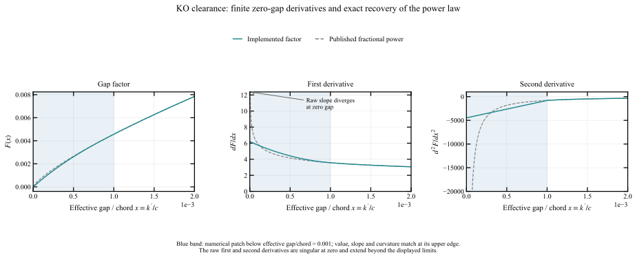
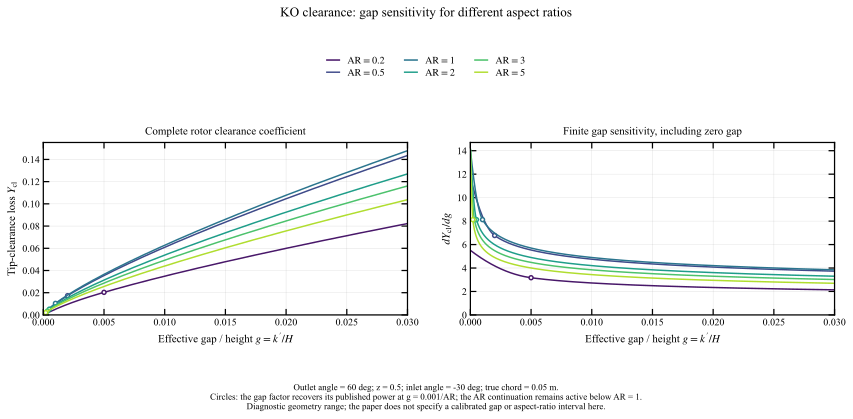
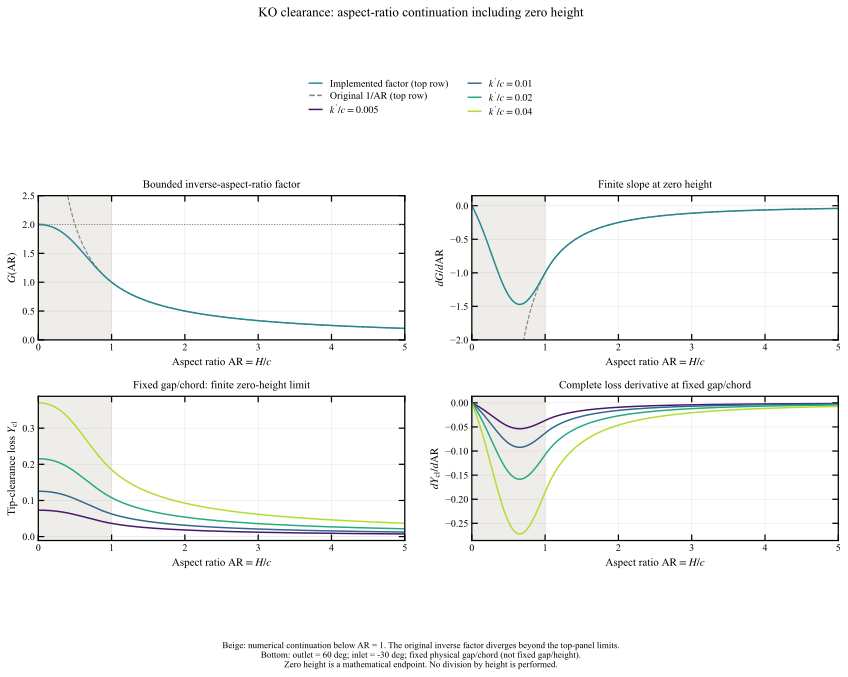
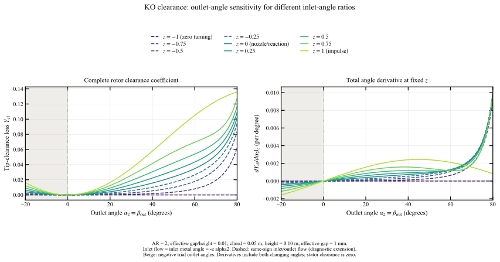
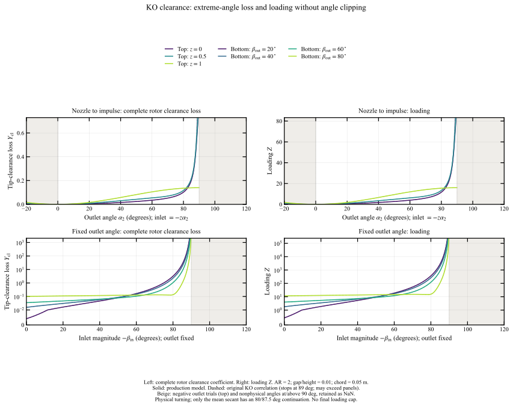

# Kacker–Okapuu: tip-clearance loss

[Previous: trailing-edge loss](03_ko_trailing.md) · [Section index](../readme.md) · [Next: coefficient conversions](05_conversions.md)

This review follows `get_tip_clearance_loss` in [the production KO source](../../../../../turbodash/loss_models/loss_model_kacker_okapuu.py). It retains the published clearance exponent and the small zero-gap patch, preserves physical turning, continues the mean secant and inverse aspect ratio, and evaluates zero-height geometry without division by zero. All plotted loss values come from this production function, shared by Kacker–Okapuu, Moustapha and Benner.

## 1. Published correlation and implemented loading

For **shrouded blades**, Kacker and Okapuu give

$$
Y_{\mathrm{cl}}=0.37\frac{c}{H}\left(\frac{k'}{c}\right)^{0.78}Z,
\qquad
k'=\frac{k}{N^{0.42}},
$$

where $c$ is true chord, $H$ is full mean blade height, $k$ is physical seal clearance and $N$ is the number of seals. These are equations (20)–(21), on journal page 116 of the [original paper](../source/kacker_okapuu_1982.pdf#page=6).

**The fractional power uses effective gap divided by chord.** To express the same law using gap/height and aspect ratio, define

$$
\mathrm{AR}=\frac{H}{c},\qquad g=\frac{k'}{H},\qquad x=\frac{k'}{c}=\mathrm{AR}\,g.
$$

Then the published rotor law becomes

$$
Y_{\mathrm{cl}}=0.37 Z\,\mathrm{AR}^{-0.22}g^{0.78}.
$$

Simply changing the old code's gap/height exponent to 0.78 while retaining its $c/H$ multiplier would give a different aspect-ratio dependence. The implementation now uses the paper's normalization as well as its exponent.

The existing interface has no seal-count input. It treats `geometry["tip_clearance"]` as $k'$: physical clearance for one seal, or a clearance already corrected by the caller for multiple seals. The coefficient 0.37 is applied to rotors; stators return zero. The paper treats unshrouded leakage separately through an efficiency penalty in equation (19). Applying this helper to every rotor remains an interface assumption, rather than evidence that equation (20) also describes unshrouded blades.

### 1.1 Loading without angle clipping

The inputs are the signed inlet and outlet flow angles in the blade-row frame, in degrees from the meridional direction. The paper's loading is

$$
Z_{\mathrm{KO}}=
4(\tan\beta_{\mathrm{in}}-\tan\beta_{\mathrm{out}})^2
\cos^2\beta_{\mathrm{out}}
\sqrt{1+\left(\frac{\tan\beta_{\mathrm{in}}+\tan\beta_{\mathrm{out}}}{2}\right)^2}.
$$

The implementation preserves the physical turning factor and continues only the mean secant:

$$
Z=4\left[\frac{\sin(\beta_{\mathrm{in}}-\beta_{\mathrm{out}})}{\cos\beta_{\mathrm{in}}}\right]^2\mathcal S(\sec\beta_m),
\qquad
\tan\beta_m=\frac{\tan\beta_{\mathrm{in}}+\tan\beta_{\mathrm{out}}}{2}.
$$

For equal inlet/outlet meridional velocity this is exactly

$$
Z=4\left(\frac{w_{\theta,\mathrm{in}}-w_{\theta,\mathrm{out}}}{w_{\mathrm{out}}}\right)^2\mathcal S(\sec\beta_m).
$$

The physical tangential-velocity change stays finite and nonzero as both rotor relative angles approach $-90^\circ$ at high reaction. No individual tangent is saturated. The angle-based first factor retains the original KO definition for unequal meridional velocities too, although its velocity-difference interpretation then no longer applies directly.

The sole loading continuation is

$$
\mathcal S(\sec\beta_m)=\begin{cases}
\sec\beta_m,&\sec\beta_m\le\sec80^\circ,\\
\sec87.5^\circ-\dfrac{\sec87.5^\circ-\sec80^\circ}{1+\tau+\tau^2},&\sec\beta_m>\sec80^\circ,
\end{cases}
\qquad
\tau=\frac{\sec\beta_m-\sec80^\circ}{\sec87.5^\circ-\sec80^\circ}.
$$

Value, slope and curvature match identity at the join. The mean factor increases monotonically toward $\sec87.5^\circ\simeq22.9256$. The join and asymptote are numerical modeling choices: a finite extension toward zero throughflow is useful, but it must not erase finite physical turning. There is no separate cap on the turning factor, on $Z$, or on the complete loss. A monotone mean factor does not require the product $Z$ to be monotone as the physical triangles change.

The source evaluates the first factor from sine and cosine and the mean factor from scaled trigonometric products, without forming either tangent. All flow angles must be strictly within $(-90^\circ,90^\circ)$. Exactly grazing and reversed-flow angle inputs return NaN explicitly. There is no unique loading endpoint for arbitrary angles at zero throughflow. This angular domain restriction does not discard negative hub radii: signed hub geometry continues to use the current shock coordinate. Equal flow angles give exactly zero loading, and reversing both signs preserves the result.

### 1.2 Aspect-ratio continuation through zero height

The clearance correlation contains $1/\mathrm{AR}$, which diverges for short blades at fixed gap/chord. We retain that factor for $\mathrm{AR}\ge1$ and replace its further growth by

$$
G(\mathrm{AR})=
\begin{cases}
2-\dfrac{\mathrm{AR}^2}{1-\mathrm{AR}+\mathrm{AR}^2},
&0\le\mathrm{AR}<1,\\
1/\mathrm{AR},&\mathrm{AR}\ge1.
\end{cases}
$$

For positive $\mathrm{AR}<1$, this is the same rational continuation as above, applied to $1/\mathrm{AR}$ with onset 1 and limit 2. Crucially, the expression implemented in the code is the cancelled form shown here: it does **not** first evaluate $1/\mathrm{AR}$ at zero.

$$
G(0)=2,\qquad G'(0)=0,\qquad G''(0)=-2,
$$

$$
G(1)=1,\qquad G'(1)=-1,\qquad G''(1)=2.
$$

The latter values match the original inverse factor. Below the join,

$$
G'(\mathrm{AR})=
-\frac{2\mathrm{AR}-\mathrm{AR}^2}
{(1-\mathrm{AR}+\mathrm{AR}^2)^2}.
$$

The factor decreases strictly for positive aspect ratio, with no flat interval; its slope tends smoothly to zero at the endpoint. The onset at one keeps the original clearance multiplier for taller blades. The limit of two is a numerical safeguard for short blades. This uses the same continuation idea as the secondary-loss treatment, but preserves the clearance correlation's own $1/\mathrm{AR}$ branch rather than substituting the secondary-loss formula.

The resulting rotor coefficient is

$$
Y_{\mathrm{cl}}=0.37\,Z\,G(\mathrm{AR})\,F(x),
\qquad x=k'/c.
$$

Only positive chord is required in a denominator. Height and clearance may reach zero in this component's mathematical continuation. The secondary-loss component now also evaluates its zero-height limit directly, as documented in [the secondary note](02_ko_secondary.md#23-evaluating-the-zero-height-endpoint-without-division-by-zero). Zero height is not a physically admissible turbine geometry. There is no separate cap on the final clearance coefficient.

## 2. Finite derivatives at zero clearance

The published gap factor $x^{0.78}$ reaches zero continuously, but its derivative $0.78x^{-0.22}$ diverges as $x\to0^+$. We replace only its small-gap endpoint with a cubic that starts at zero and joins the original law smoothly.

With $p=0.78$, $\delta=0.001$ and $q=x/\delta$, the implemented factor is

$$
F(x)=
\begin{cases}
\delta^p(aq+bq^2+dq^3),&0\le x<\delta,\\
x^p,&x\ge\delta,
\end{cases}
$$

$$
a=\frac{(p-2)(p-3)}{2}=1.3542,\qquad
b=(p-1)(3-p)=-0.4884,\qquad
d=\frac{(p-1)(p-2)}{2}=0.1342.
$$

These coefficients enforce the original value, slope and curvature at $x=\delta$. Inside the patch,

$$
F'(x)=\delta^{p-1}(a+2bq+3dq^2),\qquad
F''(x)=\delta^{p-2}(2b+6dq).
$$

Consequently,

$$
F(0)=0,\qquad F'(0)=a\delta^{p-1}\approx6.19,
$$

$$
F(\delta)=\delta^p,\qquad
F'(\delta)=p\delta^{p-1},\qquad
F''(\delta)=p(p-1)\delta^{p-2}.
$$

The factor is positive, increasing and concave for positive gaps. It lies slightly below the original law inside the patch and matches it exactly from $k'/c=0.001$ onward. There is no artificial residual loss at zero, no flat small-gap plateau, and no upper loss cap. A gradient-based optimizer retains a finite gap sensitivity at zero whenever rotor loading is nonzero.

The width corresponds to 0.1% of chord, or 0.05 mm for a 50 mm chord. It is a numerical regularization choice, not a measured threshold. For another width, the endpoint sensitivity scales as $\delta^{-0.22}$. Negative clearance remains invalid and returns NaN: smoothness at zero means finite right derivatives on the physical domain, with a $C^2$ join to the power law at $\delta$.



[SVG](../figures/ko_clearance_gap_factor.svg) · [CSV](../data/clearance_review/gap_factor.csv)

Blue shading marks the numerical patch. The dashed power law has singular first and second derivatives at zero; those singular branches extend beyond the displayed derivative limits. The solid curves have finite endpoint derivatives and meet the dashed curves continuously in value, slope and curvature at $x=0.001$.

## 3. Tip-gap sensitivity at different aspect ratios

At fixed angles and positive aspect ratio, the complete implemented rotor coefficient is

$$
Y_{\mathrm{cl}}(g,\mathrm{AR})
=0.37Z\,G(\mathrm{AR})F(\mathrm{AR}\,g),
$$

$$
\left.\frac{\partial Y_{\mathrm{cl}}}{\partial g}\right|_{\mathrm{AR},\,\mathrm{angles}}
=0.37Z\,G(\mathrm{AR})\,\mathrm{AR}\,F'(\mathrm{AR}\,g).
$$

We hold $c=0.05$ m, $\alpha_2=\beta_{\mathrm{out}}=60^\circ$ and $z=0.5$, giving $\beta_{\mathrm{in}}=-30^\circ$. The horizontal axis is effective gap/height, $0\le g\le0.03$, and the curves use $\mathrm{AR}=0.2,0.5,1,2,3,5$. Height is $H=\mathrm{AR}\,c$ and effective gap is $k'=gH$, so a given horizontal coordinate represents the same relative gap across curves, rather than the same gap in millimetres.



[SVG](../figures/ko_clearance_gap_review.svg) | [CSV](../data/clearance_review/gap_sensitivity.csv)

Every loss curve starts at zero and increases smoothly. Circles mark the end of each small-gap patch, $g=0.001/\mathrm{AR}$. They indicate recovery of the gap power law; the aspect-ratio continuation still applies below $\mathrm{AR}=1$.

The initial slopes coincide for $\mathrm{AR}\ge1$, since then $G(\mathrm{AR})\mathrm{AR}=1$. Below one, that product decreases: the continuation weakens the loss increase associated with very short blades. Consequently, smaller aspect ratio need not give a higher coefficient at fixed gap/height. This is expected because physical gap also decreases with height along this comparison. Outside both continuations, the published scaling remains $Y_{\mathrm{cl}}\propto\mathrm{AR}^{-0.22}g^{0.78}$.

The plotted gap and aspect-ratio ranges are diagnostic. The paper does not state calibrated bounds for these variables alongside equation (20). Stator values and gap derivatives are identically zero and are omitted.

### 3.1 Aspect-ratio sensitivity at fixed physical gap/chord

To isolate the height continuation, the next figure holds $x=k'/c$ fixed as aspect ratio varies from zero to five. It shows $G$ and its derivative, followed by the complete coefficient for several gap/chord ratios:

$$
\left.\frac{\partial Y_{\mathrm{cl}}}{\partial\mathrm{AR}}\right|_{x,\,\mathrm{angles}}
=0.37Z\,F(x)G'(\mathrm{AR}).
$$



[SVG](../figures/ko_clearance_ar_review.svg) | [Factor CSV](../data/clearance_review/aspect_factor.csv) | [Loss CSV](../data/clearance_review/aspect_sensitivity.csv)

The beige region marks the numerical continuation. The original inverse factor and its slope diverge beyond the displayed limits; the implemented curves remain finite and have continuous first derivatives at the join.

The zero-height limit depends on what is held fixed:

- At fixed $x=k'/c$, the loss tends to $0.74Z F(x)$, with zero aspect-ratio derivative.
- At fixed $g=k'/H$, physical gap shrinks with height. Since $F(\mathrm{AR}\,g)\sim F'(0)\mathrm{AR}\,g$, the loss tends to zero with a finite slope. The script evaluates this path through $k'=gH$; it never divides by zero height.
- At zero gap, the loss is exactly zero for every nonnegative aspect ratio, including zero. The independent gap/chord derivative there is $0.37Z G(\mathrm{AR})F'(0)$, which remains finite.

The product $Z\,G(\mathrm{AR})\,F(k'/c)$ therefore also has finite derivatives at the joint zero-gap, zero-height endpoint for positive chord. Derivatives at these physical boundaries are right derivatives; negative gap or height remains invalid.

## 4. Outlet-angle sensitivity at fixed gap and aspect ratio

For this plot we fix $c=0.05$ m, $\mathrm{AR}=2$, $H=0.10$ m and $g=0.01$, corresponding to $k'=1$ mm. The gap factor is outside its endpoint patch. Signed outlet angle runs from $-20^\circ$ to $80^\circ$ and each curve specifies an inlet-angle ratio:

$$
\beta_{\mathrm{out}}=\alpha_2,\qquad
\beta_{\mathrm{in}}=\theta_{\mathrm{in}}=-z\alpha_2,
\qquad -1\le z\le1.
$$

This uses the same zero-incidence angle parameterization as the profile and secondary notes. Here $z$ only sets the flow angles; the clearance model does not interpolate between separate nozzle and impulse correlations. All plotted nonzero values are rotor clearance losses.

At fixed geometry, the derivative along a curve is

$$
\left.\frac{dY_{\mathrm{cl}}}{d\alpha_2}\right|_z
=0.37G(\mathrm{AR})F(x)
\left(\frac{\partial Z}{\partial\beta_{\mathrm{out}}}
-z\frac{\partial Z}{\partial\beta_{\mathrm{in}}}\right).
$$

Derivatives are per degree and include the change in both flow angles. The inlet metal angle does not enter the clearance function directly.



[SVG](../figures/ko_clearance_angle_review.svg) | [CSV](../data/clearance_review/angle_sensitivity.csv)

The $z=-1$ curve has equal inlet/outlet angles and therefore zero loading and loss throughout. At $z=0$ the inlet flow is axial; $z=1$ has equal-and-opposite angles, giving symmetric impulse turning. Negative-$z$ curves have same-sign flow angles and are dashed to identify these diagnostic extensions.

All curves pass through zero loss and zero angle derivative at $\alpha_2=0$. **This behavior is implemented in the source function, not only in the plotting script.** The function takes $\beta_{\mathrm{in}}$ and $\beta_{\mathrm{out}}$ directly and never evaluates $z=-\beta_{\mathrm{in}}/\beta_{\mathrm{out}}$. The script constructs $\beta_{\mathrm{in}}=-z\alpha_2$, which gives both angles zero at the origin without forming $0/0$. Direct calls with both angles zero likewise give zero loss and zero partial angle derivatives.

The negative-angle interval is shaded beige and represents diagnostic trial angles. The script retains $\beta_{\mathrm{in}}=-z\alpha_2$ there, so all prescribed angles reverse together. Loss mirrors the positive-angle result and its total angle derivative changes sign; both properties are verified numerically. This parameterized path is distinct from holding inlet metal angle fixed in the profile/trailing-edge continuations. Within this figure's interval, symmetric impulse loading remains exactly $Z=16\sin^2\alpha_2$. The mean-secant continuation is inactive for these plotted paths through $80^\circ$.

### 4.1 Extreme-angle continuation: clearance loss and loading

The additional figure extends the outlet-angle paths from $-20^\circ$ to $120^\circ$ and also sweeps inlet-angle magnitude at several fixed outlet angles. **The left column shows the complete rotor clearance loss coefficient $Y_{\mathrm{cl}}$; the right column shows the corresponding loading $Z$.** Loss values are evaluated directly with the production clearance function. Derivative panels are omitted.

Both rows hold $\mathrm{AR}=2$, $c=0.05$ m and $g=k'/H=0.01$, so $H=0.10$ m, $k'=1$ mm and $x=k'/c=0.02$. The gap and aspect factors are outside their continuation regions. Therefore,

$$
Y_{\mathrm{cl}}=C_{\mathrm{geom}}Z,\qquad
C_{\mathrm{geom}}=\frac{0.37}{2}(0.02)^{0.78}.
$$

This fixed multiplier explains why the two columns have the same curve shapes but different magnitudes. It exposes the effect of the mean-secant continuation on the actual loss coefficient.



[SVG](../figures/ko_clearance_loading_review.svg) | [CSV](../data/clearance_review/loading_sensitivity.csv)

The top row uses $\beta_{\mathrm{out}}=\alpha_2$ and $\beta_{\mathrm{in}}=-z\alpha_2$, with $z=0,0.5,1$. The bottom row retains inlet-angle magnitude from $0^\circ$ to $120^\circ$ while fixing the outlet angle at $20^\circ$, $40^\circ$, $60^\circ$ or $80^\circ$.

Solid curves show the implemented loss and loading. Dashed curves show the original KO expressions only up to $89^\circ$; some leave the panels as the original loading grows. Beige marks negative trial outlet angles in the top row and invalid angles at or beyond $90^\circ$ in both rows. Those invalid inputs remain NaN. Vertical dotted lines mark $90^\circ$.

The symmetric-impulse path retains its original physical loading $Z=16\sin^2\alpha_2\to16$ as $\alpha_2\to90^-$. The mean angle is zero on that path, so no mean continuation activates. Equal-angle paths give exactly zero throughout the physical angular domain. At a fixed nongrazing outlet angle, inlet grazing can still make the physical turning factor grow without bound; the mean-secant limit is not a global loading ceiling. Points at or beyond the angular boundary remain NaN. The lower figure row uses a symmetric logarithmic ordinate to keep the finite lower-angle response visible.

The small dip before the sharp rise in the fixed-$80^\circ$ outlet case appears in both columns: it comes from the changing mean-flow/loading geometry. Both the loading and the resulting clearance coefficient remain smooth through the angle continuation and approach finite limits.

## 5. Verification, integration and reproduction

Clearance checks cover the zero-gap patch, the aspect-ratio and mean-secant joins, finite derivatives at zero height and at the joint zero-gap/height endpoint, angle reflection, zero turning, array broadcasting, length-unit invariance and invalid inputs. The current focused script evaluates the actual production function and verifies its assembly, including physical turning and its mean-secant continuation.

An independent evaluation of equation (20) was compared against 4,000 angle/geometry combinations. Of these, 3,372 lie outside all modified regions and match the paper to a maximum absolute error of 3.55e-15. In the other cases within $\pm80^\circ$, the continued result stays nonnegative and no larger than the original correlation. The maximum absolute discrepancy between complex-step and independent finite-difference derivatives in the plotted gap/angle checks is 1.53e-10.

A further **36,504 combinations** include zero height, zero clearance and physical angles through +/-89.9 degrees. Loss values and independent height/gap derivatives remain finite and loss coefficients are nonnegative. Exactly grazing and reversed-flow angles are separately checked as invalid. The physical turning factor is not globally bounded when an arbitrary inlet angle approaches grazing at fixed outlet angle; this is distinct from the coherent high-reaction family. These checks establish numerical behavior, not aerodynamic validity in the extrapolated region.

The plotted reference point at $\mathrm{AR}=2$, $g=0.01$, $\alpha_2=60^\circ$ and $z=0.5$ remains $Y_{\mathrm{cl}}=0.05388194$: none of the new continuations changes it. Along the coherent high-reaction family, finite physical turning and the continued mean secant retain nonzero finite clearance loss; arbitrary fixed-outlet inlet-grazing limits need not be bounded. The coefficient still grows with gap/chord.

The new KO, Moustapha and Benner assemblies all use this clearance helper. Integration tests verify that changing clearance changes each model's total by exactly its clearance contribution. These are the production implementations in `turbodash/loss_models`. The Benner and KO stage reports use this same current helper.

Reproduce the current plots from the repository root:

```powershell
python -B development/loss_model_analysis/loss_model_audit/individual_functions/scripts/clearance_review.py
```

Use `--render-only` to redraw saved data without model evaluations. The script checks source and data hashes before rendering and uses the repository's `set_plot_options()` styling with ordered viridis colors and linear aspect-ratio axes.

[Generator](../scripts/clearance_review.py) | [Tests](../../../../../tests/test_ko_clearance.py) | [Numerical validation](../data/clearance_review/validation.json) | [Figure provenance](../data/clearance_review/render_manifest.json)
