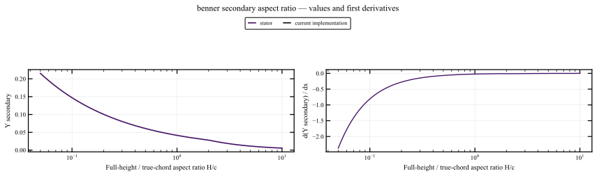
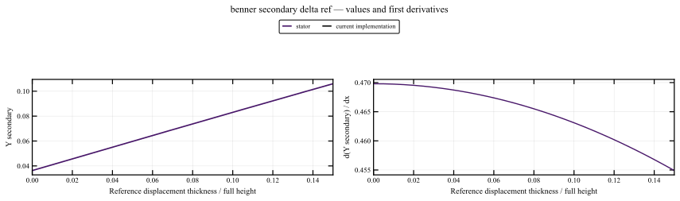

# Benner: secondary loss

[Previous: Moustapha: secondary incidence correction](08_moustapha_secondary.md) · [Section index](../readme.md) · [Next: Benner: incidence loss](10_benner_incidence.md)

These plots evaluate the current production implementation. [Audit overview](../../readme.md).

Benner's penetration tangential-loading helper retains the [profile-reference bounded tangent coordinates](00_ko_safeguards_overview.md): exact tangents through $\pm80^\circ$, rational continuation toward $\pm\tan87.5^\circ$, and a mean cosine consistent with those tangents. It is distinct from KO loading Z. The shared clearance correction now preserves physical turning and continues only the mean secant; Benner's own secondary and penetration correlations retain their documented angular conventions. Benner's absolute-value cusp at zero and its separate secondary-loss expression remain as documented below.

## Functions and dependencies

`get_secondary_loss; inlet boundary-layer correction delta/H=delta_ref*(Re_in/3e5)^(-1/7)`.

## Observed behavior

## Implemented formulation

A full-factor quintic Hermite transition over H/c = 1.8–2.2 matches original endpoint values, first derivatives and second derivatives. Outer branches and the boundary-layer dependence are preserved. Dense checks confirm positive decreasing values with no transition overshoot over the tested displacement-thickness ratios.

## Current values and derivatives

## Quantitative checks

Shrinking one-sided probes below use h=1e-5×max(1,|join|). The full h sequence is retained; the smallest h alone is not a continuity test.

| Feature | Version | Extrapolated value jump | Right minus left slope |
|---|---|---:|---:|
| benner_secondary_AR1.8 | current | 1.4398e-15 | 4.262e-07 |
| benner_secondary_AR2.0 | current | -2.0123e-16 | -8.5193e-07 |
| benner_secondary_AR2.2 | current | -2.3245e-15 | 7.029e-07 |

The cosine-ratio floor also uses the implemented strict C2 envelope: bound 0.1, half-width 0.02. The patch is checked over displacement-thickness/full-height ratios 0, 0.01, 0.05, 0.2 and 1.

5 fundamental sweeps for this mechanism. [Value/gradient data and manifest](../data/sweep_manifest.json), [first-derivative convergence](../data/provenance/fundamental_join_intervals.csv), [second-derivative convergence](../data/provenance/fundamental_curvature_intervals.csv). C2 claims additionally use endpoint regression tests; C1 table interpolation and retained C1 branches are explicitly distinguished.

## Remaining limitations

The transition width is a numerical design choice. This removes a branch defect without validating the empirical low-AR extrapolation or changing the inlet boundary-layer model.

## All sweeps for this mechanism

Every figure contains current-source values and derivatives; links below cover all saved sweeps, including those not embedded above. CSV files are gzip-compressed.

| Parameter / case | Range | Comparison figure | Numerical data |
|---|---|---|---|
| Aspect ratio H/c | 0.05 to 10 (log axis) | [Open](../figures/benner_secondary_aspect_ratio.svg) | [stator](../data/sweeps/fundamental_benner_secondary_aspect_ratio__stator.csv.gz) |
| Incidence | -30 to 30 | [Open](../figures/benner_secondary_incidence.svg) | [stator](../data/sweeps/fundamental_benner_secondary_incidence__stator.csv.gz) |
| Signed exit angle in design direction | -20 to 80 | [Open](../figures/benner_secondary_exit_angle.svg) | [stator](../data/sweeps/fundamental_benner_secondary_exit_angle__stator.csv.gz) |
| Reference boundary-layer thickness | 0 to 0.15 | [Open](../figures/benner_secondary_delta_ref.svg) | [stator](../data/sweeps/fundamental_benner_secondary_delta_ref__stator.csv.gz) |
| Stagger angle | -89.9 to 89.9 | [Open](../figures/benner_secondary_stagger.svg) | [stator](../data/sweeps/fundamental_benner_secondary_stagger__stator.csv.gz) |

[All individual functions](../readme.md) · [Methods, validation and reproduction](../methodology.md)
