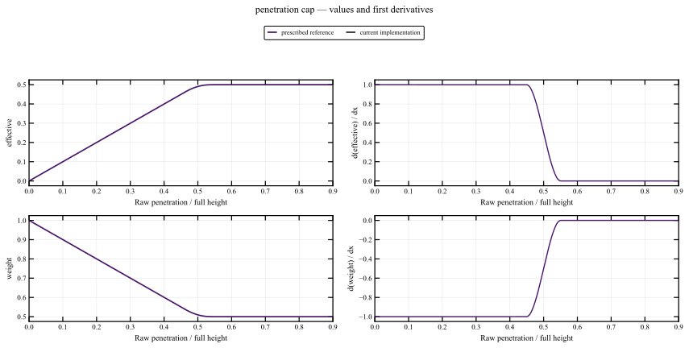
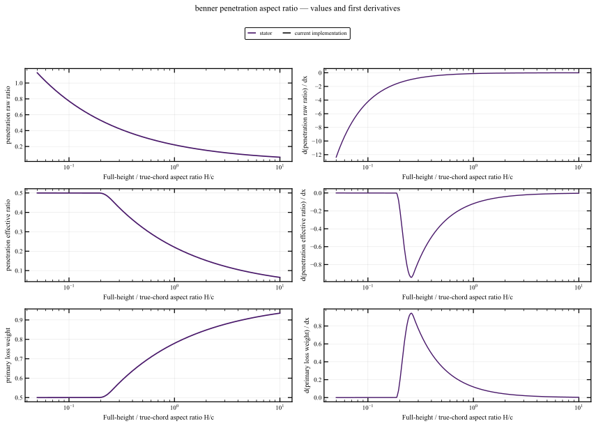
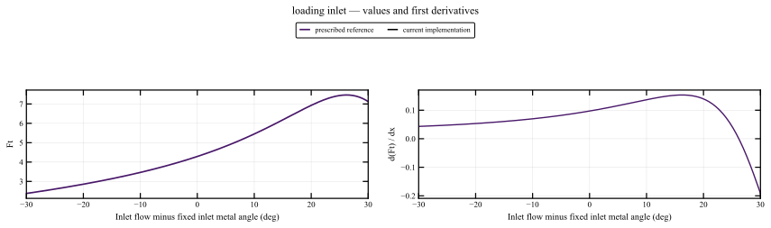

# Benner: penetration and primary-loss weighting

[Previous: Benner: incidence loss](10_benner_incidence.md) · [Section index](../readme.md)

These plots evaluate the current production implementation. [Audit overview](../../readme.md).

## Functions and dependencies

`F_t → get_penetration_depth_raw / get_penetration_diagnostics → limit_penetration_depth`.

## Observed behavior

The existing effective-penetration limiter already has smooth joins at raw ratios 0.45/0.55 and enforces maximum penetration 0.5. The prior profile kink was inherited from KO rather than caused by this cap.

## Implemented formulation

No penetration, loading or weighting equation changed. Fundamental plots expose raw penetration, effective penetration and primary-loss weight. Exact array parity and source-level function checks retain this successful C2 cap.

## Current values and derivatives

## Quantitative checks

Shrinking one-sided probes below use h=1e-5×max(1,|join|). The full h sequence is retained; the smallest h alone is not a continuity test.

| Feature | Version | Extrapolated value jump | Right minus left slope |
|---|---|---:|---:|
| penetration_cap_0.45 | current | 5.9996e-13 | -6.9994e-08 |
| penetration_cap_0.55 | current | -5.9996e-13 | -6.9994e-08 |

8 fundamental sweeps for this mechanism. [Value/gradient data and manifest](../data/sweep_manifest.json), [first-derivative convergence](../data/provenance/fundamental_join_intervals.csv), [second-derivative convergence](../data/provenance/fundamental_curvature_intervals.csv). C2 claims additionally use endpoint regression tests; C1 table interpolation and retained C1 branches are explicitly distinguished.

## Remaining limitations

The sum-of-absolute-tangents loading convention can retain loading for equal same-sign angles. Resolving that convention requires physical evidence; smoothing is not a substitute. Weighting propagation is outside this individual-function dataset; see the [audit overview](../../readme.md) for stage-level evidence.

## All sweeps for this mechanism

Every figure contains current-source values and derivatives; links below cover all saved sweeps, including those not embedded above. CSV files are gzip-compressed.

| Parameter / case | Range | Comparison figure | Numerical data |
|---|---|---|---|
| Aspect ratio H/c | 0.05 to 10 (log axis) | [Open](../figures/benner_penetration_aspect_ratio.svg) | [stator](../data/sweeps/fundamental_benner_penetration_aspect_ratio__stator.csv.gz) |
| Pitch/chord ratio | 0.05 to 5 | [Open](../figures/benner_penetration_pitch_chord.svg) | [stator](../data/sweeps/fundamental_benner_penetration_pitch_chord__stator.csv.gz) |
| Incidence | -30 to 30 | [Open](../figures/benner_penetration_incidence.svg) | [stator](../data/sweeps/fundamental_benner_penetration_incidence__stator.csv.gz) |
| Signed exit angle in design direction | -20 to 80 | [Open](../figures/benner_penetration_exit_angle.svg) | [stator](../data/sweeps/fundamental_benner_penetration_exit_angle__stator.csv.gz) |
| Reference boundary-layer thickness | 0 to 0.15 | [Open](../figures/benner_penetration_delta_ref.svg) | [stator](../data/sweeps/fundamental_benner_penetration_delta_ref__stator.csv.gz) |
| Inlet Reynolds number | 10000 to 1e+07 (log axis) | [Open](../figures/benner_penetration_re_in.svg) | [stator](../data/sweeps/fundamental_benner_penetration_re_in__stator.csv.gz) |
| Raw penetration ratio · penetration cap | 0 to 0.9 | [Open](../figures/penetration_cap.svg) | [prescribed reference](../data/sweeps/fundamental_penetration_cap.csv.gz) |
| Incidence · loading inlet | -30 to 30 | [Open](../figures/loading_inlet.svg) | [prescribed reference](../data/sweeps/fundamental_loading_inlet.csv.gz) |

[All individual functions](../readme.md) · [Methods, validation and reproduction](../methodology.md)

The complete production model also inherits the new analytical AM references through KO profile loss. The mechanism reviewed here is unchanged by that replacement. See the [profile integration and model-propagation review](01_ko_profile.md#shared-profile-loss-in-moustapha-and-benner) for isolated profile/total differences and independent regression checks.
