# Constant loss (Y = 0.1 per row): single-stage air turbine

[Common method](../readme.md)

Blue and orange encode total-total and total-static efficiency. Curves use the common baseline except for the indicated parameter. Negative hub radii and negative efficiencies remain in the numerical data. Efficiency axes show 0-100%. No hub-ratio boundary markers are drawn.

This study uses the existing production `custom` option with a total pressure-loss coefficient of 0.1 in each row:

$$
Y_{\mathrm{stator}}=0.1,\qquad Y_{\mathrm{rotor}}=0.1.
$$

These are complete row coefficients under the same stagnation-pressure definition as the empirical studies. They are not kinetic-energy coefficients or prescribed enthalpy defects. The exact Air EOS converts each coefficient into an enthalpy defect before applying the common signed efficiency definitions.

The prescribed totals are unpartitioned. The production custom model returns zero profile, incidence, secondary, trailing-edge and clearance components; those zero components do not sum to the nonzero prescribed total. No empirical shock, Reynolds, loading or penetration correction is applied.

Pitch/chord, aspect ratio, trailing-edge thickness, specific speed and mass-flow curves should coincide wherever the common reference design is finite. Stator-angle curves can separate through turning and exit kinetic energy; expansion-Mach curves can separate through the pressure-to-enthalpy conversion. A fixed pressure-loss coefficient does not imply fixed efficiency.

Reproduce all 21 constant-loss figures with the shared scripts:

```powershell
python -B development/loss_model_analysis/loss_model_audit/overall_stage/study.py --models constant_loss
```

## Stator exit angle: Blade velocity ratio at $R=0$

**Purpose.** Isolate the effect of turning and exit kinetic energy while both row pressure-loss coefficients stay fixed at 0.1.

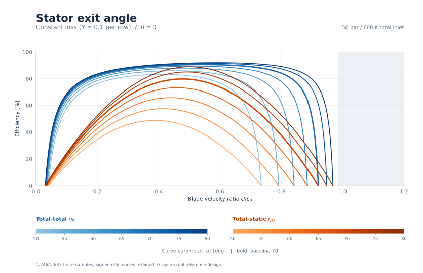

[Vector SVG](figures/speed_r0_stator_exit_angle.svg) | [Samples](data/constant_loss.csv.gz)

**Consistent.** Both row total pressure-loss coefficients remain exactly 0.1. Turning changes the row velocities, the enthalpy defects associated with fixed Y, and the unrecovered exit kinetic energy. At $U/c_0$=0.6, total-total efficiency ranges from 76.71% to 91.90%, and total-static efficiency from 30.57% to 84.87%. Retained samples include 405 negative-hub designs and 74 negative total-total efficiencies. This is a controlled reference; it does not predict the loss penalties of the empirical correlations.

## Stator exit angle: Blade velocity ratio at $R=0.5$

**Purpose.** Isolate the effect of turning and exit kinetic energy while both row pressure-loss coefficients stay fixed at 0.1.

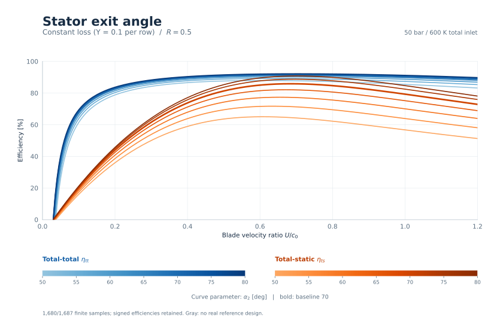

[Vector SVG](figures/speed_r05_stator_exit_angle.svg) | [Samples](data/constant_loss.csv.gz)

**Consistent.** Both row total pressure-loss coefficients remain exactly 0.1. Turning changes the row velocities, the enthalpy defects associated with fixed Y, and the unrecovered exit kinetic energy. At $U/c_0$=0.6, total-total efficiency ranges from 87.91% to 92.05%, and total-static efficiency from 65.01% to 89.54%. Retained samples include 471 negative-hub designs and 41 negative total-total efficiencies. This is a controlled reference; it does not predict the loss penalties of the empirical correlations.

## Stator exit angle: Reaction at $U/c_0=0.6$

**Purpose.** Isolate the effect of turning and exit kinetic energy while both row pressure-loss coefficients stay fixed at 0.1.

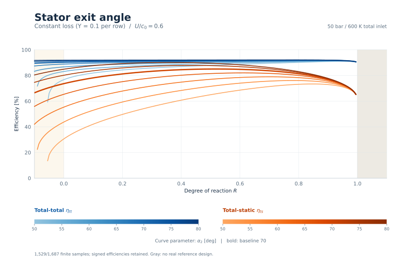

[Vector SVG](figures/reaction_stator_exit_angle.svg) | [Samples](data/constant_loss.csv.gz)

**Consistent.** Both row total pressure-loss coefficients remain exactly 0.1. Turning changes the row velocities, the enthalpy defects associated with fixed Y, and the unrecovered exit kinetic energy. At $R$=0.5, total-total efficiency ranges from 87.91% to 92.05%, and total-static efficiency from 65.01% to 89.54%. Retained samples include 94 negative-hub designs and 0 negative total-total efficiencies. This is a controlled reference; it does not predict the loss penalties of the empirical correlations.

## Pitch / true chord: Blade velocity ratio at $R=0$

**Purpose.** Check that spacing does not change efficiency when both row pressure-loss coefficients are prescribed, with no spacing correlation active.

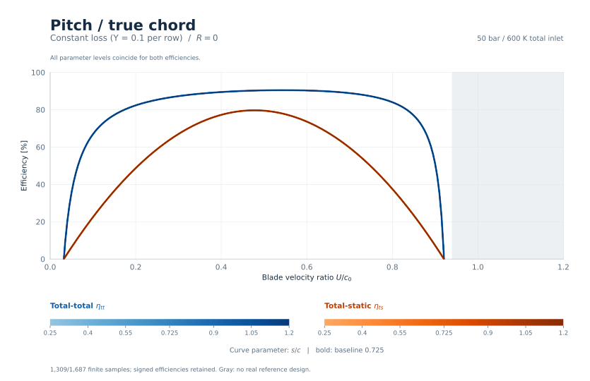

[Vector SVG](figures/speed_r0_pitch_chord.svg) | [Samples](data/constant_loss.csv.gz)

**Consistent.** Both row total pressure-loss coefficients remain exactly 0.1. All parameter levels coincide as expected: this parameter changes geometry or inactive loss corrections while the row states and prescribed coefficients stay the same. At $U/c_0$=0.6, total-total efficiency ranges from 90.31% to 90.31%, and total-static efficiency from 73.63% to 73.63%. Retained samples include 420 negative-hub designs and 63 negative total-total efficiencies. This is a controlled reference; it does not predict the loss penalties of the empirical correlations.

## Pitch / true chord: Blade velocity ratio at $R=0.5$

**Purpose.** Check that spacing does not change efficiency when both row pressure-loss coefficients are prescribed, with no spacing correlation active.


[Vector SVG](figures/speed_r05_pitch_chord.svg) | [Samples](data/constant_loss.csv.gz)

**Consistent.** Both row total pressure-loss coefficients remain exactly 0.1. All parameter levels coincide as expected: this parameter changes geometry or inactive loss corrections while the row states and prescribed coefficients stay the same. At $U/c_0$=0.6, total-total efficiency ranges from 91.42% to 91.42%, and total-static efficiency from 85.00% to 85.00%. Retained samples include 490 negative-hub designs and 42 negative total-total efficiencies. This is a controlled reference; it does not predict the loss penalties of the empirical correlations.

## Pitch / true chord: Reaction at $U/c_0=0.6$

**Purpose.** Check that spacing does not change efficiency when both row pressure-loss coefficients are prescribed, with no spacing correlation active.


[Vector SVG](figures/reaction_pitch_chord.svg) | [Samples](data/constant_loss.csv.gz)

**Consistent.** Both row total pressure-loss coefficients remain exactly 0.1. All parameter levels coincide as expected: this parameter changes geometry or inactive loss corrections while the row states and prescribed coefficients stay the same. At $R$=0.5, total-total efficiency ranges from 91.42% to 91.42%, and total-static efficiency from 85.00% to 85.00%. Retained samples include 77 negative-hub designs and 0 negative total-total efficiencies. This is a controlled reference; it does not predict the loss penalties of the empirical correlations.

## Blade aspect ratio: Blade velocity ratio at $R=0$

**Purpose.** Check that changing blade aspect ratio only resizes geometry when secondary, clearance and Reynolds loss corrections are inactive.

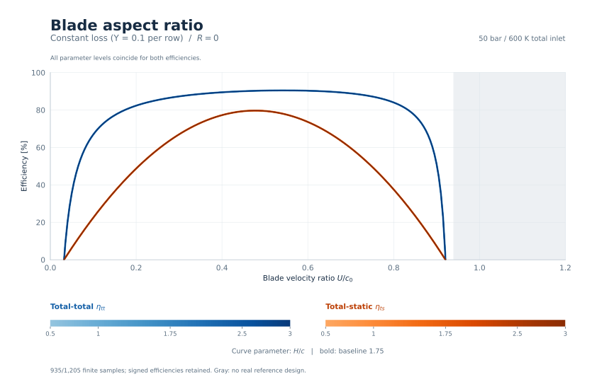

[Vector SVG](figures/speed_r0_aspect_ratio.svg) | [Samples](data/constant_loss.csv.gz)

**Consistent.** Both row total pressure-loss coefficients remain exactly 0.1. All parameter levels coincide as expected: this parameter changes geometry or inactive loss corrections while the row states and prescribed coefficients stay the same. At $U/c_0$=0.6, total-total efficiency ranges from 90.31% to 90.31%, and total-static efficiency from 73.63% to 73.63%. Retained samples include 300 negative-hub designs and 45 negative total-total efficiencies. This is a controlled reference; it does not predict the loss penalties of the empirical correlations.

## Blade aspect ratio: Blade velocity ratio at $R=0.5$

**Purpose.** Check that changing blade aspect ratio only resizes geometry when secondary, clearance and Reynolds loss corrections are inactive.

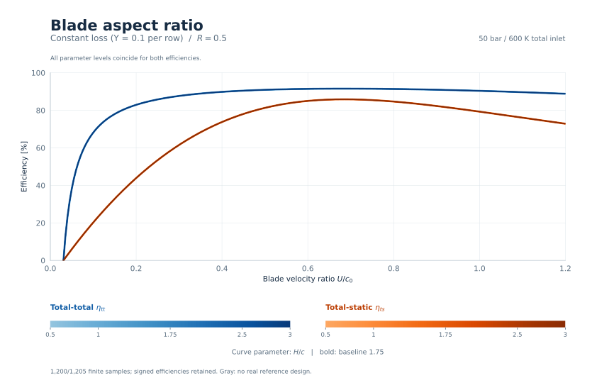

[Vector SVG](figures/speed_r05_aspect_ratio.svg) | [Samples](data/constant_loss.csv.gz)

**Consistent.** Both row total pressure-loss coefficients remain exactly 0.1. All parameter levels coincide as expected: this parameter changes geometry or inactive loss corrections while the row states and prescribed coefficients stay the same. At $U/c_0$=0.6, total-total efficiency ranges from 91.42% to 91.42%, and total-static efficiency from 85.00% to 85.00%. Retained samples include 350 negative-hub designs and 30 negative total-total efficiencies. This is a controlled reference; it does not predict the loss penalties of the empirical correlations.

## Blade aspect ratio: Reaction at $U/c_0=0.6$

**Purpose.** Check that changing blade aspect ratio only resizes geometry when secondary, clearance and Reynolds loss corrections are inactive.

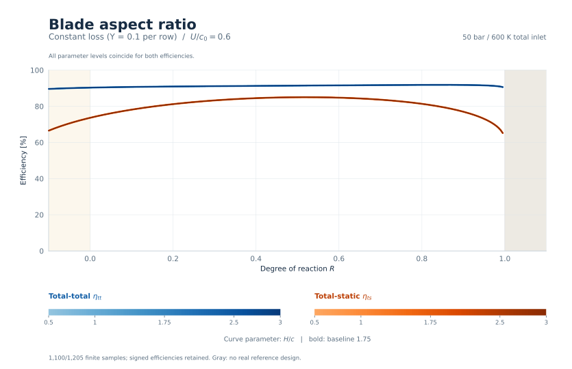

[Vector SVG](figures/reaction_aspect_ratio.svg) | [Samples](data/constant_loss.csv.gz)

**Consistent.** Both row total pressure-loss coefficients remain exactly 0.1. All parameter levels coincide as expected: this parameter changes geometry or inactive loss corrections while the row states and prescribed coefficients stay the same. At $R$=0.5, total-total efficiency ranges from 91.42% to 91.42%, and total-static efficiency from 85.00% to 85.00%. Retained samples include 55 negative-hub designs and 0 negative total-total efficiencies. This is a controlled reference; it does not predict the loss penalties of the empirical correlations.

## Trailing-edge thickness / opening: Blade velocity ratio at $R=0$

**Purpose.** Check that changing both trailing-edge thicknesses does not change the prescribed row losses; compare the overlap with empirical thickness penalties.

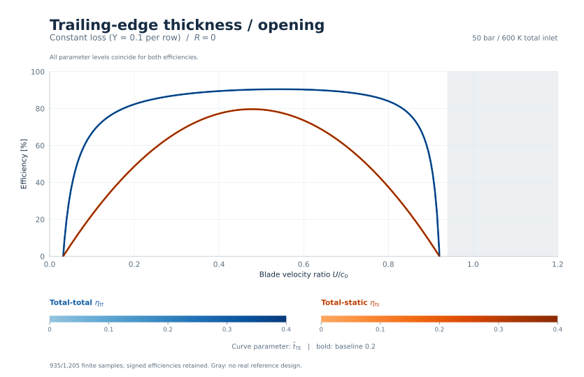

[Vector SVG](figures/speed_r0_trailing_ratio.svg) | [Samples](data/constant_loss.csv.gz)

**Consistent.** Both row total pressure-loss coefficients remain exactly 0.1. All parameter levels coincide as expected: this parameter changes geometry or inactive loss corrections while the row states and prescribed coefficients stay the same. At $U/c_0$=0.6, total-total efficiency ranges from 90.31% to 90.31%, and total-static efficiency from 73.63% to 73.63%. Retained samples include 300 negative-hub designs and 45 negative total-total efficiencies. This is a controlled reference; it does not predict the loss penalties of the empirical correlations.

## Trailing-edge thickness / opening: Blade velocity ratio at $R=0.5$

**Purpose.** Check that changing both trailing-edge thicknesses does not change the prescribed row losses; compare the overlap with empirical thickness penalties.

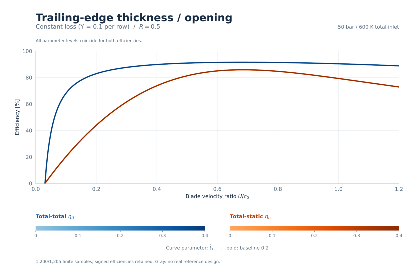

[Vector SVG](figures/speed_r05_trailing_ratio.svg) | [Samples](data/constant_loss.csv.gz)

**Consistent.** Both row total pressure-loss coefficients remain exactly 0.1. All parameter levels coincide as expected: this parameter changes geometry or inactive loss corrections while the row states and prescribed coefficients stay the same. At $U/c_0$=0.6, total-total efficiency ranges from 91.42% to 91.42%, and total-static efficiency from 85.00% to 85.00%. Retained samples include 350 negative-hub designs and 30 negative total-total efficiencies. This is a controlled reference; it does not predict the loss penalties of the empirical correlations.

## Trailing-edge thickness / opening: Reaction at $U/c_0=0.6$

**Purpose.** Check that changing both trailing-edge thicknesses does not change the prescribed row losses; compare the overlap with empirical thickness penalties.

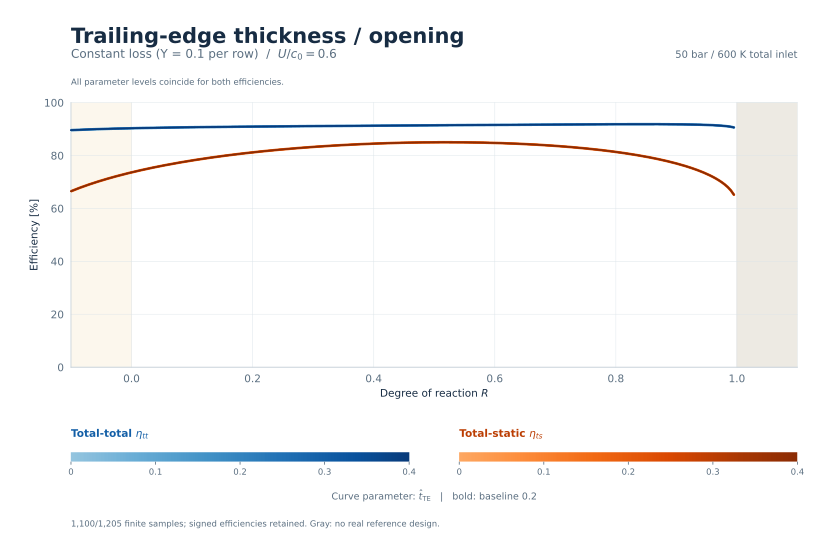

[Vector SVG](figures/reaction_trailing_ratio.svg) | [Samples](data/constant_loss.csv.gz)

**Consistent.** Both row total pressure-loss coefficients remain exactly 0.1. All parameter levels coincide as expected: this parameter changes geometry or inactive loss corrections while the row states and prescribed coefficients stay the same. At $R$=0.5, total-total efficiency ranges from 91.42% to 91.42%, and total-static efficiency from 85.00% to 85.00%. Retained samples include 55 negative-hub designs and 0 negative total-total efficiencies. This is a controlled reference; it does not predict the loss penalties of the empirical correlations.

## Specific speed: Blade velocity ratio at $R=0$

**Purpose.** Check that rotational speed and annulus sizing leave efficiency unchanged at fixed dimensionless triangles and fixed row pressure-loss coefficients.

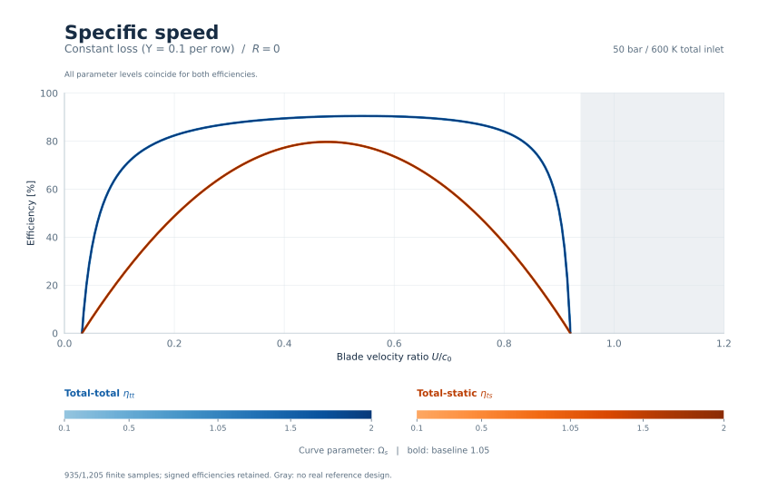

[Vector SVG](figures/speed_r0_specific_speed.svg) | [Samples](data/constant_loss.csv.gz)

**Consistent.** Both row total pressure-loss coefficients remain exactly 0.1. All parameter levels coincide as expected: this parameter changes geometry or inactive loss corrections while the row states and prescribed coefficients stay the same. At $U/c_0$=0.6, total-total efficiency ranges from 90.31% to 90.31%, and total-static efficiency from 73.63% to 73.63%. Retained samples include 293 negative-hub designs and 45 negative total-total efficiencies. This is a controlled reference; it does not predict the loss penalties of the empirical correlations.

## Specific speed: Blade velocity ratio at $R=0.5$

**Purpose.** Check that rotational speed and annulus sizing leave efficiency unchanged at fixed dimensionless triangles and fixed row pressure-loss coefficients.


[Vector SVG](figures/speed_r05_specific_speed.svg) | [Samples](data/constant_loss.csv.gz)

**Consistent.** Both row total pressure-loss coefficients remain exactly 0.1. All parameter levels coincide as expected: this parameter changes geometry or inactive loss corrections while the row states and prescribed coefficients stay the same. At $U/c_0$=0.6, total-total efficiency ranges from 91.42% to 91.42%, and total-static efficiency from 85.00% to 85.00%. Retained samples include 343 negative-hub designs and 30 negative total-total efficiencies. This is a controlled reference; it does not predict the loss penalties of the empirical correlations.

## Specific speed: Reaction at $U/c_0=0.6$

**Purpose.** Check that rotational speed and annulus sizing leave efficiency unchanged at fixed dimensionless triangles and fixed row pressure-loss coefficients.

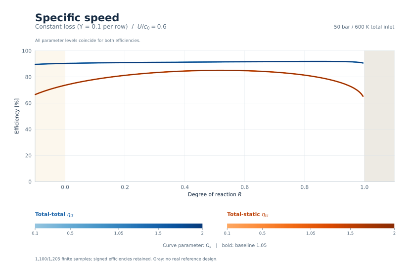

[Vector SVG](figures/reaction_specific_speed.svg) | [Samples](data/constant_loss.csv.gz)

**Consistent.** Both row total pressure-loss coefficients remain exactly 0.1. All parameter levels coincide as expected: this parameter changes geometry or inactive loss corrections while the row states and prescribed coefficients stay the same. At $R$=0.5, total-total efficiency ranges from 91.42% to 91.42%, and total-static efficiency from 85.00% to 85.00%. Retained samples include 222 negative-hub designs and 0 negative total-total efficiencies. This is a controlled reference; it does not predict the loss penalties of the empirical correlations.

## Mass flow: Blade velocity ratio at $R=0$

**Purpose.** Check size invariance with fixed row pressure-loss coefficients: dimensions and Reynolds numbers change, but no Reynolds correction is applied.

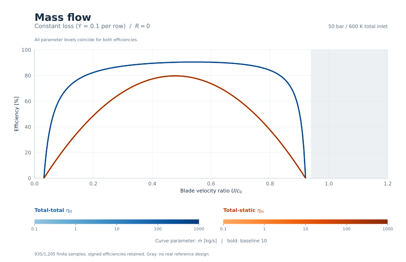

[Vector SVG](figures/speed_r0_mass_flow.svg) | [Samples](data/constant_loss.csv.gz)

**Consistent.** Both row total pressure-loss coefficients remain exactly 0.1. All parameter levels coincide as expected: this parameter changes geometry or inactive loss corrections while the row states and prescribed coefficients stay the same. At $U/c_0$=0.6, total-total efficiency ranges from 90.31% to 90.31%, and total-static efficiency from 73.63% to 73.63%. Retained samples include 300 negative-hub designs and 45 negative total-total efficiencies. This is a controlled reference; it does not predict the loss penalties of the empirical correlations.

## Mass flow: Blade velocity ratio at $R=0.5$

**Purpose.** Check size invariance with fixed row pressure-loss coefficients: dimensions and Reynolds numbers change, but no Reynolds correction is applied.

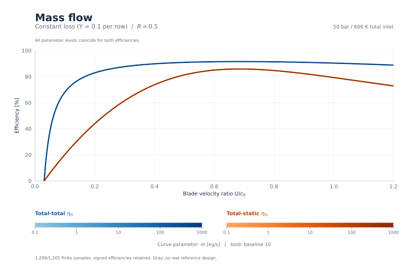

[Vector SVG](figures/speed_r05_mass_flow.svg) | [Samples](data/constant_loss.csv.gz)

**Consistent.** Both row total pressure-loss coefficients remain exactly 0.1. All parameter levels coincide as expected: this parameter changes geometry or inactive loss corrections while the row states and prescribed coefficients stay the same. At $U/c_0$=0.6, total-total efficiency ranges from 91.42% to 91.42%, and total-static efficiency from 85.00% to 85.00%. Retained samples include 350 negative-hub designs and 30 negative total-total efficiencies. This is a controlled reference; it does not predict the loss penalties of the empirical correlations.

## Mass flow: Reaction at $U/c_0=0.6$

**Purpose.** Check size invariance with fixed row pressure-loss coefficients: dimensions and Reynolds numbers change, but no Reynolds correction is applied.

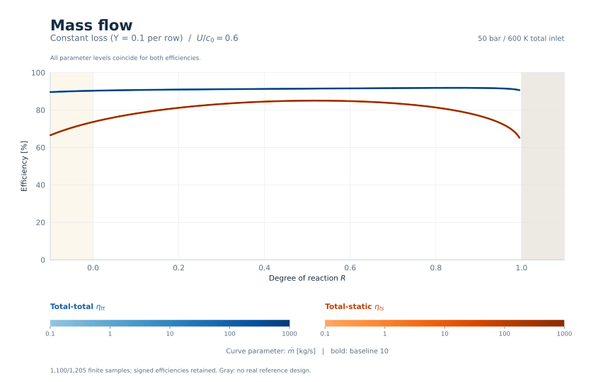

[Vector SVG](figures/reaction_mass_flow.svg) | [Samples](data/constant_loss.csv.gz)

**Consistent.** Both row total pressure-loss coefficients remain exactly 0.1. All parameter levels coincide as expected: this parameter changes geometry or inactive loss corrections while the row states and prescribed coefficients stay the same. At $R$=0.5, total-total efficiency ranges from 91.42% to 91.42%, and total-static efficiency from 85.00% to 85.00%. Retained samples include 55 negative-hub designs and 0 negative total-total efficiencies. This is a controlled reference; it does not predict the loss penalties of the empirical correlations.

## Isentropic expansion Mach number: Blade velocity ratio at $R=0$

**Purpose.** Isolate compressibility in the pressure-to-enthalpy-loss conversion at fixed row pressure-loss coefficients, without empirical Mach or shock corrections.

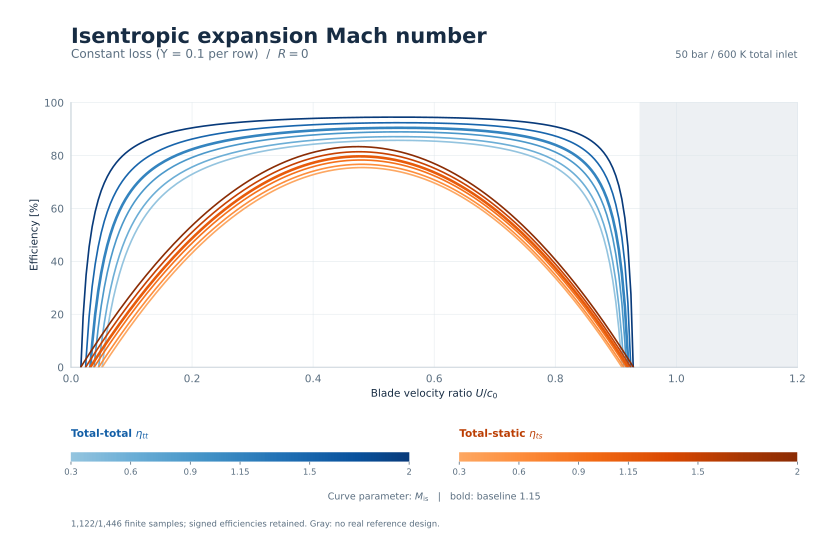

[Vector SVG](figures/speed_r0_isentropic_mach.svg) | [Samples](data/constant_loss.csv.gz)

**Consistent.** Both row total pressure-loss coefficients remain exactly 0.1. Different Mach curves are possible even with fixed Y: the exact Air EOS converts the same pressure-loss coefficient into different enthalpy defects. This response contains no empirical shock or Reynolds correction. At $U/c_0$=0.6, total-total efficiency ranges from 85.43% to 94.41%, and total-static efficiency from 69.65% to 76.97%. Retained samples include 360 negative-hub designs and 61 negative total-total efficiencies. This is a controlled reference; it does not predict the loss penalties of the empirical correlations.

## Isentropic expansion Mach number: Blade velocity ratio at $R=0.5$

**Purpose.** Isolate compressibility in the pressure-to-enthalpy-loss conversion at fixed row pressure-loss coefficients, without empirical Mach or shock corrections.

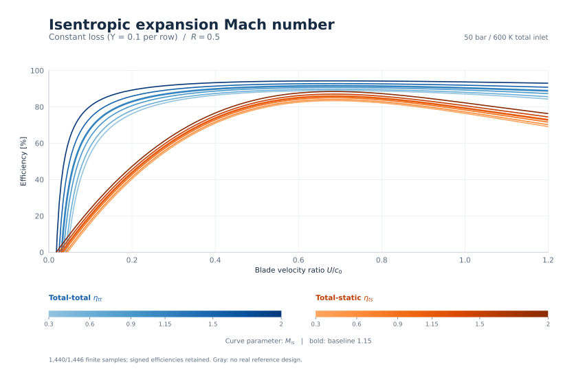

[Vector SVG](figures/speed_r05_isentropic_mach.svg) | [Samples](data/constant_loss.csv.gz)

**Consistent.** Both row total pressure-loss coefficients remain exactly 0.1. Different Mach curves are possible even with fixed Y: the exact Air EOS converts the same pressure-loss coefficient into different enthalpy defects. This response contains no empirical shock or Reynolds correction. At $U/c_0$=0.6, total-total efficiency ranges from 88.76% to 94.22%, and total-static efficiency from 82.53% to 87.61%. Retained samples include 420 negative-hub designs and 37 negative total-total efficiencies. This is a controlled reference; it does not predict the loss penalties of the empirical correlations.

## Isentropic expansion Mach number: Reaction at $U/c_0=0.6$

**Purpose.** Isolate compressibility in the pressure-to-enthalpy-loss conversion at fixed row pressure-loss coefficients, without empirical Mach or shock corrections.

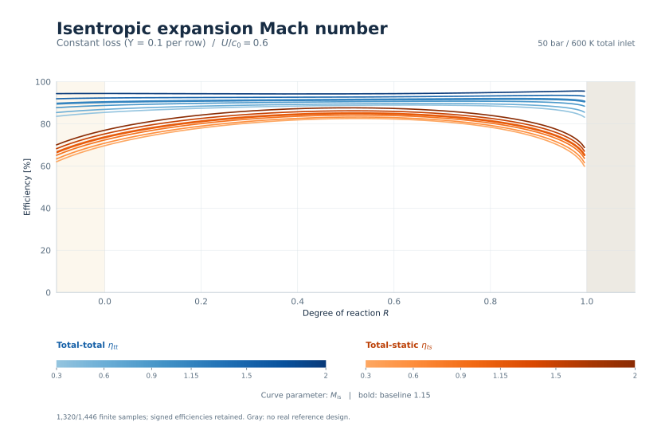

[Vector SVG](figures/reaction_isentropic_mach.svg) | [Samples](data/constant_loss.csv.gz)

**Consistent.** Both row total pressure-loss coefficients remain exactly 0.1. Different Mach curves are possible even with fixed Y: the exact Air EOS converts the same pressure-loss coefficient into different enthalpy defects. This response contains no empirical shock or Reynolds correction. At $R$=0.5, total-total efficiency ranges from 88.76% to 94.22%, and total-static efficiency from 82.53% to 87.61%. Retained samples include 66 negative-hub designs and 0 negative total-total efficiencies. This is a controlled reference; it does not predict the loss penalties of the empirical correlations.
