# Isentropic (zero losses): single-stage air turbine

[Common method](../readme.md)

Blue and orange encode total-total and total-static efficiency. Curves use the common baseline except for the indicated parameter. Negative hub radii and negative efficiencies remain in the numerical data. Efficiency axes show 0-100%. No hub-ratio boundary markers are drawn.

This study uses the existing production `isentropic` option. Profile, incidence, secondary, trailing-edge and clearance losses are all exactly zero. Geometry and inlet conditions match the empirical studies; the loss functions are bypassed.

$$
\eta_{tt}=1,\qquad\eta_{ts}=1-\frac{v_4^2/2}{h_{01}-h_{4s}}.
$$

Total-static efficiency can therefore be below 100% despite zero irreversible loss: it includes unrecovered absolute exit kinetic energy. Curves for pitch/chord, aspect ratio, trailing-edge thickness, specific speed and mass flow coincide because these inputs only change geometry or inactive loss corrections. Expansion Mach changes dimensional states and work, while the prescribed normalized triangles leave this ideal efficiency unchanged. Overlap is expected and is checked numerically.

The blue total-total curves lie exactly on the upper 100% boundary. Both efficiencies use solid lines and their existing colormaps; no visual offsets are introduced to separate identical solutions. Zero blade speed and nonreal reference triangles remain explicit gaps, as in the other studies.

## Stator exit angle: Blade velocity ratio at $R=0$

**Purpose.** Isolate how stator exit angle changes the velocity triangles and unrecovered exit kinetic energy, with every row-loss component set to zero.

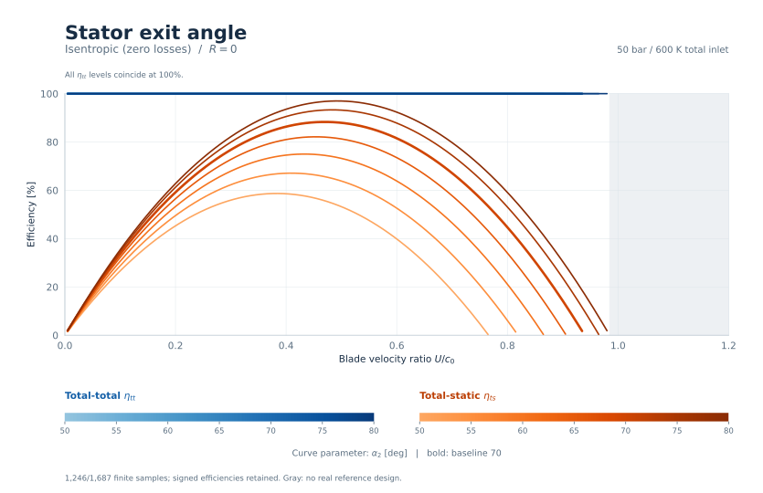

[Vector SVG](figures/speed_r0_stator_exit_angle.svg) | [Samples](data/isentropic.csv.gz)

**Consistent.** All row-loss components are exactly zero and total-total efficiency is exactly 100%. Stator angle changes exit kinetic energy and therefore total-static efficiency; total-total efficiency remains exactly 100% for every finite reference design. At $U/c_0$=0.6, total-static efficiency ranges from 39.85% to 92.35%. Retained finite samples include 405 negative-hub designs. Gaps use the same reference-design checks as the empirical studies.

## Stator exit angle: Blade velocity ratio at $R=0.5$

**Purpose.** Isolate how stator exit angle changes the velocity triangles and unrecovered exit kinetic energy, with every row-loss component set to zero.

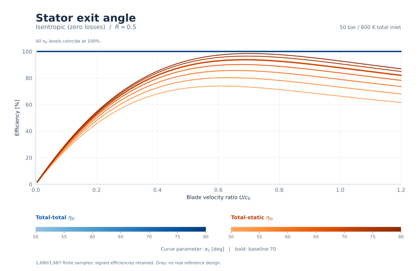

[Vector SVG](figures/speed_r05_stator_exit_angle.svg) | [Samples](data/isentropic.csv.gz)

**Consistent.** All row-loss components are exactly zero and total-total efficiency is exactly 100%. Stator angle changes exit kinetic energy and therefore total-static efficiency; total-total efficiency remains exactly 100% for every finite reference design. At $U/c_0$=0.6, total-static efficiency ranges from 73.96% to 97.28%. Retained finite samples include 471 negative-hub designs. Gaps use the same reference-design checks as the empirical studies.

## Stator exit angle: Reaction at $U/c_0=0.6$

**Purpose.** Isolate how stator exit angle changes the velocity triangles and unrecovered exit kinetic energy, with every row-loss component set to zero.

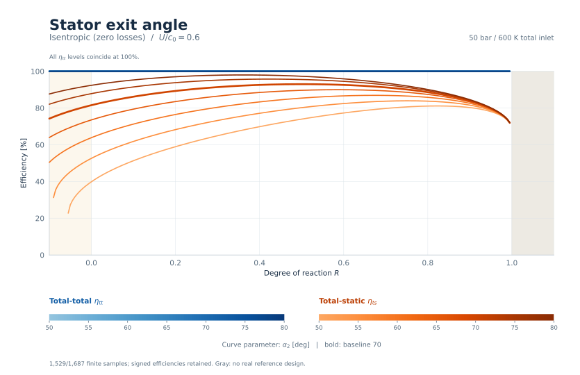

[Vector SVG](figures/reaction_stator_exit_angle.svg) | [Samples](data/isentropic.csv.gz)

**Consistent.** All row-loss components are exactly zero and total-total efficiency is exactly 100%. Stator angle changes exit kinetic energy and therefore total-static efficiency; total-total efficiency remains exactly 100% for every finite reference design. At $R$=0.5, total-static efficiency ranges from 73.96% to 97.28%. Retained finite samples include 94 negative-hub designs. Gaps use the same reference-design checks as the empirical studies.

## Pitch / true chord: Blade velocity ratio at $R=0$

**Purpose.** Verify that spacing has no aerodynamic efficiency effect when the loss model is isentropic; retain the common geometry checks.

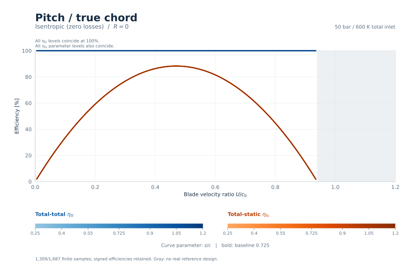

[Vector SVG](figures/speed_r0_pitch_chord.svg) | [Samples](data/isentropic.csv.gz)

**Consistent.** All row-loss components are exactly zero and total-total efficiency is exactly 100%. The parameter levels overlap because this parameter does not change the prescribed dimensionless triangles and no empirical loss correction is active. At $U/c_0$=0.6, total-static efficiency ranges from 81.53% to 81.53%. Retained finite samples include 420 negative-hub designs. Gaps use the same reference-design checks as the empirical studies.

## Pitch / true chord: Blade velocity ratio at $R=0.5$

**Purpose.** Verify that spacing has no aerodynamic efficiency effect when the loss model is isentropic; retain the common geometry checks.

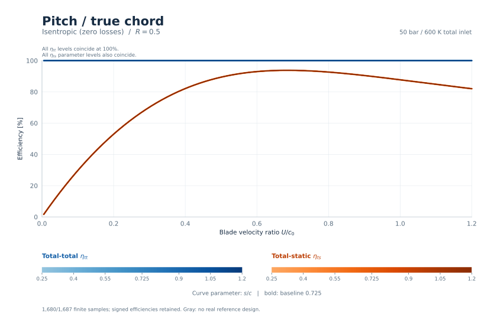

[Vector SVG](figures/speed_r05_pitch_chord.svg) | [Samples](data/isentropic.csv.gz)

**Consistent.** All row-loss components are exactly zero and total-total efficiency is exactly 100%. The parameter levels overlap because this parameter does not change the prescribed dimensionless triangles and no empirical loss correction is active. At $U/c_0$=0.6, total-static efficiency ranges from 92.98% to 92.98%. Retained finite samples include 490 negative-hub designs. Gaps use the same reference-design checks as the empirical studies.

## Pitch / true chord: Reaction at $U/c_0=0.6$

**Purpose.** Verify that spacing has no aerodynamic efficiency effect when the loss model is isentropic; retain the common geometry checks.

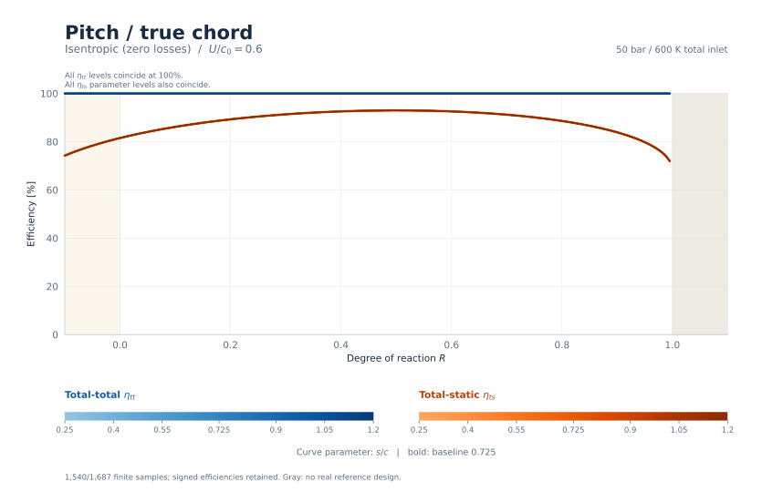

[Vector SVG](figures/reaction_pitch_chord.svg) | [Samples](data/isentropic.csv.gz)

**Consistent.** All row-loss components are exactly zero and total-total efficiency is exactly 100%. The parameter levels overlap because this parameter does not change the prescribed dimensionless triangles and no empirical loss correction is active. At $R$=0.5, total-static efficiency ranges from 92.98% to 92.98%. Retained finite samples include 77 negative-hub designs. Gaps use the same reference-design checks as the empirical studies.

## Blade aspect ratio: Blade velocity ratio at $R=0$

**Purpose.** Verify that blade aspect ratio affects sizing but cannot create secondary or clearance losses in the zero-loss model.

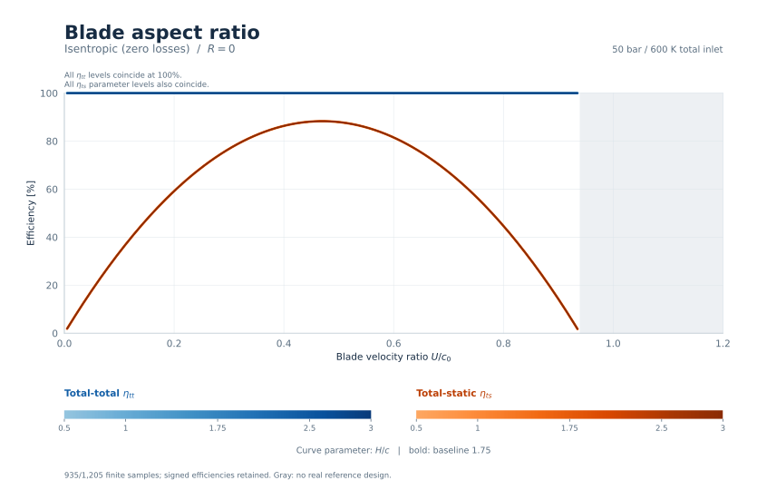

[Vector SVG](figures/speed_r0_aspect_ratio.svg) | [Samples](data/isentropic.csv.gz)

**Consistent.** All row-loss components are exactly zero and total-total efficiency is exactly 100%. The parameter levels overlap because this parameter does not change the prescribed dimensionless triangles and no empirical loss correction is active. At $U/c_0$=0.6, total-static efficiency ranges from 81.53% to 81.53%. Retained finite samples include 300 negative-hub designs. Gaps use the same reference-design checks as the empirical studies.

## Blade aspect ratio: Blade velocity ratio at $R=0.5$

**Purpose.** Verify that blade aspect ratio affects sizing but cannot create secondary or clearance losses in the zero-loss model.

[Vector SVG](figures/speed_r05_aspect_ratio.svg) | [Samples](data/isentropic.csv.gz)

**Consistent.** All row-loss components are exactly zero and total-total efficiency is exactly 100%. The parameter levels overlap because this parameter does not change the prescribed dimensionless triangles and no empirical loss correction is active. At $U/c_0$=0.6, total-static efficiency ranges from 92.98% to 92.98%. Retained finite samples include 350 negative-hub designs. Gaps use the same reference-design checks as the empirical studies.

## Blade aspect ratio: Reaction at $U/c_0=0.6$

**Purpose.** Verify that blade aspect ratio affects sizing but cannot create secondary or clearance losses in the zero-loss model.

[Vector SVG](figures/reaction_aspect_ratio.svg) | [Samples](data/isentropic.csv.gz)

**Consistent.** All row-loss components are exactly zero and total-total efficiency is exactly 100%. The parameter levels overlap because this parameter does not change the prescribed dimensionless triangles and no empirical loss correction is active. At $R$=0.5, total-static efficiency ranges from 92.98% to 92.98%. Retained finite samples include 55 negative-hub designs. Gaps use the same reference-design checks as the empirical studies.

## Trailing-edge thickness / opening: Blade velocity ratio at $R=0$

**Purpose.** Verify that trailing-edge thickness adds no loss in the isentropic model; retain the same reference-geometry checks as the empirical studies.

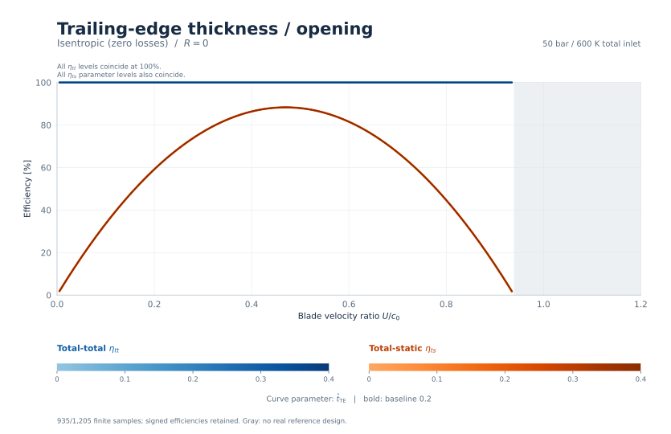

[Vector SVG](figures/speed_r0_trailing_ratio.svg) | [Samples](data/isentropic.csv.gz)

**Consistent.** All row-loss components are exactly zero and total-total efficiency is exactly 100%. The parameter levels overlap because this parameter does not change the prescribed dimensionless triangles and no empirical loss correction is active. At $U/c_0$=0.6, total-static efficiency ranges from 81.53% to 81.53%. Retained finite samples include 300 negative-hub designs. Gaps use the same reference-design checks as the empirical studies.

## Trailing-edge thickness / opening: Blade velocity ratio at $R=0.5$

**Purpose.** Verify that trailing-edge thickness adds no loss in the isentropic model; retain the same reference-geometry checks as the empirical studies.

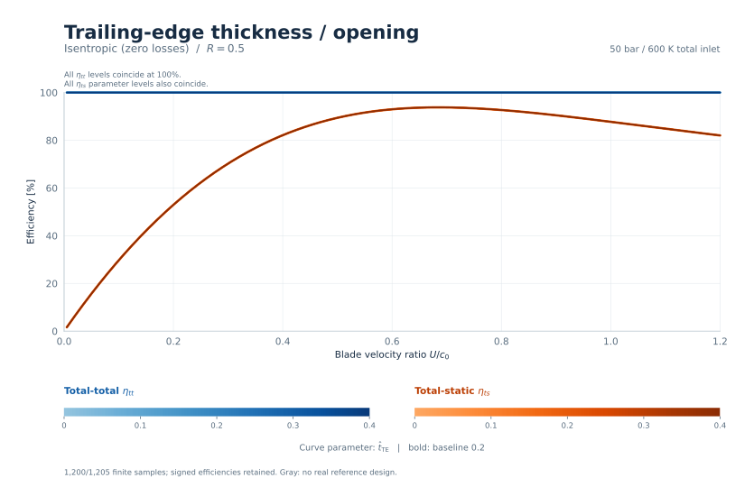

[Vector SVG](figures/speed_r05_trailing_ratio.svg) | [Samples](data/isentropic.csv.gz)

**Consistent.** All row-loss components are exactly zero and total-total efficiency is exactly 100%. The parameter levels overlap because this parameter does not change the prescribed dimensionless triangles and no empirical loss correction is active. At $U/c_0$=0.6, total-static efficiency ranges from 92.98% to 92.98%. Retained finite samples include 350 negative-hub designs. Gaps use the same reference-design checks as the empirical studies.

## Trailing-edge thickness / opening: Reaction at $U/c_0=0.6$

**Purpose.** Verify that trailing-edge thickness adds no loss in the isentropic model; retain the same reference-geometry checks as the empirical studies.

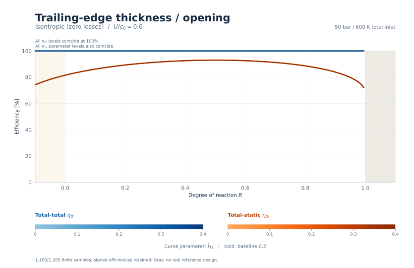

[Vector SVG](figures/reaction_trailing_ratio.svg) | [Samples](data/isentropic.csv.gz)

**Consistent.** All row-loss components are exactly zero and total-total efficiency is exactly 100%. The parameter levels overlap because this parameter does not change the prescribed dimensionless triangles and no empirical loss correction is active. At $R$=0.5, total-static efficiency ranges from 92.98% to 92.98%. Retained finite samples include 55 negative-hub designs. Gaps use the same reference-design checks as the empirical studies.

## Specific speed: Blade velocity ratio at $R=0$

**Purpose.** Check that rotational speed and annulus sizing leave the prescribed dimensionless triangles and zero-loss efficiencies unchanged.

[Vector SVG](figures/speed_r0_specific_speed.svg) | [Samples](data/isentropic.csv.gz)

**Consistent.** All row-loss components are exactly zero and total-total efficiency is exactly 100%. The parameter levels overlap because this parameter does not change the prescribed dimensionless triangles and no empirical loss correction is active. At $U/c_0$=0.6, total-static efficiency ranges from 81.53% to 81.53%. Retained finite samples include 293 negative-hub designs. Gaps use the same reference-design checks as the empirical studies.

## Specific speed: Blade velocity ratio at $R=0.5$

**Purpose.** Check that rotational speed and annulus sizing leave the prescribed dimensionless triangles and zero-loss efficiencies unchanged.

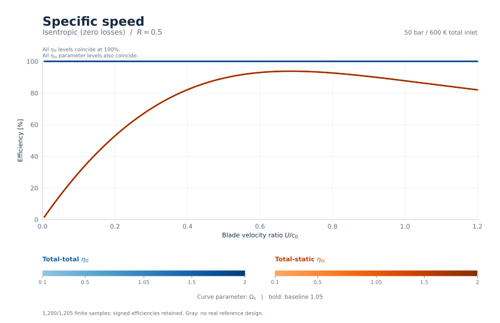

[Vector SVG](figures/speed_r05_specific_speed.svg) | [Samples](data/isentropic.csv.gz)

**Consistent.** All row-loss components are exactly zero and total-total efficiency is exactly 100%. The parameter levels overlap because this parameter does not change the prescribed dimensionless triangles and no empirical loss correction is active. At $U/c_0$=0.6, total-static efficiency ranges from 92.98% to 92.98%. Retained finite samples include 343 negative-hub designs. Gaps use the same reference-design checks as the empirical studies.

## Specific speed: Reaction at $U/c_0=0.6$

**Purpose.** Check that rotational speed and annulus sizing leave the prescribed dimensionless triangles and zero-loss efficiencies unchanged.

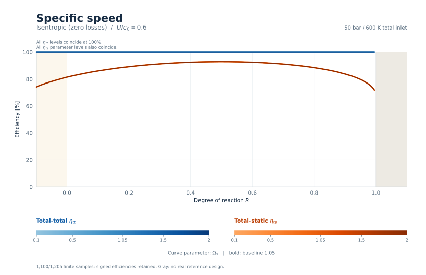

[Vector SVG](figures/reaction_specific_speed.svg) | [Samples](data/isentropic.csv.gz)

**Consistent.** All row-loss components are exactly zero and total-total efficiency is exactly 100%. The parameter levels overlap because this parameter does not change the prescribed dimensionless triangles and no empirical loss correction is active. At $R$=0.5, total-static efficiency ranges from 92.98% to 92.98%. Retained finite samples include 222 negative-hub designs. Gaps use the same reference-design checks as the empirical studies.

## Mass flow: Blade velocity ratio at $R=0$

**Purpose.** Check size invariance: mass flow changes dimensions and Reynolds numbers, but neither row losses nor normalized velocity triangles.

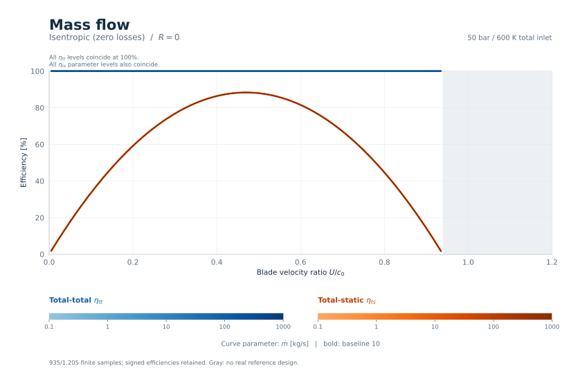

[Vector SVG](figures/speed_r0_mass_flow.svg) | [Samples](data/isentropic.csv.gz)

**Consistent.** All row-loss components are exactly zero and total-total efficiency is exactly 100%. The parameter levels overlap because this parameter does not change the prescribed dimensionless triangles and no empirical loss correction is active. At $U/c_0$=0.6, total-static efficiency ranges from 81.53% to 81.53%. Retained finite samples include 300 negative-hub designs. Gaps use the same reference-design checks as the empirical studies.

## Mass flow: Blade velocity ratio at $R=0.5$

**Purpose.** Check size invariance: mass flow changes dimensions and Reynolds numbers, but neither row losses nor normalized velocity triangles.

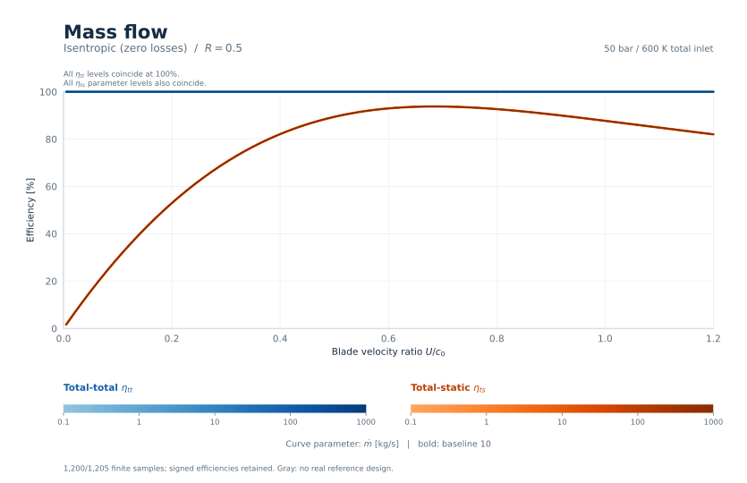

[Vector SVG](figures/speed_r05_mass_flow.svg) | [Samples](data/isentropic.csv.gz)

**Consistent.** All row-loss components are exactly zero and total-total efficiency is exactly 100%. The parameter levels overlap because this parameter does not change the prescribed dimensionless triangles and no empirical loss correction is active. At $U/c_0$=0.6, total-static efficiency ranges from 92.98% to 92.98%. Retained finite samples include 350 negative-hub designs. Gaps use the same reference-design checks as the empirical studies.

## Mass flow: Reaction at $U/c_0=0.6$

**Purpose.** Check size invariance: mass flow changes dimensions and Reynolds numbers, but neither row losses nor normalized velocity triangles.

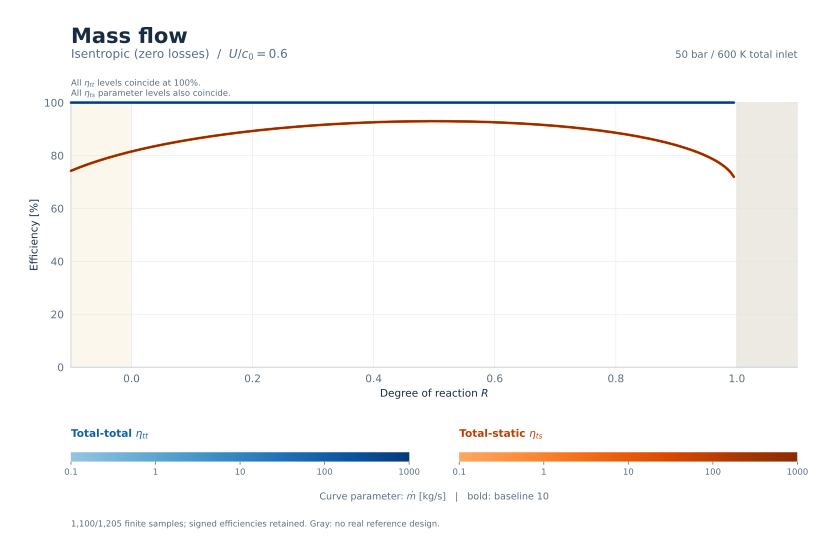

[Vector SVG](figures/reaction_mass_flow.svg) | [Samples](data/isentropic.csv.gz)

**Consistent.** All row-loss components are exactly zero and total-total efficiency is exactly 100%. The parameter levels overlap because this parameter does not change the prescribed dimensionless triangles and no empirical loss correction is active. At $R$=0.5, total-static efficiency ranges from 92.98% to 92.98%. Retained finite samples include 55 negative-hub designs. Gaps use the same reference-design checks as the empirical studies.

## Isentropic expansion Mach number: Blade velocity ratio at $R=0$

**Purpose.** Vary dimensional expansion and thermodynamic states while checking that the prescribed normalized exit kinetic energy, and hence ideal efficiency, is unchanged.

[Vector SVG](figures/speed_r0_isentropic_mach.svg) | [Samples](data/isentropic.csv.gz)

**Consistent.** All row-loss components are exactly zero and total-total efficiency is exactly 100%. The parameter levels overlap because this parameter does not change the prescribed dimensionless triangles and no empirical loss correction is active. At $U/c_0$=0.6, total-static efficiency ranges from 81.53% to 81.53%. Retained finite samples include 360 negative-hub designs. Gaps use the same reference-design checks as the empirical studies.

## Isentropic expansion Mach number: Blade velocity ratio at $R=0.5$

**Purpose.** Vary dimensional expansion and thermodynamic states while checking that the prescribed normalized exit kinetic energy, and hence ideal efficiency, is unchanged.

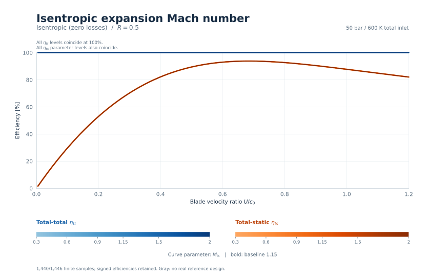

[Vector SVG](figures/speed_r05_isentropic_mach.svg) | [Samples](data/isentropic.csv.gz)

**Consistent.** All row-loss components are exactly zero and total-total efficiency is exactly 100%. The parameter levels overlap because this parameter does not change the prescribed dimensionless triangles and no empirical loss correction is active. At $U/c_0$=0.6, total-static efficiency ranges from 92.98% to 92.98%. Retained finite samples include 420 negative-hub designs. Gaps use the same reference-design checks as the empirical studies.

## Isentropic expansion Mach number: Reaction at $U/c_0=0.6$

**Purpose.** Vary dimensional expansion and thermodynamic states while checking that the prescribed normalized exit kinetic energy, and hence ideal efficiency, is unchanged.

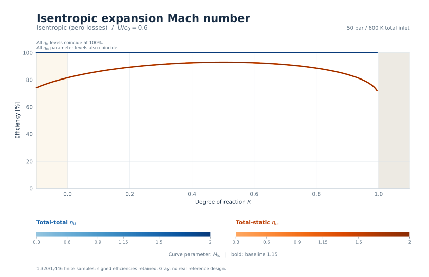

[Vector SVG](figures/reaction_isentropic_mach.svg) | [Samples](data/isentropic.csv.gz)

**Consistent.** All row-loss components are exactly zero and total-total efficiency is exactly 100%. The parameter levels overlap because this parameter does not change the prescribed dimensionless triangles and no empirical loss correction is active. At $R$=0.5, total-static efficiency ranges from 92.98% to 92.98%. Retained finite samples include 66 negative-hub designs. Gaps use the same reference-design checks as the empirical studies.
