# Kacker–Okapuu: single-stage air turbine

[Common method](../readme.md)

Blue and orange encode total-total and total-static efficiency. Curves use the common baseline except for the indicated parameter. Negative hub radii and negative efficiencies remain in the numerical data. Efficiency axes show 0-100%. No hub-ratio boundary markers are drawn.

## Stator exit angle: Blade velocity ratio at $R=0$

**Purpose.** Test stator turning, rotor inlet triangles and unrecovered exit kinetic energy while redesigning the metal angles at every point.

[Vector SVG](figures/speed_r0_stator_exit_angle.svg) | [Samples](data/kacker_okapuu.csv.gz)

**Consistent.** At $U/c_0$=0.6, increasing $\alpha_2$ from 50 to 80 changes total-total efficiency from 58.9% to 80.2% and total-static efficiency from 23.5% to 74.0%. The total-total and total-static responses reflect turning, row losses and leaving kinetic energy. Retained samples include 405 negative-hub designs and 226 negative total-total efficiencies; the latter fall below the displayed axes.

## Stator exit angle: Blade velocity ratio at $R=0.5$

**Purpose.** Test stator turning, rotor inlet triangles and unrecovered exit kinetic energy while redesigning the metal angles at every point.

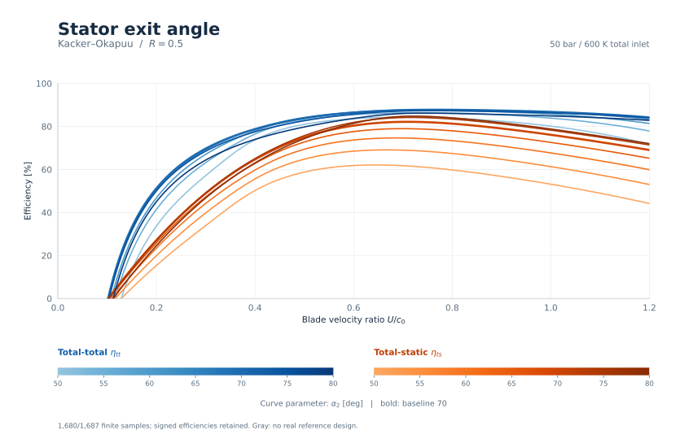

[Vector SVG](figures/speed_r05_stator_exit_angle.svg) | [Samples](data/kacker_okapuu.csv.gz)

**Consistent.** At $U/c_0$=0.6, increasing $\alpha_2$ from 50 to 80 changes total-total efficiency from 83.6% to 83.7% and total-static efficiency from 61.8% to 81.4%. The total-total and total-static responses reflect turning, row losses and leaving kinetic energy. Retained samples include 471 negative-hub designs and 151 negative total-total efficiencies; the latter fall below the displayed axes.

## Stator exit angle: Reaction at $U/c_0=0.6$

**Purpose.** Test stator turning, rotor inlet triangles and unrecovered exit kinetic energy while redesigning the metal angles at every point.

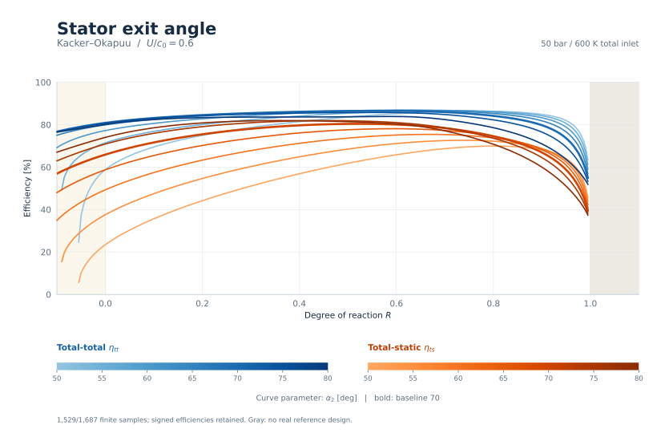

[Vector SVG](figures/reaction_stator_exit_angle.svg) | [Samples](data/kacker_okapuu.csv.gz)

**Consistent.** At $R$=0.5, increasing $\alpha_2$ from 50 to 80 changes total-total efficiency from 83.6% to 83.7% and total-static efficiency from 61.8% to 81.4%. The total-total and total-static responses reflect turning, row losses and leaving kinetic energy. Above R=0.9, there are 0 adjacent total-total efficiency rises larger than 0.1 percentage point. Shared clearance and KO secondary loading preserve physical turning, with only the mean secant continued from sec80 toward sec87.5. Retained samples include 94 negative-hub designs and 0 negative total-total efficiencies; the latter fall below the displayed axes.

## Pitch / true chord: Blade velocity ratio at $R=0$

**Purpose.** Search for the spacing optimum, including continuation outside the Ainley-Mathieson chart, with the same pitch/true-chord ratio in both rows.

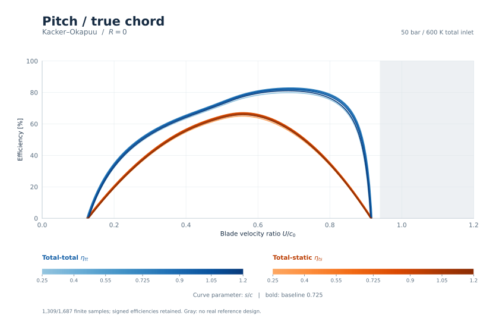

[Vector SVG](figures/speed_r0_pitch_chord.svg) | [Samples](data/kacker_okapuu.csv.gz)

**Consistent.** At $U/c_0$=0.6, increasing $s/c$ from 0.25 to 1.2 changes total-total efficiency from 78.3% to 79.4% and total-static efficiency from 63.8% to 64.7%. The best sampled spacing here is 0.725; an interior minimum in loss is plausible. Retained samples include 420 negative-hub designs and 203 negative total-total efficiencies; the latter fall below the displayed axes.

## Pitch / true chord: Blade velocity ratio at $R=0.5$

**Purpose.** Search for the spacing optimum, including continuation outside the Ainley-Mathieson chart, with the same pitch/true-chord ratio in both rows.

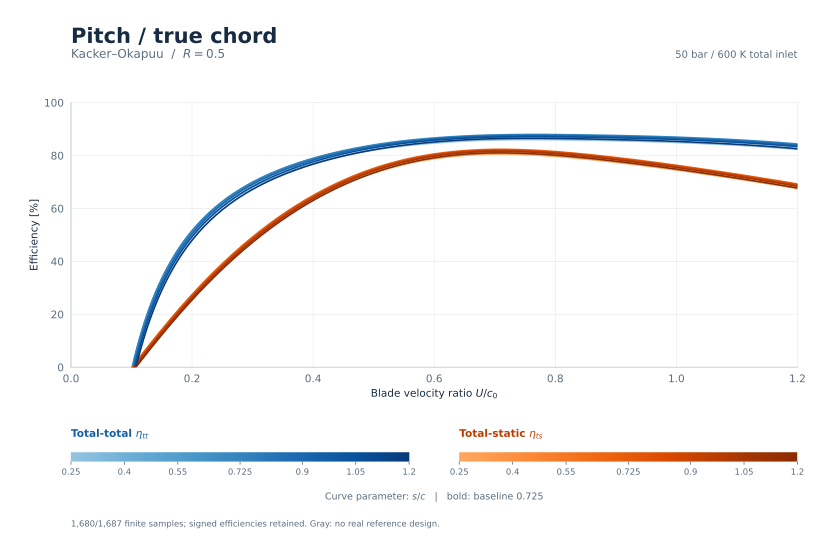

[Vector SVG](figures/speed_r05_pitch_chord.svg) | [Samples](data/kacker_okapuu.csv.gz)

**Consistent.** At $U/c_0$=0.6, increasing $s/c$ from 0.25 to 1.2 changes total-total efficiency from 84.7% to 85.1% and total-static efficiency from 78.8% to 79.1%. The best sampled spacing here is 0.725; an interior minimum in loss is plausible. Retained samples include 490 negative-hub designs and 142 negative total-total efficiencies; the latter fall below the displayed axes.

## Pitch / true chord: Reaction at $U/c_0=0.6$

**Purpose.** Search for the spacing optimum, including continuation outside the Ainley-Mathieson chart, with the same pitch/true-chord ratio in both rows.

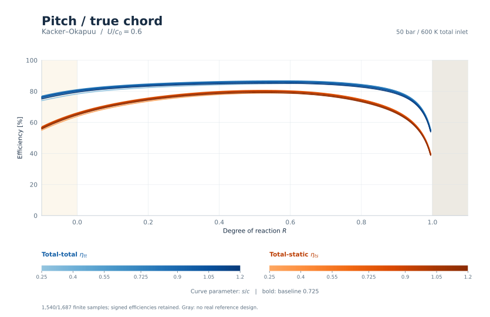

[Vector SVG](figures/reaction_pitch_chord.svg) | [Samples](data/kacker_okapuu.csv.gz)

**Consistent.** At $R$=0.5, increasing $s/c$ from 0.25 to 1.2 changes total-total efficiency from 84.7% to 85.1% and total-static efficiency from 78.8% to 79.1%. The best sampled spacing here is 0.725; an interior minimum in loss is plausible. Above R=0.9, there are 0 adjacent total-total efficiency rises larger than 0.1 percentage point. Shared clearance and KO secondary loading preserve physical turning, with only the mean secant continued from sec80 toward sec87.5. Retained samples include 77 negative-hub designs and 0 negative total-total efficiencies; the latter fall below the displayed axes.

## Blade aspect ratio: Blade velocity ratio at $R=0$

**Purpose.** Test secondary/clearance benefits against the Reynolds change caused by changing true chord, with equal height/chord ratios in both rows.

[Vector SVG](figures/speed_r0_aspect_ratio.svg) | [Samples](data/kacker_okapuu.csv.gz)

**Review.** At $U/c_0$=0.6, increasing $H/c$ from 0.5 to 3 changes total-total efficiency from 78.4% to 82.4% and total-static efficiency from 64.0% to 67.2%. Changing aspect ratio changes secondary/clearance losses and chord Reynolds number together; their balance should be assessed through the saved row components. Retained samples include 300 negative-hub designs and 142 negative total-total efficiencies; the latter fall below the displayed axes.

## Blade aspect ratio: Blade velocity ratio at $R=0.5$

**Purpose.** Test secondary/clearance benefits against the Reynolds change caused by changing true chord, with equal height/chord ratios in both rows.

[Vector SVG](figures/speed_r05_aspect_ratio.svg) | [Samples](data/kacker_okapuu.csv.gz)

**Review.** At $U/c_0$=0.6, increasing $H/c$ from 0.5 to 3 changes total-total efficiency from 83.5% to 87.7% and total-static efficiency from 77.7% to 81.6%. Changing aspect ratio changes secondary/clearance losses and chord Reynolds number together; their balance should be assessed through the saved row components. Retained samples include 350 negative-hub designs and 99 negative total-total efficiencies; the latter fall below the displayed axes.

## Blade aspect ratio: Reaction at $U/c_0=0.6$

**Purpose.** Test secondary/clearance benefits against the Reynolds change caused by changing true chord, with equal height/chord ratios in both rows.

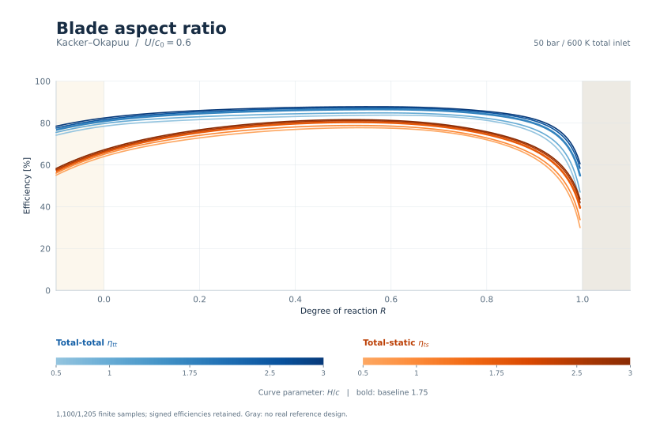

[Vector SVG](figures/reaction_aspect_ratio.svg) | [Samples](data/kacker_okapuu.csv.gz)

**Review.** At $R$=0.5, increasing $H/c$ from 0.5 to 3 changes total-total efficiency from 83.5% to 87.7% and total-static efficiency from 77.7% to 81.6%. Changing aspect ratio changes secondary/clearance losses and chord Reynolds number together; their balance should be assessed through the saved row components. Above R=0.9, there are 0 adjacent total-total efficiency rises larger than 0.1 percentage point. Shared clearance and KO secondary loading preserve physical turning, with only the mean secant continued from sec80 toward sec87.5. Retained samples include 55 negative-hub designs and 0 negative total-total efficiencies; the latter fall below the displayed axes.

## Trailing-edge thickness / opening: Blade velocity ratio at $R=0$

**Purpose.** Check that thickening both trailing edges increases loss and reduces efficiency, including the zero-thickness endpoint.

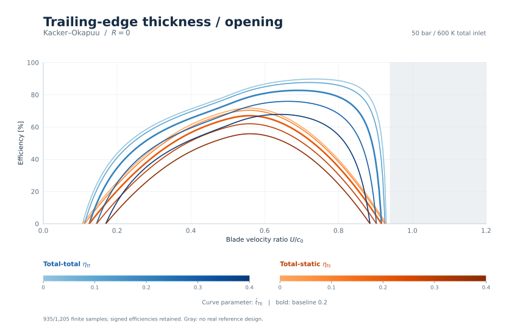

[Vector SVG](figures/speed_r0_trailing_ratio.svg) | [Samples](data/kacker_okapuu.csv.gz)

**Consistent.** At $U/c_0$=0.6, increasing $\hat{t}_{\mathrm{TE}}$ from 0 to 0.4 changes total-total efficiency from 86.6% to 67.3% and total-static efficiency from 70.6% to 54.8%. There are 0 reversals of the expected thickness trend across adjacent finite parameter levels. Retained samples include 300 negative-hub designs and 153 negative total-total efficiencies; the latter fall below the displayed axes.

## Trailing-edge thickness / opening: Blade velocity ratio at $R=0.5$

**Purpose.** Check that thickening both trailing edges increases loss and reduces efficiency, including the zero-thickness endpoint.

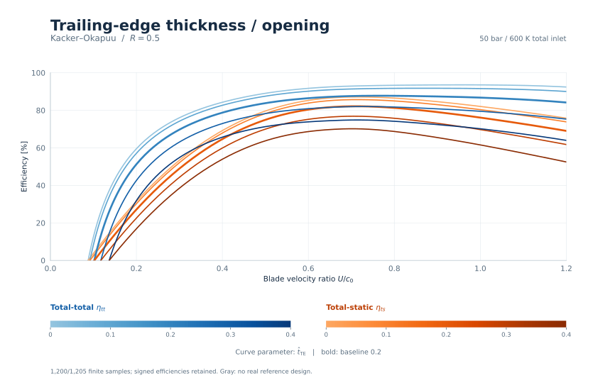

[Vector SVG](figures/speed_r05_trailing_ratio.svg) | [Samples](data/kacker_okapuu.csv.gz)

**Consistent.** At $U/c_0$=0.6, increasing $\hat{t}_{\mathrm{TE}}$ from 0 to 0.4 changes total-total efficiency from 91.7% to 73.8% and total-static efficiency from 85.3% to 68.7%. There are 0 reversals of the expected thickness trend across adjacent finite parameter levels. Retained samples include 350 negative-hub designs and 105 negative total-total efficiencies; the latter fall below the displayed axes.

## Trailing-edge thickness / opening: Reaction at $U/c_0=0.6$

**Purpose.** Check that thickening both trailing edges increases loss and reduces efficiency, including the zero-thickness endpoint.

[Vector SVG](figures/reaction_trailing_ratio.svg) | [Samples](data/kacker_okapuu.csv.gz)

**Consistent.** At $R$=0.5, increasing $\hat{t}_{\mathrm{TE}}$ from 0 to 0.4 changes total-total efficiency from 91.7% to 73.8% and total-static efficiency from 85.3% to 68.7%. There are 0 reversals of the expected thickness trend across adjacent finite parameter levels. Above R=0.9, there are 0 adjacent total-total efficiency rises larger than 0.1 percentage point. Shared clearance and KO secondary loading preserve physical turning, with only the mean secant continued from sec80 toward sec87.5. Retained samples include 55 negative-hub designs and 0 negative total-total efficiencies; the latter fall below the displayed axes.

## Specific speed: Blade velocity ratio at $R=0$

**Purpose.** Expose the coupled response of rotational speed, annulus shape, chord, Reynolds correction and hub shock at fixed mass flow.

[Vector SVG](figures/speed_r0_specific_speed.svg) | [Samples](data/kacker_okapuu.csv.gz)

**Review.** At $U/c_0$=0.6, increasing $\Omega_s$ from 0.1 to 2 changes total-total efficiency from 82.9% to 76.8% and total-static efficiency from 67.6% to 62.6%. This is a coupled sizing effect. The positive hub/tip coordinate and finite Reynolds-correction limit bound the empirical inputs while signed hub radii remain in the meanline geometry. Retained samples include 293 negative-hub designs and 141 negative total-total efficiencies; the latter fall below the displayed axes.

## Specific speed: Blade velocity ratio at $R=0.5$

**Purpose.** Expose the coupled response of rotational speed, annulus shape, chord, Reynolds correction and hub shock at fixed mass flow.

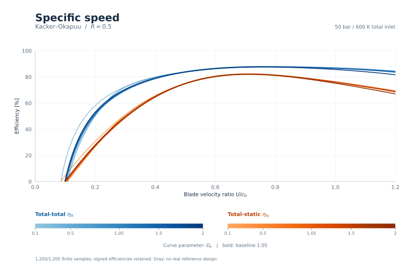

[Vector SVG](figures/speed_r05_specific_speed.svg) | [Samples](data/kacker_okapuu.csv.gz)

**Review.** At $U/c_0$=0.6, increasing $\Omega_s$ from 0.1 to 2 changes total-total efficiency from 86.1% to 86.4% and total-static efficiency from 80.1% to 80.3%. This is a coupled sizing effect. The positive hub/tip coordinate and finite Reynolds-correction limit bound the empirical inputs while signed hub radii remain in the meanline geometry. Retained samples include 343 negative-hub designs and 97 negative total-total efficiencies; the latter fall below the displayed axes.

## Specific speed: Reaction at $U/c_0=0.6$

**Purpose.** Expose the coupled response of rotational speed, annulus shape, chord, Reynolds correction and hub shock at fixed mass flow.

[Vector SVG](figures/reaction_specific_speed.svg) | [Samples](data/kacker_okapuu.csv.gz)

**Review.** At $R$=0.5, increasing $\Omega_s$ from 0.1 to 2 changes total-total efficiency from 86.1% to 86.4% and total-static efficiency from 80.1% to 80.3%. This is a coupled sizing effect. The positive hub/tip coordinate and finite Reynolds-correction limit bound the empirical inputs while signed hub radii remain in the meanline geometry. Above R=0.9, there are 0 adjacent total-total efficiency rises larger than 0.1 percentage point. Shared clearance and KO secondary loading preserve physical turning, with only the mean secant continued from sec80 toward sec87.5. Retained samples include 222 negative-hub designs and 0 negative total-total efficiencies; the latter fall below the displayed axes.

## Mass flow: Blade velocity ratio at $R=0$

**Purpose.** Isolate size at fixed dimensionless design. Larger chord Reynolds numbers approach the finite Reynolds-correction limit.

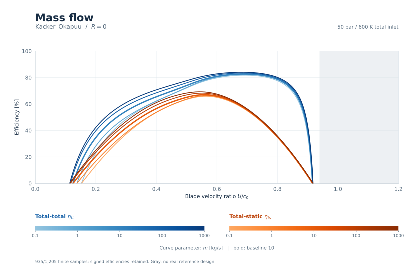

[Vector SVG](figures/speed_r0_mass_flow.svg) | [Samples](data/kacker_okapuu.csv.gz)

**Consistent.** At $U/c_0$=0.6, increasing $\dot{m}$ from 0.1 to 1000 changes total-total efficiency from 79.7% to 82.8% and total-static efficiency from 65.0% to 67.5%. Chord Reynolds number grows with the square root of mass flow; its correction approaches 0.457305, giving a finite size benefit. Retained samples include 300 negative-hub designs and 146 negative total-total efficiencies; the latter fall below the displayed axes.

## Mass flow: Blade velocity ratio at $R=0.5$

**Purpose.** Isolate size at fixed dimensionless design. Larger chord Reynolds numbers approach the finite Reynolds-correction limit.

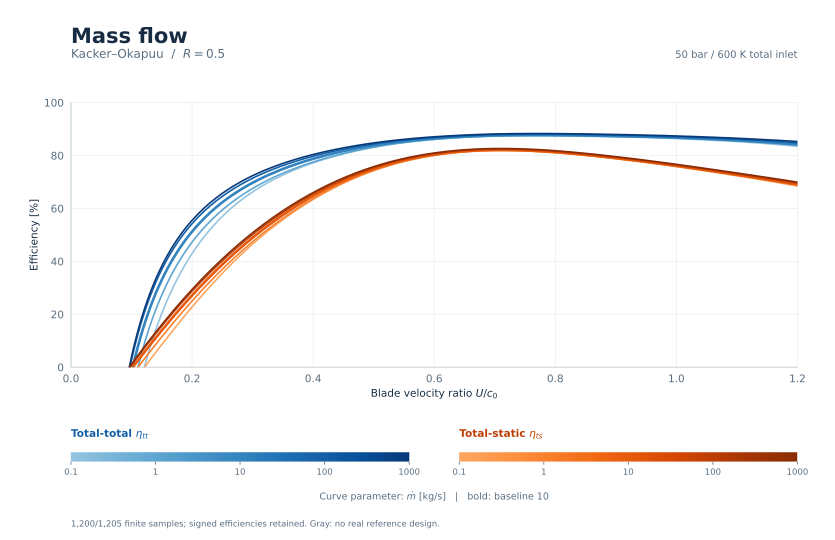

[Vector SVG](figures/speed_r05_mass_flow.svg) | [Samples](data/kacker_okapuu.csv.gz)

**Consistent.** At $U/c_0$=0.6, increasing $\dot{m}$ from 0.1 to 1000 changes total-total efficiency from 86.1% to 87.1% and total-static efficiency from 80.1% to 81.0%. Chord Reynolds number grows with the square root of mass flow; its correction approaches 0.457305, giving a finite size benefit. Retained samples include 350 negative-hub designs and 104 negative total-total efficiencies; the latter fall below the displayed axes.

## Mass flow: Reaction at $U/c_0=0.6$

**Purpose.** Isolate size at fixed dimensionless design. Larger chord Reynolds numbers approach the finite Reynolds-correction limit.

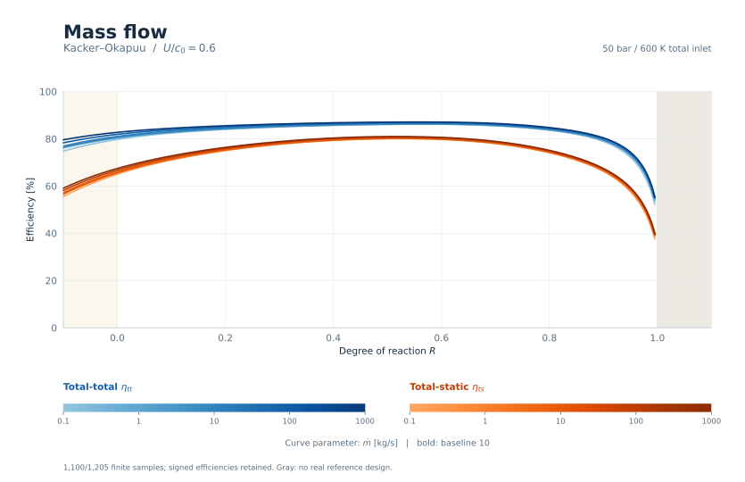

[Vector SVG](figures/reaction_mass_flow.svg) | [Samples](data/kacker_okapuu.csv.gz)

**Consistent.** At $R$=0.5, increasing $\dot{m}$ from 0.1 to 1000 changes total-total efficiency from 86.1% to 87.1% and total-static efficiency from 80.1% to 81.0%. Chord Reynolds number grows with the square root of mass flow; its correction approaches 0.457305, giving a finite size benefit. Above R=0.9, there are 0 adjacent total-total efficiency rises larger than 0.1 percentage point. Shared clearance and KO secondary loading preserve physical turning, with only the mean secant continued from sec80 toward sec87.5. Retained samples include 55 negative-hub designs and 0 negative total-total efficiencies; the latter fall below the displayed axes.

## Isentropic expansion Mach number: Blade velocity ratio at $R=0$

**Purpose.** Change expansion pressure ratio and inspect the combined compressibility, shock and Reynolds response.

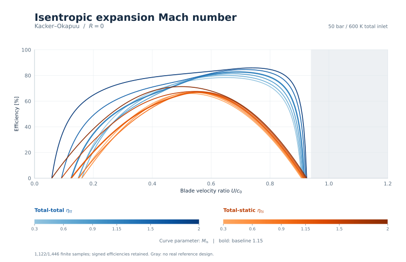

[Vector SVG](figures/speed_r0_isentropic_mach.svg) | [Samples](data/kacker_okapuu.csv.gz)

**Review.** At $U/c_0$=0.6, increasing $M_{\mathrm{is}}$ from 0.3 to 2 changes total-total efficiency from 77.9% to 83.3% and total-static efficiency from 63.5% to 67.9%. Supersonic trends require review: the extra outlet-supersonic profile multiplier is disabled, so a numerical optimum does not establish aerodynamic validity. Retained samples include 360 negative-hub designs and 171 negative total-total efficiencies; the latter fall below the displayed axes.

## Isentropic expansion Mach number: Blade velocity ratio at $R=0.5$

**Purpose.** Change expansion pressure ratio and inspect the combined compressibility, shock and Reynolds response.

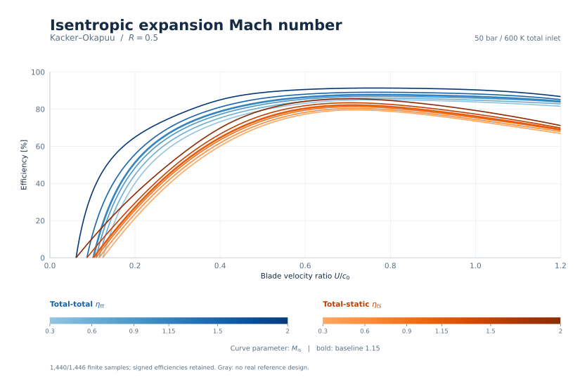

[Vector SVG](figures/speed_r05_isentropic_mach.svg) | [Samples](data/kacker_okapuu.csv.gz)

**Review.** At $U/c_0$=0.6, increasing $M_{\mathrm{is}}$ from 0.3 to 2 changes total-total efficiency from 83.1% to 90.6% and total-static efficiency from 77.3% to 84.2%. Supersonic trends require review: the extra outlet-supersonic profile multiplier is disabled, so a numerical optimum does not establish aerodynamic validity. Retained samples include 420 negative-hub designs and 117 negative total-total efficiencies; the latter fall below the displayed axes.

## Isentropic expansion Mach number: Reaction at $U/c_0=0.6$

**Purpose.** Change expansion pressure ratio and inspect the combined compressibility, shock and Reynolds response.

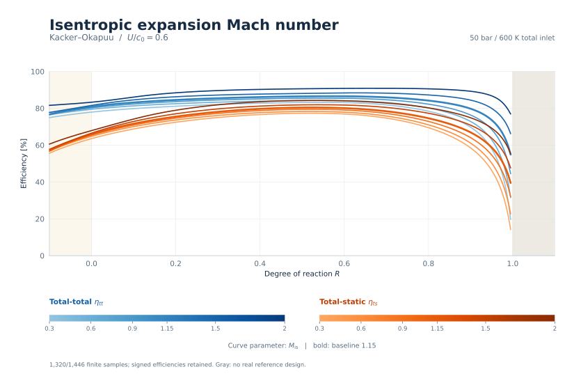

[Vector SVG](figures/reaction_isentropic_mach.svg) | [Samples](data/kacker_okapuu.csv.gz)

**Review.** At $R$=0.5, increasing $M_{\mathrm{is}}$ from 0.3 to 2 changes total-total efficiency from 83.1% to 90.6% and total-static efficiency from 77.3% to 84.2%. Supersonic trends require review: the extra outlet-supersonic profile multiplier is disabled, so a numerical optimum does not establish aerodynamic validity. Above R=0.9, there are 0 adjacent total-total efficiency rises larger than 0.1 percentage point. Shared clearance and KO secondary loading preserve physical turning, with only the mean secant continued from sec80 toward sec87.5. Retained samples include 66 negative-hub designs and 0 negative total-total efficiencies; the latter fall below the displayed axes.
