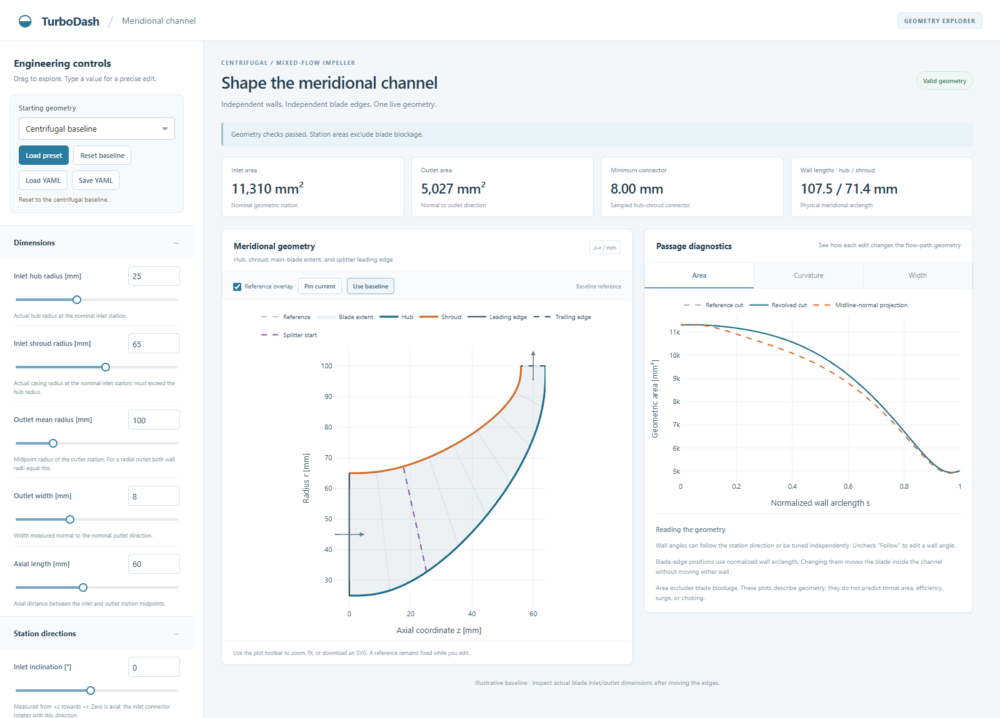
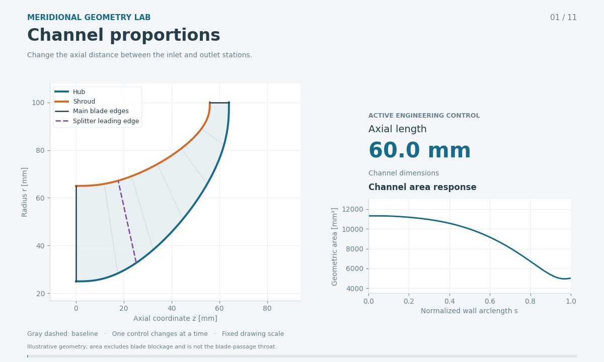
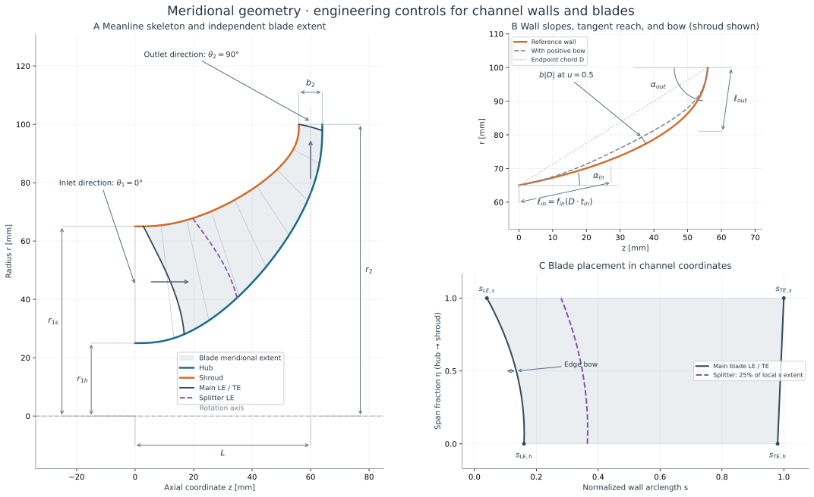

# Centrifugal and mixed-flow meridional geometry

Use **meanline dimensions + independent wall engineering controls + separate blade
extent**. Internal spline control points are calculated from those inputs. This
keeps the baseline small and reusable, while allowing wall turning, blade sweep,
cutback, and splitter placement to be refined independently.

The design follows the engineering-template approach of Casey (1983) and Casey &
Robinson (2021). Romei et al. (2023) informs the sensitivity variables and splitter
example. The numerical defaults are illustrative geometry, not a reproduction of
any paper's compressor or an aerodynamic optimum.

## Interactive explorer

From the TurboDash repository root, run:

```powershell
.venv/Scripts/python.exe development/mixed_flow/launch.py
```

This opens the local Dash app at `http://127.0.0.1:8065`. It follows the existing
blade-parameterization app's layout, with independently scrolling controls and
plots. Use `--port 8066` if needed, `--no-browser` to serve without opening a
window, or `--preset inclined` to start with an inclined inlet and mixed-flow
outlet. You can also start from a saved configuration:

```powershell
.venv/Scripts/python.exe development/mixed_flow/launch.py --config development/mixed_flow/examples/inclined_swept.yaml
```

- Drag any slider for live updates or type a precise number. Length controls
  display millimetres; saved YAML uses metres.
- Open **Hub wall** or **Shroud wall** to tune each curve independently.
  Uncheck **Follow inlet/outlet direction** to override a wall's tangent angle.
- Open **Blade edges** and **Splitter** to adjust blade extent independently of
  the channel walls.
- Use **Pin current** to compare subsequent edits against a fixed reference;
  **Use baseline** restores the initial reference. Toggle its overlay as needed.
- Switch the diagnostic tabs between area, curvature, and connector width.
  The Plotly toolbar provides zoom, fit, and SVG downloads.
- **Load YAML** and **Save YAML** use the same configuration schema as the
  standalone scripts. Presets include the baseline, inclined/swept example, and
  illustrative Romei-inspired slopes.

Invalid edits remain visible and display a reason. The last valid plots remain
on screen with an explicit stale-view notice; current metrics are cleared and
save/pin actions are disabled until the geometry is valid again. A rejected YAML
upload leaves the previous inputs and geometry intact.



## Animated parameter tour

[Open the 44-second looping GIF](media/meridional_parameter_tour.gif). It changes
11 engineering parameters one at a time: axial length, outlet width, inlet and
outlet inclination, hub inlet slope, shroud tangent reach and bow, main-blade
sweep, edge bow and cutback, and splitter start. Each chapter returns smoothly
to the baseline. Fixed plot limits, a baseline overlay, live parameter values,
and an area plot make the changes directly comparable.



The animation uses the same geometry kernel as the app, through a standalone
Matplotlib script. Regenerate it with:

```powershell
.venv/Scripts/python.exe development/mixed_flow/scripts/animate_channel.py
```

The delivered GIF is 960 × 576 at 12 frames/s, about 2.7 MB. Its
[YAML manifest](media/meridional_parameter_tour.yaml) records the baseline,
parameter targets, and chapter timings. Options include `--seconds`, `--fps`,
`--gif-width`, and `--output-dir`. Optional MP4 output is available with
`--format mp4 --ffmpeg PATH_TO_FFMPEG`; it requires an FFmpeg build with `libx264`.
The GIF needs only the project's existing Matplotlib/Pillow environment.

## Engineering diagram



## Read and run

- [Parameterization, equations, defaults, and limitations](parametrization.md)
- [Romei findings and recommended design checks](romei_design_guidelines.md)
- [Six geometry sensitivity examples](assets/parameter_sweep.svg)
- [Baseline channel, area, and curvature plots](assets/channel_overview.svg)

Run from the repository root using the project's Python environment:

```powershell
python development/mixed_flow/scripts/demo_channel.py --show
python development/mixed_flow/scripts/parameter_sweep.py --show
python development/mixed_flow/scripts/demo_channel.py --config development/mixed_flow/examples/inclined_swept.yaml --output-dir development/mixed_flow/output/inclined --show
python -m pytest development/mixed_flow/tests -q
```

On this Windows checkout, `.venv/Scripts/python.exe` can replace `python`. Omitting
`--show` saves images without opening a window. Scripts also work when invoked by
absolute path from another directory. Dependencies are NumPy, SciPy,
Matplotlib and PyYAML; the explorer additionally uses the project's Dash and
Plotly installation. Pytest runs the tests.

`demo_channel.py` writes SVG/PNG plots, the resolved engineering inputs in `parameters.yaml`,
wall coordinates and diagnostics in `channel.csv`, actual blade/splitter edge
coordinates in `blade_edges.csv`, and `summary.yaml`. The scripts use **metres**
for inputs and CSV coordinates; plotted lengths are millimetres. The core accepts
any one consistent length unit. Default generated results go to ignored `output/`.

Edit [baseline.yaml](examples/baseline.yaml) or the
[inclined and swept example](examples/inclined_swept.yaml) and rerun with
`--config`. Empty `hub`, `shroud`, and `blade` objects use their defaults. Both
inlet and outlet station inclinations are available; the initial baseline uses
an axial inlet and radial outlet. Configuration files use YAML (`.yaml` or `.yml`);
unknown parameter names and malformed parameter groups are reported explicitly.

```python
from development.mixed_flow.meridional import (
    MeanlineDimensions, WallShape, MeridionalChannel, BladeEdges, BladeMeridional,
)

# Replace these illustrative dimensions with your meanline results [m].
dimensions = MeanlineDimensions(
    inlet_hub_radius=0.025, inlet_shroud_radius=0.065,
    outlet_radius=0.100, outlet_width=0.008,
    inlet_flow_angle_deg=0.0, outlet_flow_angle_deg=90.0,
)  # axial_length defaults to 0.60 * outlet_radius

channel = MeridionalChannel(
    dimensions,
    hub=WallShape(),
    shroud=WallShape(inlet_angle_deg=10, outlet_angle_deg=86, bow=0.01),
)
blade = BladeMeridional(channel, BladeEdges(leading_hub=0.12, leading_shroud=0.02))
splitter = blade.splitter(start_fraction=0.25)

point_zr = blade.point(xi=0.5, eta=0.5)
diagnostics = channel.diagnostics()
hub_bspline = channel.hub.as_bspline()  # exact SciPy B-spline, parameter u in [0, 1]
```

## Files and scope

| Location | Purpose |
| --- | --- |
| [meridional/parameters.py](meridional/parameters.py) | Meanline station dimensions, inclination, area adapters, wall engineering inputs |
| [meridional/curves.py](meridional/curves.py) | Smooth walls, arclength mapping, derivatives, curvature, exact B-spline export |
| [meridional/channel.py](meridional/channel.py) | Hub/shroud interpolation, geometry screening, areas |
| [meridional/blades.py](meridional/blades.py) | Separate main-blade and splitter meridional extents |
| [explorer/app.py](explorer/app.py) | Local Dash interface and callback handling |
| [explorer/model.py](explorer/model.py) | YAML persistence, engineering controls, and display-unit conversions |
| [explorer/plots.py](explorer/plots.py) | Interactive geometry and diagnostic figures |
| [scripts](scripts) | Runnable examples and reproducible vector diagram |
| [scripts/animate_channel.py](scripts/animate_channel.py) | Reproducible GIF and optional MP4 parameter tour |
| [tests/test_meridional.py](tests/test_meridional.py) | Geometry invariants and invalid-input checks |
| [tests/test_explorer.py](tests/test_explorer.py) | YAML, units, presets, inheritance, and app contracts |

This is a development geometry package. It is not connected to the production
Turbodash app or its turbine solver. It defines a **2-D meridional blade extent**;
circumferential camber, metal angle, thickness, blade count, lean/rake, and tip
clearance remain separate future layers. Area diagnostics exclude blockage and
do not determine the blade throat, choking, surge, or efficiency.

Regenerate the tracked documentation figures with:

```powershell
python development/mixed_flow/scripts/make_parameter_diagram.py
python development/mixed_flow/scripts/demo_channel.py --output-dir development/mixed_flow/output/baseline
Copy-Item development/mixed_flow/output/baseline/channel_overview.svg development/mixed_flow/assets/channel_overview.svg
python development/mixed_flow/scripts/parameter_sweep.py --output-dir development/mixed_flow/assets
```

`assets/channel_overview.svg` is the baseline SVG copied from
`output/baseline/channel_overview.svg`; the associated CSV/YAML remain in
`output/baseline/`. PNG previews in `assets/` are ignored.
