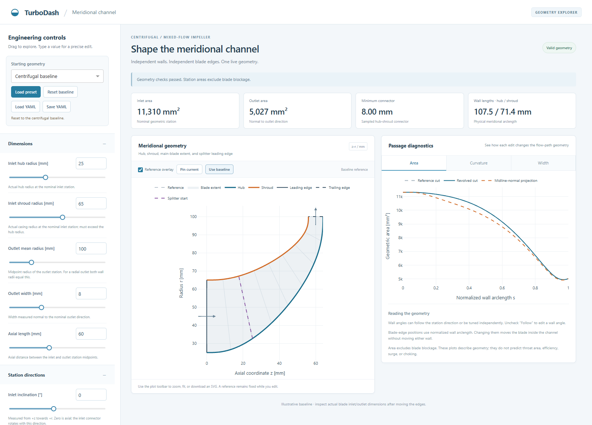
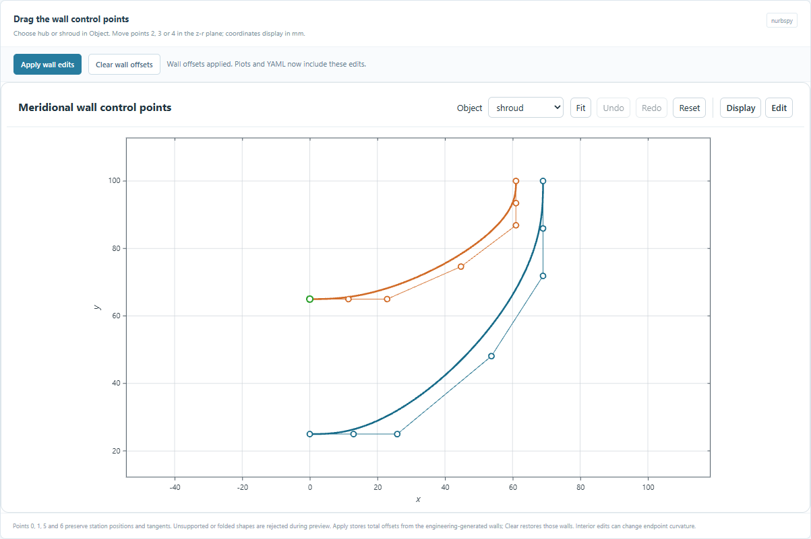
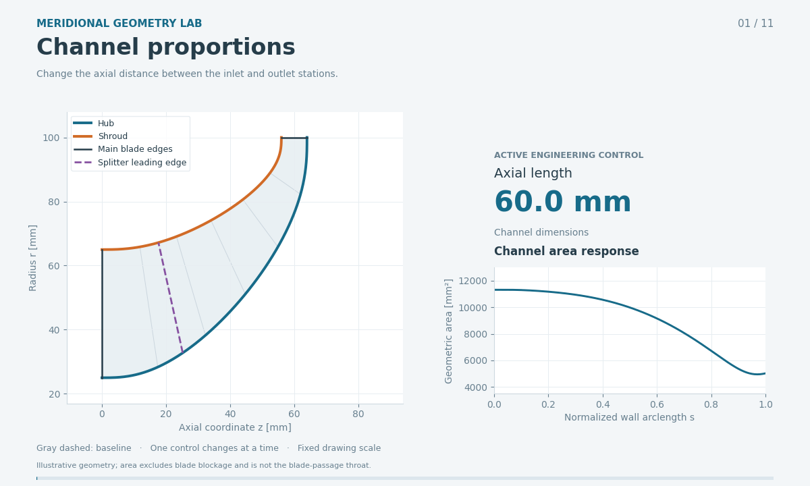
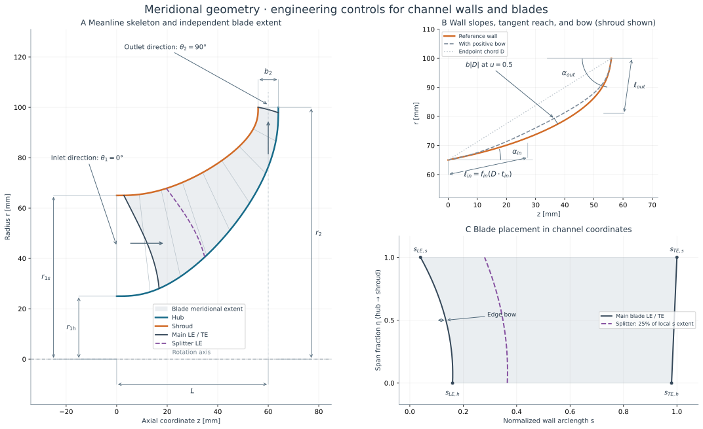

# Centrifugal and mixed-flow meridional geometry

Use **meanline dimensions + independent wall engineering controls + separate blade
extent**. Internal spline control points are calculated from those inputs;
optional baseline-relative offsets provide direct wall refinement. This keeps
the baseline small and reusable, while allowing wall turning, blade sweep,
cutback, and splitter placement to be refined independently.

The design follows the engineering-template approach of Casey (1983) and Casey &
Robinson (2021). Romei et al. (2023) informs the sensitivity variables and splitter
example. The numerical defaults are illustrative geometry, not a reproduction of
any paper's compressor or an aerodynamic optimum.

## Interactive explorer

From the TurboDash repository root, run:

```powershell
.venv/Scripts/python.exe development/mixed_flow/launch.py
```

This opens the local Dash app at `http://127.0.0.1:8065`. It follows the existing
blade-parameterization app's layout, with independently scrolling controls and
plots. Use `--port 8066` if needed, `--no-browser` to serve without opening a
window, or `--preset inclined` to start with an inclined inlet and mixed-flow
outlet. You can also start from a saved configuration:

```powershell
.venv/Scripts/python.exe development/mixed_flow/launch.py --config development/mixed_flow/examples/inclined_swept.yaml
```

- Drag any slider for live updates or type a precise number. Length controls
  display millimetres; saved YAML uses metres.
- Open **Hub wall** or **Shroud wall** to tune each curve independently.
  Uncheck **Follow inlet/outlet direction** to override a wall's tangent angle.
- In **Drag the wall control points**, select `hub` or `shroud` with **Object**,
  then drag points 2, 3, or 4. **Apply wall edits** updates the passage plots,
  metrics, and saved YAML; **Clear wall offsets** restores the engineering walls.
- Open **Blade edges** and **Splitter** to adjust blade extent independently of
  the channel walls.
- Use **Pin current** to compare subsequent edits against a fixed reference;
  **Use baseline** restores the initial reference. Toggle its overlay as needed.
- Switch the diagnostic tabs between area, curvature, and connector width.
  The Plotly toolbar provides zoom, fit, and SVG downloads.
- **Load YAML** and **Save YAML** use the same configuration schema as the
  standalone scripts. Presets include the baseline, inclined/swept example, and
  illustrative Romei-inspired slopes.

Invalid engineering-control edits remain visible and display a reason. The last valid plots remain
on screen with an explicit stale-view notice; current metrics are cleared and
save/pin actions are disabled until the geometry is valid again. A rejected YAML
upload leaves the previous inputs and geometry intact.



### Direct wall refinement with local nurbspy

The new wall plot uses nurbspy's native multi-object `Figure` and
`GeometryEditor`: its graphics, control-point picking and dragging, numeric
editing, selection, and undo/redo are shared package functionality. The prototype
adapter supplies passage constraints and configuration conversion; it does not
copy the viewer or NURBS evaluation code. The horizontal editor coordinate is
axial $z$ and the vertical coordinate is radius $r$, displayed in millimetres.

Points 0, 1, 5, and 6 stay fixed to preserve station positions and endpoint
tangent vectors. Only points 2, 3, and 4 of each exact degree-six wall spline may
move. These interior edits can change endpoint curvature; the baseline's zero
endpoint curvature is not imposed on the refined walls. Invalid passage edits
are rejected during evaluation. The wall plot shows the current editing preview;
the other plots, metrics, and YAML use the applied configuration until you choose
**Apply wall edits**. Changing engineering inputs refreshes the editor and
discards unapplied preview changes.

Saved offsets are sparse, dimensionless **total** displacements from the walls
generated by the current engineering inputs. For each wall,
$Q_i=Q_i^0+c_w[\delta z_i,\delta r_i]$, where $c_w$ is that unedited wall's
straight endpoint chord. A single accepted configuration reconstructs the whole
geometry at once; drag history is never required or saved. Engineering-control
changes preserve the normalized applied offsets and regenerate their baseline.
Selecting a preset replaces the configuration and clears these offsets.
**Clear wall offsets** removes them explicitly.

An optional top-level YAML group records the refinement:

```yaml
control_point_displacements:
  hub:
    3: [0.008, -0.004]  # [delta z, delta r] / original hub endpoint chord
  shroud:
    3: [-0.006, 0.004]  # scale uses the original shroud endpoint chord
```

Omitted entries mean zero. Load the complete
[control-point example](examples/control_point_edits.yaml) with `--config` or
**Load YAML**. See [the parameterization](parametrization.md#baseline-relative-control-point-refinement)
for the reconstruction and constraints. Radius, wall-speed, and Jacobian checks
use sampled validation; they do not prove global intersection freedom or
aerodynamic suitability.

The explorer automatically prefers the sibling `../nurbspy/src` checkout so it
can use unpublished development changes. For another location, set
`TURBODASH_NURBSPY` to the nurbspy repository root or its `src` directory before
launching, for example:

```powershell
$env:TURBODASH_NURBSPY = 'C:/Users/roagr/git_projects/nurbspy'
.venv/Scripts/python.exe development/mixed_flow/launch.py --config development/mixed_flow/examples/control_point_edits.yaml
```

Use the local nurbspy numerical dependencies in the app's Python environment.
The adapter targets its current development viewer API; the prototype does not
add an unreleased package requirement to TurboDash's production dependencies.



With the explorer running, repeat the real browser verification (requires
Playwright and Microsoft Edge, or `--channel chrome`):

```powershell
.venv/Scripts/python.exe development/mixed_flow/scripts/verify_editor_browser.py --url http://127.0.0.1:8065
```

It checks pointer dragging, Apply, unchanged reapplication, clearing offsets,
YAML save/reload, engineering-input regeneration, switching walls, and numeric
editing. Generated YAML and a screenshot go to ignored `output/browser_check/`.

## Animated parameter tour

[Open the 44-second looping GIF](media/meridional_parameter_tour.gif). It changes
11 engineering parameters one at a time: axial length, outlet width, inlet and
outlet inclination, hub inlet slope, shroud tangent reach and bow, main-blade
sweep, edge bow and cutback, and splitter start. Each chapter returns smoothly
to the baseline. Fixed plot limits, a baseline overlay, live parameter values,
and an area plot make the changes directly comparable.



The animation uses the same geometry kernel as the app, through a standalone
Matplotlib script. Regenerate it with:

```powershell
.venv/Scripts/python.exe development/mixed_flow/scripts/animate_channel.py
```

The delivered GIF is 960 × 576 at 12 frames/s, about 2.7 MB. Its
[YAML manifest](media/meridional_parameter_tour.yaml) records the baseline,
parameter targets, and chapter timings. Options include `--seconds`, `--fps`,
`--gif-width`, and `--output-dir`. Optional MP4 output is available with
`--format mp4 --ffmpeg PATH_TO_FFMPEG`; it requires an FFmpeg build with `libx264`.
The GIF needs only the project's existing Matplotlib/Pillow environment.

## Engineering diagram



## Read and run

- [Parameterization, equations, defaults, and limitations](parametrization.md)
- [Romei findings and recommended design checks](romei_design_guidelines.md)
- [Six geometry sensitivity examples](assets/parameter_sweep.svg)
- [Baseline channel, area, and curvature plots](assets/channel_overview.svg)

Run from the repository root using the project's Python environment:

```powershell
python development/mixed_flow/scripts/demo_channel.py --show
python development/mixed_flow/scripts/parameter_sweep.py --show
python development/mixed_flow/scripts/demo_channel.py --config development/mixed_flow/examples/inclined_swept.yaml --output-dir development/mixed_flow/output/inclined --show
python -m pytest development/mixed_flow/tests -q
```

On this Windows checkout, `.venv/Scripts/python.exe` can replace `python`. Omitting
`--show` saves images without opening a window. Scripts also work when invoked by
absolute path from another directory. Dependencies are NumPy, SciPy,
Matplotlib and PyYAML; the explorer additionally uses the project's Dash and
Plotly installation and the local nurbspy checkout described above. Pytest runs
the tests.

`demo_channel.py` writes SVG/PNG plots, the resolved engineering inputs in `parameters.yaml`,
wall coordinates and diagnostics in `channel.csv`, actual blade/splitter edge
coordinates in `blade_edges.csv`, and `summary.yaml`. The scripts use **metres**
for inputs and CSV coordinates; plotted lengths are millimetres. The core accepts
any one consistent length unit. Default generated results go to ignored `output/`.

Edit [baseline.yaml](examples/baseline.yaml) or the
[inclined and swept example](examples/inclined_swept.yaml) and rerun with
`--config`. Empty `hub`, `shroud`, and `blade` objects use their defaults. Both
inlet and outlet station inclinations are available; the initial baseline uses
an axial inlet and radial outlet. Configuration files use YAML (`.yaml` or `.yml`);
unknown parameter names and malformed parameter groups are reported explicitly.

```python
from development.mixed_flow.meridional import (
    MeanlineDimensions, WallShape, MeridionalChannel, BladeEdges, BladeMeridional,
)

# Replace these illustrative dimensions with your meanline results [m].
dimensions = MeanlineDimensions(
    inlet_hub_radius=0.025, inlet_shroud_radius=0.065,
    outlet_radius=0.100, outlet_width=0.008,
    inlet_flow_angle_deg=0.0, outlet_flow_angle_deg=90.0,
)  # axial_length defaults to 0.60 * outlet_radius

channel = MeridionalChannel(
    dimensions,
    hub=WallShape(),
    shroud=WallShape(inlet_angle_deg=10, outlet_angle_deg=86, bow=0.01),
)
blade = BladeMeridional(channel, BladeEdges(leading_hub=0.12, leading_shroud=0.02))
splitter = blade.splitter(start_fraction=0.25)

point_zr = blade.point(xi=0.5, eta=0.5)
diagnostics = channel.diagnostics()
hub_bspline = channel.hub.as_bspline()  # exact SciPy B-spline, parameter u in [0, 1]
```

## Files and scope

| Location | Purpose |
| --- | --- |
| [meridional/parameters.py](meridional/parameters.py) | Meanline station dimensions, inclination, area adapters, wall engineering inputs |
| [meridional/curves.py](meridional/curves.py) | Smooth walls, arclength mapping, derivatives, curvature, exact B-spline export |
| [meridional/channel.py](meridional/channel.py) | Hub/shroud interpolation, geometry screening, areas |
| [meridional/editing.py](meridional/editing.py) | Sparse total wall offsets, protected points, and baseline scaling |
| [meridional/blades.py](meridional/blades.py) | Separate main-blade and splitter meridional extents |
| [explorer/app.py](explorer/app.py) | Local Dash interface and callback handling |
| [explorer/model.py](explorer/model.py) | YAML persistence, engineering controls, and display-unit conversions |
| [explorer/plots.py](explorer/plots.py) | Interactive geometry and diagnostic figures |
| [explorer/control_point_editor.py](explorer/control_point_editor.py) | Local nurbspy adapter, passage validation, and Apply handling |
| [scripts](scripts) | Runnable examples and reproducible vector diagram |
| [scripts/animate_channel.py](scripts/animate_channel.py) | Reproducible GIF and optional MP4 parameter tour |
| [tests/test_meridional.py](tests/test_meridional.py) | Geometry invariants and invalid-input checks |
| [tests/test_explorer.py](tests/test_explorer.py) | YAML, units, presets, inheritance, and app contracts |

This is a development geometry package. It is not connected to the production
Turbodash app or its turbine solver. It defines a **2-D meridional blade extent**;
circumferential camber, metal angle, thickness, blade count, lean/rake, and tip
clearance remain separate future layers. Area diagnostics exclude blockage and
do not determine the blade throat, choking, surge, or efficiency.

Regenerate the tracked documentation figures with:

```powershell
python development/mixed_flow/scripts/make_parameter_diagram.py
python development/mixed_flow/scripts/demo_channel.py --output-dir development/mixed_flow/output/baseline
Copy-Item development/mixed_flow/output/baseline/channel_overview.svg development/mixed_flow/assets/channel_overview.svg
python development/mixed_flow/scripts/parameter_sweep.py --output-dir development/mixed_flow/assets
```

`assets/channel_overview.svg` is the baseline SVG copied from
`output/baseline/channel_overview.svg`; the associated CSV/YAML remain in
`output/baseline/`. PNG previews in `assets/` are ignored.
