# Overall stage: side-by-side model sensitivities

[Common method and baseline](readme.md) | [Isentropic (zero losses)](sensitivity_isentropic/readme.md) | [Kacker–Okapuu](sensitivity_kacker_okapuu/readme.md) | [Benner](sensitivity_benner/readme.md)

Each section uses the same saved designs and parameter levels, with **isentropic, Kacker–Okapuu and Benner** in fixed left-to-right columns. Air enters at 50 bar and 600 K. All plots retain the same axes, 0–100% efficiency limits, blue total-total and orange total-static colormaps, and solid lines. Negative hub ratios remain in the data without boundary markers.

SVG figures are embedded in each column; click an image to inspect it at full size. The three models stay in one table row; a narrow preview may need horizontal scrolling. Isentropic total-total efficiency is exactly 100%; its total-static efficiency includes unrecovered exit kinetic energy. Coincident ideal curves are expected for parameters that only affect sizing or loss corrections.

## Stator exit angle: Blade velocity ratio at $R=0$

**Purpose.** Test stator turning, rotor inlet triangles and unrecovered exit kinetic energy while redesigning the metal angles at every point.

<table width="100%" style="width:100%;table-layout:fixed">
<thead><tr>
<th width="33.333%" align="center">Isentropic (zero losses)</th>
<th width="33.333%" align="center">Kacker–Okapuu</th>
<th width="33.333%" align="center">Benner</th>
</tr></thead>
<tbody><tr>
<td width="33.333%" align="center" valign="top">
<a href="sensitivity_isentropic/figures/speed_r0_stator_exit_angle.svg" title="Isentropic (zero losses): Stator exit angle, speed_r0">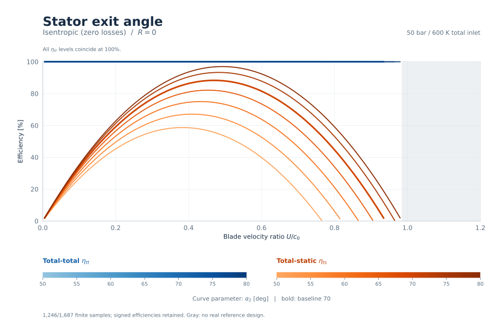</a>
</td>
<td width="33.333%" align="center" valign="top">
<a href="sensitivity_kacker_okapuu/figures/speed_r0_stator_exit_angle.svg" title="Kacker–Okapuu: Stator exit angle, speed_r0">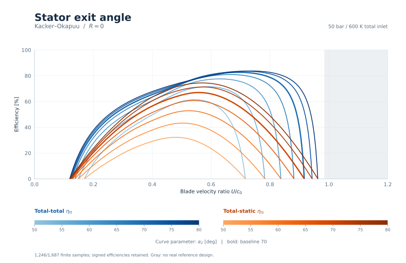</a>
</td>
<td width="33.333%" align="center" valign="top">
<a href="sensitivity_benner/figures/speed_r0_stator_exit_angle.svg" title="Benner: Stator exit angle, speed_r0">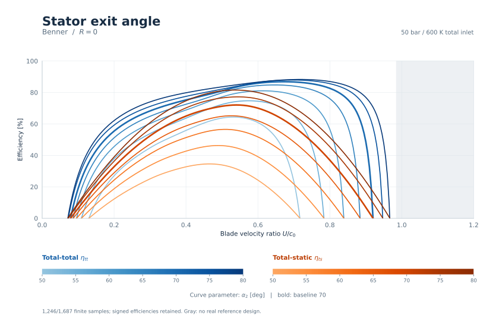</a>
</td>
</tr></tbody>
</table>

**Comparison.** At $U/c_0$=0.6, Benner minus KO spans 1.99 to 6.41 percentage points in total-total efficiency and 0.79 to 5.92 points in total-static efficiency across the common finite parameter levels.

## Stator exit angle: Blade velocity ratio at $R=0.5$

**Purpose.** Test stator turning, rotor inlet triangles and unrecovered exit kinetic energy while redesigning the metal angles at every point.

<table width="100%" style="width:100%;table-layout:fixed">
<thead><tr>
<th width="33.333%" align="center">Isentropic (zero losses)</th>
<th width="33.333%" align="center">Kacker–Okapuu</th>
<th width="33.333%" align="center">Benner</th>
</tr></thead>
<tbody><tr>
<td width="33.333%" align="center" valign="top">
<a href="sensitivity_isentropic/figures/speed_r05_stator_exit_angle.svg" title="Isentropic (zero losses): Stator exit angle, speed_r05">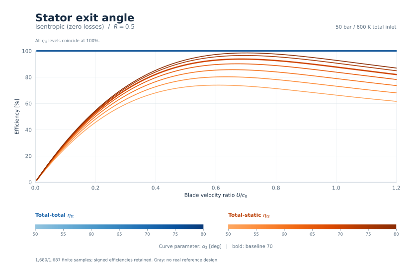</a>
</td>
<td width="33.333%" align="center" valign="top">
<a href="sensitivity_kacker_okapuu/figures/speed_r05_stator_exit_angle.svg" title="Kacker–Okapuu: Stator exit angle, speed_r05">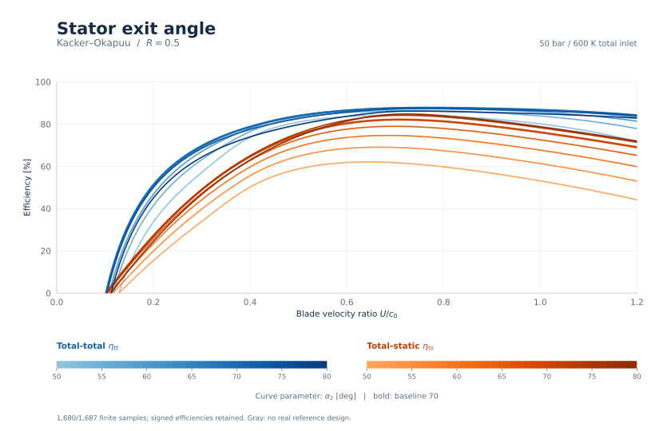</a>
</td>
<td width="33.333%" align="center" valign="top">
<a href="sensitivity_benner/figures/speed_r05_stator_exit_angle.svg" title="Benner: Stator exit angle, speed_r05">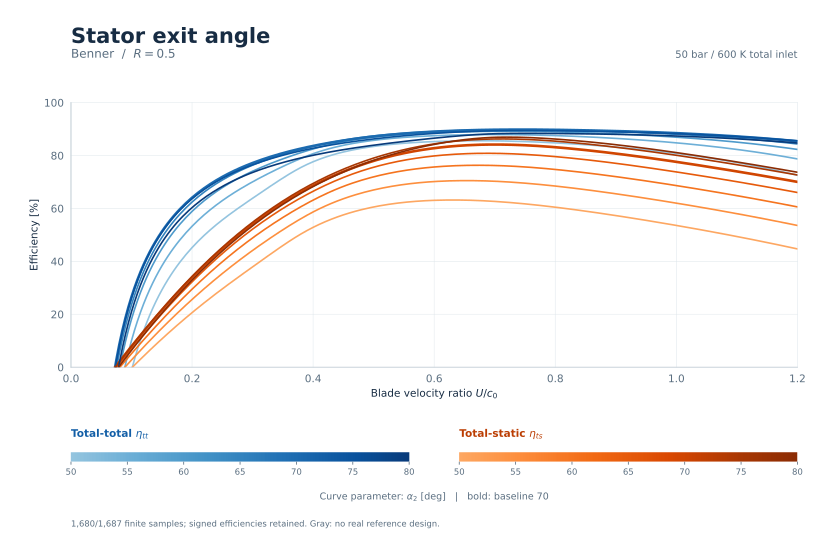</a>
</td>
</tr></tbody>
</table>

**Comparison.** At $U/c_0$=0.6, Benner minus KO spans 1.67 to 2.84 percentage points in total-total efficiency and 1.24 to 2.76 points in total-static efficiency across the common finite parameter levels.

## Stator exit angle: Reaction at $U/c_0=0.6$

**Purpose.** Test stator turning, rotor inlet triangles and unrecovered exit kinetic energy while redesigning the metal angles at every point.

<table width="100%" style="width:100%;table-layout:fixed">
<thead><tr>
<th width="33.333%" align="center">Isentropic (zero losses)</th>
<th width="33.333%" align="center">Kacker–Okapuu</th>
<th width="33.333%" align="center">Benner</th>
</tr></thead>
<tbody><tr>
<td width="33.333%" align="center" valign="top">
<a href="sensitivity_isentropic/figures/reaction_stator_exit_angle.svg" title="Isentropic (zero losses): Stator exit angle, reaction">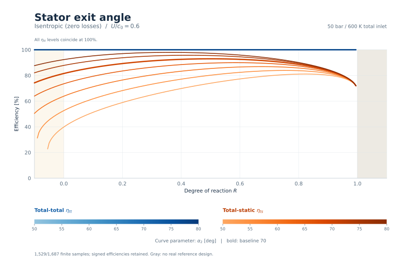</a>
</td>
<td width="33.333%" align="center" valign="top">
<a href="sensitivity_kacker_okapuu/figures/reaction_stator_exit_angle.svg" title="Kacker–Okapuu: Stator exit angle, reaction"></a>
</td>
<td width="33.333%" align="center" valign="top">
<a href="sensitivity_benner/figures/reaction_stator_exit_angle.svg" title="Benner: Stator exit angle, reaction">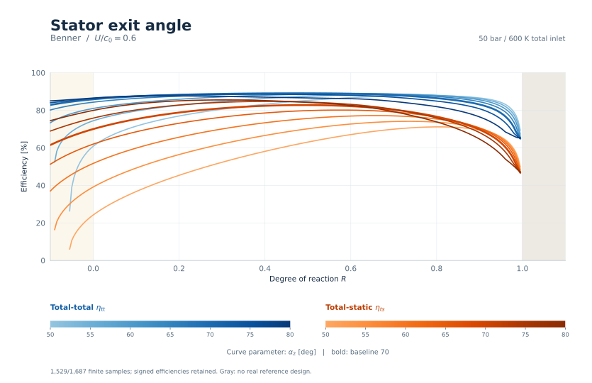</a>
</td>
</tr></tbody>
</table>

**Comparison.** At $R$=0.5, Benner minus KO spans 1.67 to 2.84 percentage points in total-total efficiency and 1.24 to 2.76 points in total-static efficiency across the common finite parameter levels.

## Pitch / true chord: Blade velocity ratio at $R=0$

**Purpose.** Search for the spacing optimum, including continuation outside the Ainley-Mathieson chart, with the same pitch/true-chord ratio in both rows.

<table width="100%" style="width:100%;table-layout:fixed">
<thead><tr>
<th width="33.333%" align="center">Isentropic (zero losses)</th>
<th width="33.333%" align="center">Kacker–Okapuu</th>
<th width="33.333%" align="center">Benner</th>
</tr></thead>
<tbody><tr>
<td width="33.333%" align="center" valign="top">
<a href="sensitivity_isentropic/figures/speed_r0_pitch_chord.svg" title="Isentropic (zero losses): Pitch / true chord, speed_r0"></a>
</td>
<td width="33.333%" align="center" valign="top">
<a href="sensitivity_kacker_okapuu/figures/speed_r0_pitch_chord.svg" title="Kacker–Okapuu: Pitch / true chord, speed_r0">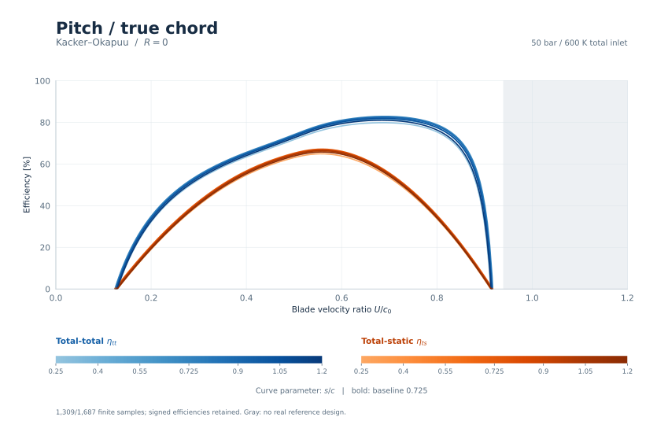</a>
</td>
<td width="33.333%" align="center" valign="top">
<a href="sensitivity_benner/figures/speed_r0_pitch_chord.svg" title="Benner: Pitch / true chord, speed_r0">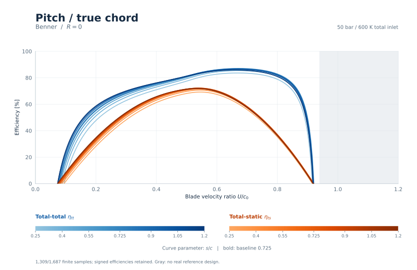</a>
</td>
</tr></tbody>
</table>

**Comparison.** At $U/c_0$=0.6, Benner minus KO spans 4.41 to 5.79 percentage points in total-total efficiency and 3.60 to 4.72 points in total-static efficiency across the common finite parameter levels.

## Pitch / true chord: Blade velocity ratio at $R=0.5$

**Purpose.** Search for the spacing optimum, including continuation outside the Ainley-Mathieson chart, with the same pitch/true-chord ratio in both rows.

<table width="100%" style="width:100%;table-layout:fixed">
<thead><tr>
<th width="33.333%" align="center">Isentropic (zero losses)</th>
<th width="33.333%" align="center">Kacker–Okapuu</th>
<th width="33.333%" align="center">Benner</th>
</tr></thead>
<tbody><tr>
<td width="33.333%" align="center" valign="top">
<a href="sensitivity_isentropic/figures/speed_r05_pitch_chord.svg" title="Isentropic (zero losses): Pitch / true chord, speed_r05">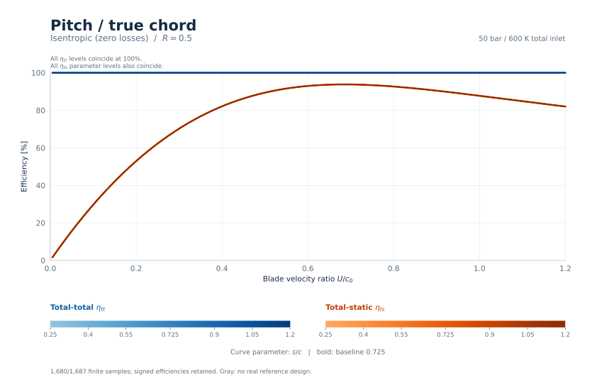</a>
</td>
<td width="33.333%" align="center" valign="top">
<a href="sensitivity_kacker_okapuu/figures/speed_r05_pitch_chord.svg" title="Kacker–Okapuu: Pitch / true chord, speed_r05">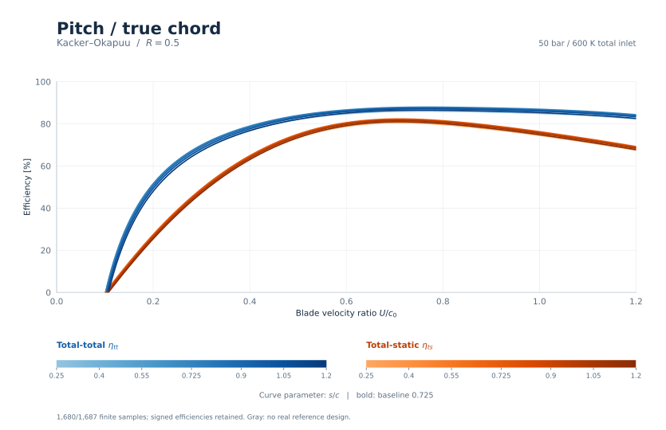</a>
</td>
<td width="33.333%" align="center" valign="top">
<a href="sensitivity_benner/figures/speed_r05_pitch_chord.svg" title="Benner: Pitch / true chord, speed_r05">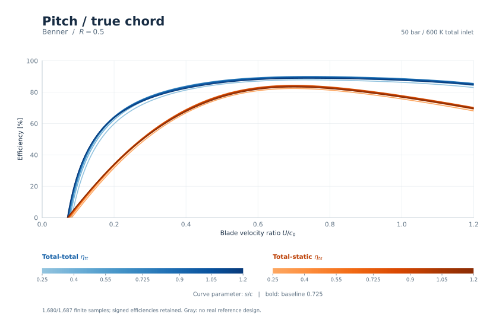</a>
</td>
</tr></tbody>
</table>

**Comparison.** At $U/c_0$=0.6, Benner minus KO spans 2.33 to 2.94 percentage points in total-total efficiency and 2.17 to 2.74 points in total-static efficiency across the common finite parameter levels.

## Pitch / true chord: Reaction at $U/c_0=0.6$

**Purpose.** Search for the spacing optimum, including continuation outside the Ainley-Mathieson chart, with the same pitch/true-chord ratio in both rows.

<table width="100%" style="width:100%;table-layout:fixed">
<thead><tr>
<th width="33.333%" align="center">Isentropic (zero losses)</th>
<th width="33.333%" align="center">Kacker–Okapuu</th>
<th width="33.333%" align="center">Benner</th>
</tr></thead>
<tbody><tr>
<td width="33.333%" align="center" valign="top">
<a href="sensitivity_isentropic/figures/reaction_pitch_chord.svg" title="Isentropic (zero losses): Pitch / true chord, reaction">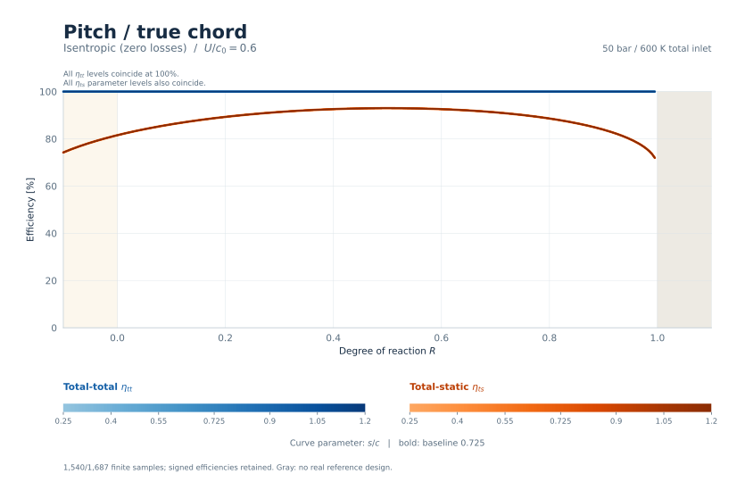</a>
</td>
<td width="33.333%" align="center" valign="top">
<a href="sensitivity_kacker_okapuu/figures/reaction_pitch_chord.svg" title="Kacker–Okapuu: Pitch / true chord, reaction"></a>
</td>
<td width="33.333%" align="center" valign="top">
<a href="sensitivity_benner/figures/reaction_pitch_chord.svg" title="Benner: Pitch / true chord, reaction">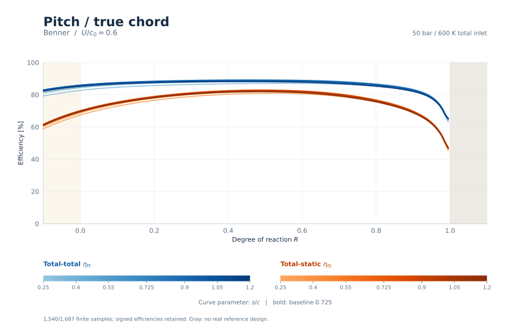</a>
</td>
</tr></tbody>
</table>

**Comparison.** At $R$=0.5, Benner minus KO spans 2.33 to 2.94 percentage points in total-total efficiency and 2.17 to 2.74 points in total-static efficiency across the common finite parameter levels.

## Blade aspect ratio: Blade velocity ratio at $R=0$

**Purpose.** Test secondary/clearance benefits against the Reynolds change caused by changing true chord, with equal height/chord ratios in both rows.

<table width="100%" style="width:100%;table-layout:fixed">
<thead><tr>
<th width="33.333%" align="center">Isentropic (zero losses)</th>
<th width="33.333%" align="center">Kacker–Okapuu</th>
<th width="33.333%" align="center">Benner</th>
</tr></thead>
<tbody><tr>
<td width="33.333%" align="center" valign="top">
<a href="sensitivity_isentropic/figures/speed_r0_aspect_ratio.svg" title="Isentropic (zero losses): Blade aspect ratio, speed_r0">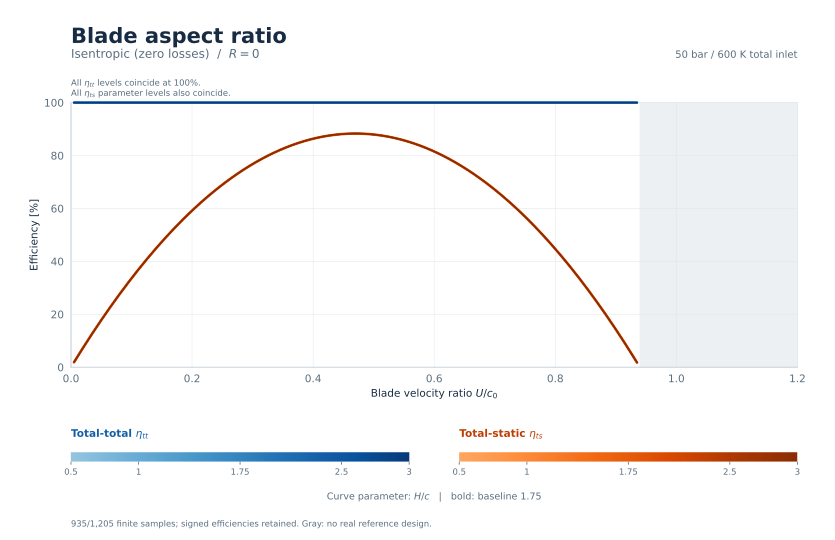</a>
</td>
<td width="33.333%" align="center" valign="top">
<a href="sensitivity_kacker_okapuu/figures/speed_r0_aspect_ratio.svg" title="Kacker–Okapuu: Blade aspect ratio, speed_r0">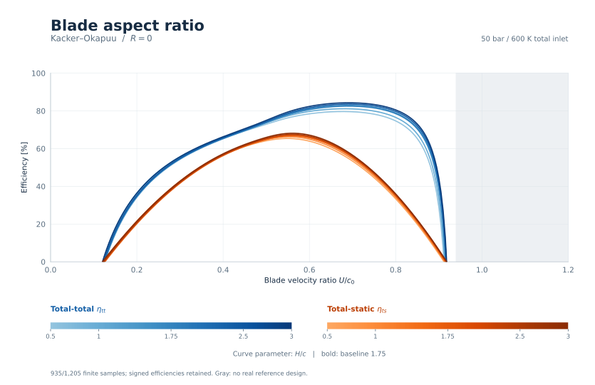</a>
</td>
<td width="33.333%" align="center" valign="top">
<a href="sensitivity_benner/figures/speed_r0_aspect_ratio.svg" title="Benner: Blade aspect ratio, speed_r0">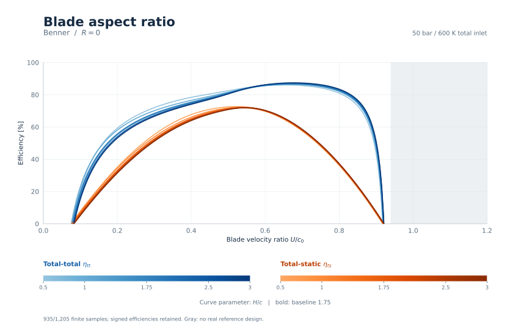</a>
</td>
</tr></tbody>
</table>

**Comparison.** At $U/c_0$=0.6, Benner minus KO spans 3.83 to 7.18 percentage points in total-total efficiency and 3.12 to 5.85 points in total-static efficiency across the common finite parameter levels.

## Blade aspect ratio: Blade velocity ratio at $R=0.5$

**Purpose.** Test secondary/clearance benefits against the Reynolds change caused by changing true chord, with equal height/chord ratios in both rows.

<table width="100%" style="width:100%;table-layout:fixed">
<thead><tr>
<th width="33.333%" align="center">Isentropic (zero losses)</th>
<th width="33.333%" align="center">Kacker–Okapuu</th>
<th width="33.333%" align="center">Benner</th>
</tr></thead>
<tbody><tr>
<td width="33.333%" align="center" valign="top">
<a href="sensitivity_isentropic/figures/speed_r05_aspect_ratio.svg" title="Isentropic (zero losses): Blade aspect ratio, speed_r05"></a>
</td>
<td width="33.333%" align="center" valign="top">
<a href="sensitivity_kacker_okapuu/figures/speed_r05_aspect_ratio.svg" title="Kacker–Okapuu: Blade aspect ratio, speed_r05">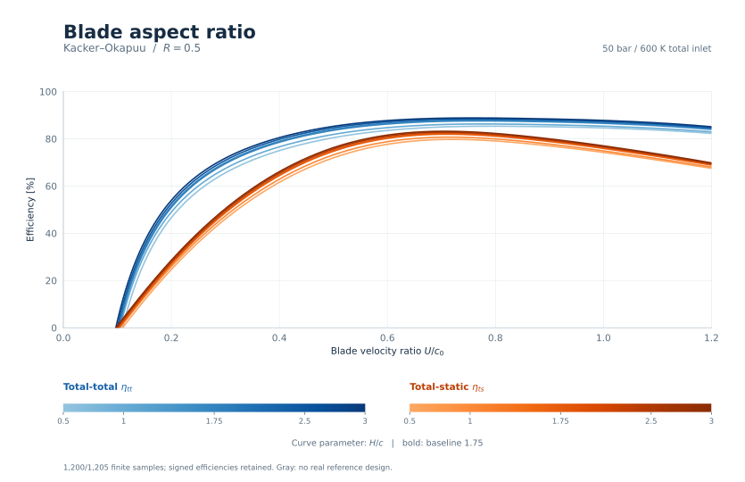</a>
</td>
<td width="33.333%" align="center" valign="top">
<a href="sensitivity_benner/figures/speed_r05_aspect_ratio.svg" title="Benner: Blade aspect ratio, speed_r05">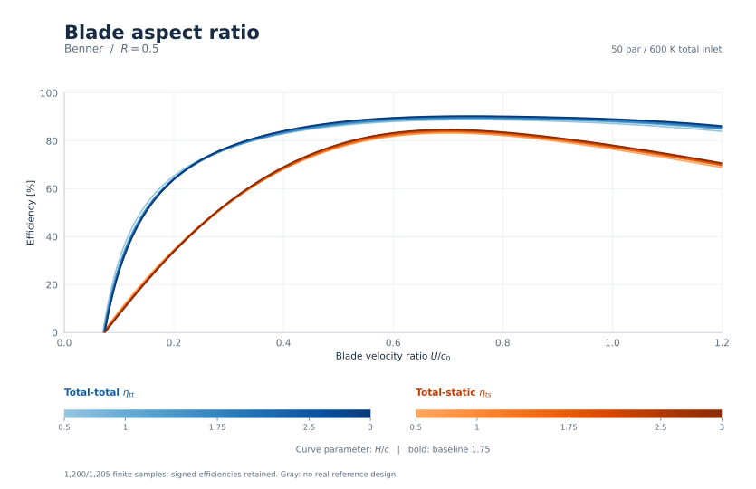</a>
</td>
</tr></tbody>
</table>

**Comparison.** At $U/c_0$=0.6, Benner minus KO spans 1.88 to 4.50 percentage points in total-total efficiency and 1.75 to 4.18 points in total-static efficiency across the common finite parameter levels.

## Blade aspect ratio: Reaction at $U/c_0=0.6$

**Purpose.** Test secondary/clearance benefits against the Reynolds change caused by changing true chord, with equal height/chord ratios in both rows.

<table width="100%" style="width:100%;table-layout:fixed">
<thead><tr>
<th width="33.333%" align="center">Isentropic (zero losses)</th>
<th width="33.333%" align="center">Kacker–Okapuu</th>
<th width="33.333%" align="center">Benner</th>
</tr></thead>
<tbody><tr>
<td width="33.333%" align="center" valign="top">
<a href="sensitivity_isentropic/figures/reaction_aspect_ratio.svg" title="Isentropic (zero losses): Blade aspect ratio, reaction"></a>
</td>
<td width="33.333%" align="center" valign="top">
<a href="sensitivity_kacker_okapuu/figures/reaction_aspect_ratio.svg" title="Kacker–Okapuu: Blade aspect ratio, reaction">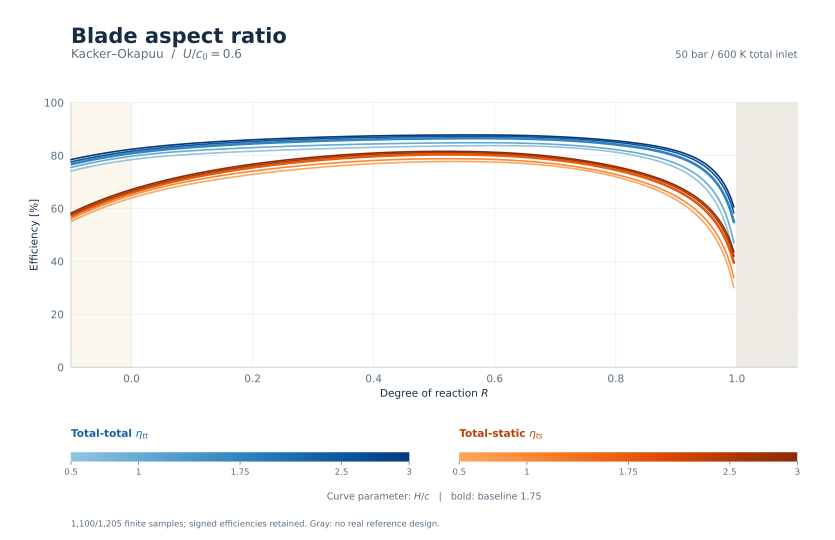</a>
</td>
<td width="33.333%" align="center" valign="top">
<a href="sensitivity_benner/figures/reaction_aspect_ratio.svg" title="Benner: Blade aspect ratio, reaction">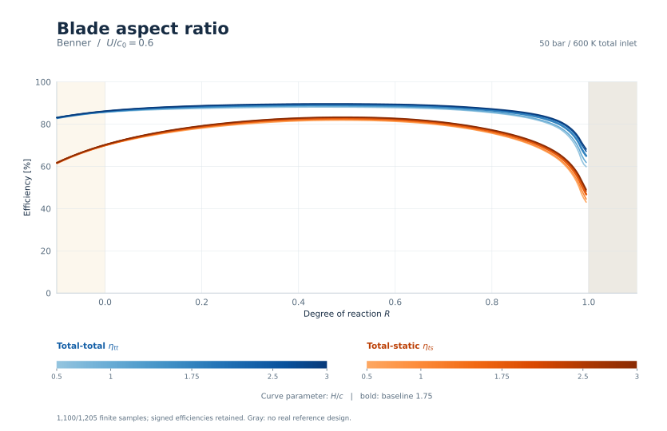</a>
</td>
</tr></tbody>
</table>

**Comparison.** At $R$=0.5, Benner minus KO spans 1.88 to 4.50 percentage points in total-total efficiency and 1.75 to 4.18 points in total-static efficiency across the common finite parameter levels.

## Trailing-edge thickness / opening: Blade velocity ratio at $R=0$

**Purpose.** Check that thickening both trailing edges increases loss and reduces efficiency, including the zero-thickness endpoint.

<table width="100%" style="width:100%;table-layout:fixed">
<thead><tr>
<th width="33.333%" align="center">Isentropic (zero losses)</th>
<th width="33.333%" align="center">Kacker–Okapuu</th>
<th width="33.333%" align="center">Benner</th>
</tr></thead>
<tbody><tr>
<td width="33.333%" align="center" valign="top">
<a href="sensitivity_isentropic/figures/speed_r0_trailing_ratio.svg" title="Isentropic (zero losses): Trailing-edge thickness / opening, speed_r0">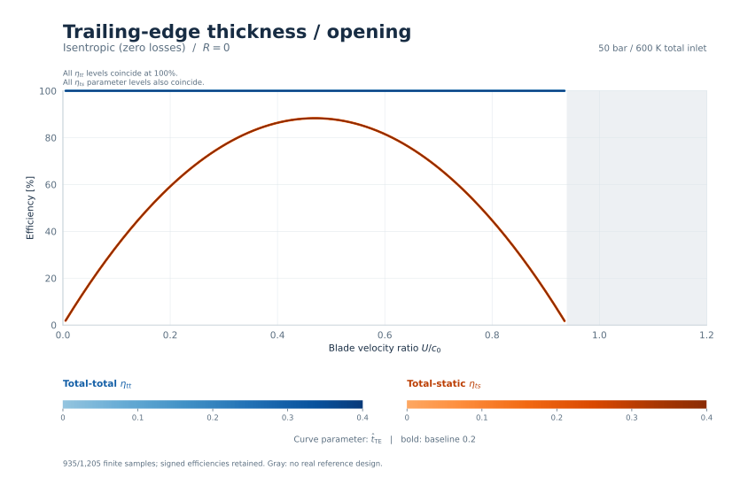</a>
</td>
<td width="33.333%" align="center" valign="top">
<a href="sensitivity_kacker_okapuu/figures/speed_r0_trailing_ratio.svg" title="Kacker–Okapuu: Trailing-edge thickness / opening, speed_r0">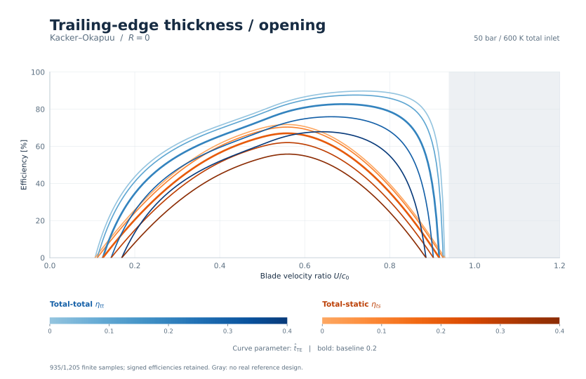</a>
</td>
<td width="33.333%" align="center" valign="top">
<a href="sensitivity_benner/figures/speed_r0_trailing_ratio.svg" title="Benner: Trailing-edge thickness / opening, speed_r0">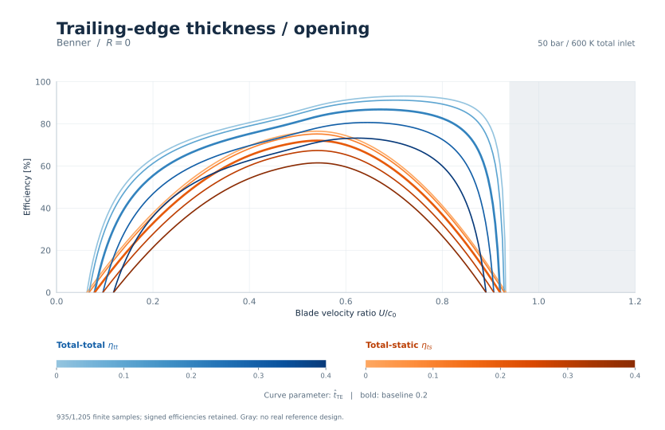</a>
</td>
</tr></tbody>
</table>

**Comparison.** At $U/c_0$=0.6, Benner minus KO spans 4.66 to 5.80 percentage points in total-total efficiency and 3.80 to 4.73 points in total-static efficiency across the common finite parameter levels.

## Trailing-edge thickness / opening: Blade velocity ratio at $R=0.5$

**Purpose.** Check that thickening both trailing edges increases loss and reduces efficiency, including the zero-thickness endpoint.

<table width="100%" style="width:100%;table-layout:fixed">
<thead><tr>
<th width="33.333%" align="center">Isentropic (zero losses)</th>
<th width="33.333%" align="center">Kacker–Okapuu</th>
<th width="33.333%" align="center">Benner</th>
</tr></thead>
<tbody><tr>
<td width="33.333%" align="center" valign="top">
<a href="sensitivity_isentropic/figures/speed_r05_trailing_ratio.svg" title="Isentropic (zero losses): Trailing-edge thickness / opening, speed_r05"></a>
</td>
<td width="33.333%" align="center" valign="top">
<a href="sensitivity_kacker_okapuu/figures/speed_r05_trailing_ratio.svg" title="Kacker–Okapuu: Trailing-edge thickness / opening, speed_r05">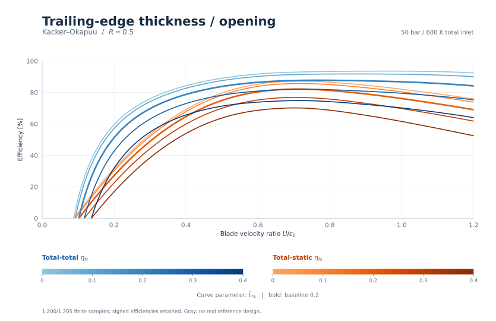</a>
</td>
<td width="33.333%" align="center" valign="top">
<a href="sensitivity_benner/figures/speed_r05_trailing_ratio.svg" title="Benner: Trailing-edge thickness / opening, speed_r05">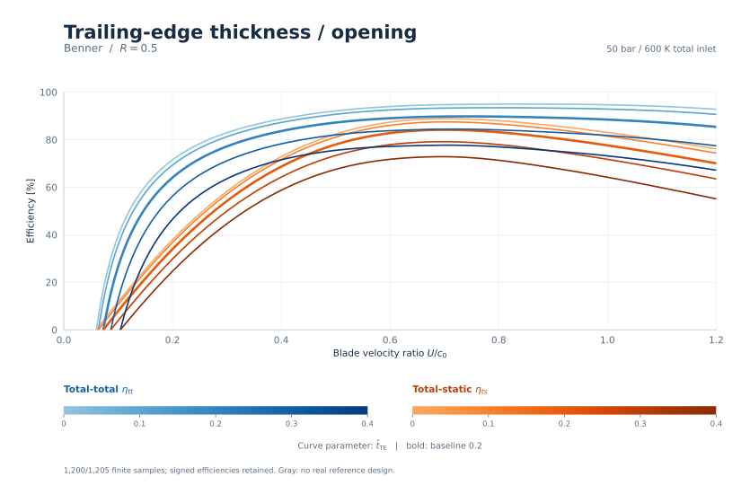</a>
</td>
</tr></tbody>
</table>

**Comparison.** At $U/c_0$=0.6, Benner minus KO spans 2.25 to 3.32 percentage points in total-total efficiency and 2.09 to 3.09 points in total-static efficiency across the common finite parameter levels.

## Trailing-edge thickness / opening: Reaction at $U/c_0=0.6$

**Purpose.** Check that thickening both trailing edges increases loss and reduces efficiency, including the zero-thickness endpoint.

<table width="100%" style="width:100%;table-layout:fixed">
<thead><tr>
<th width="33.333%" align="center">Isentropic (zero losses)</th>
<th width="33.333%" align="center">Kacker–Okapuu</th>
<th width="33.333%" align="center">Benner</th>
</tr></thead>
<tbody><tr>
<td width="33.333%" align="center" valign="top">
<a href="sensitivity_isentropic/figures/reaction_trailing_ratio.svg" title="Isentropic (zero losses): Trailing-edge thickness / opening, reaction">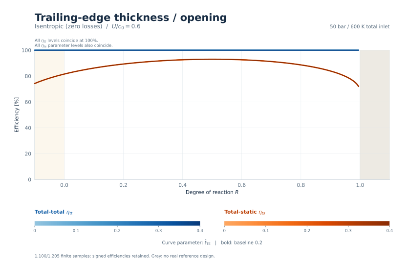</a>
</td>
<td width="33.333%" align="center" valign="top">
<a href="sensitivity_kacker_okapuu/figures/reaction_trailing_ratio.svg" title="Kacker–Okapuu: Trailing-edge thickness / opening, reaction">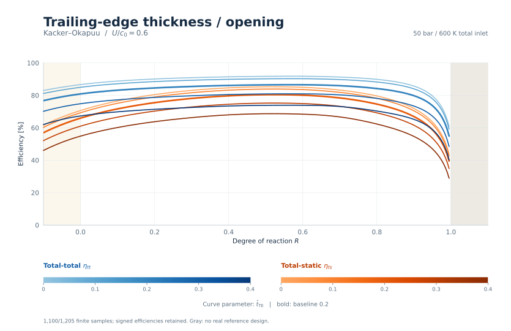</a>
</td>
<td width="33.333%" align="center" valign="top">
<a href="sensitivity_benner/figures/reaction_trailing_ratio.svg" title="Benner: Trailing-edge thickness / opening, reaction">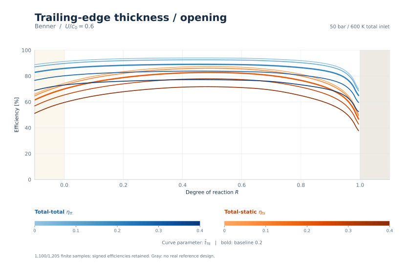</a>
</td>
</tr></tbody>
</table>

**Comparison.** At $R$=0.5, Benner minus KO spans 2.25 to 3.32 percentage points in total-total efficiency and 2.09 to 3.09 points in total-static efficiency across the common finite parameter levels.

## Specific speed: Blade velocity ratio at $R=0$

**Purpose.** Expose the coupled response of rotational speed, annulus shape, chord, Reynolds correction and hub shock at fixed mass flow.

<table width="100%" style="width:100%;table-layout:fixed">
<thead><tr>
<th width="33.333%" align="center">Isentropic (zero losses)</th>
<th width="33.333%" align="center">Kacker–Okapuu</th>
<th width="33.333%" align="center">Benner</th>
</tr></thead>
<tbody><tr>
<td width="33.333%" align="center" valign="top">
<a href="sensitivity_isentropic/figures/speed_r0_specific_speed.svg" title="Isentropic (zero losses): Specific speed, speed_r0">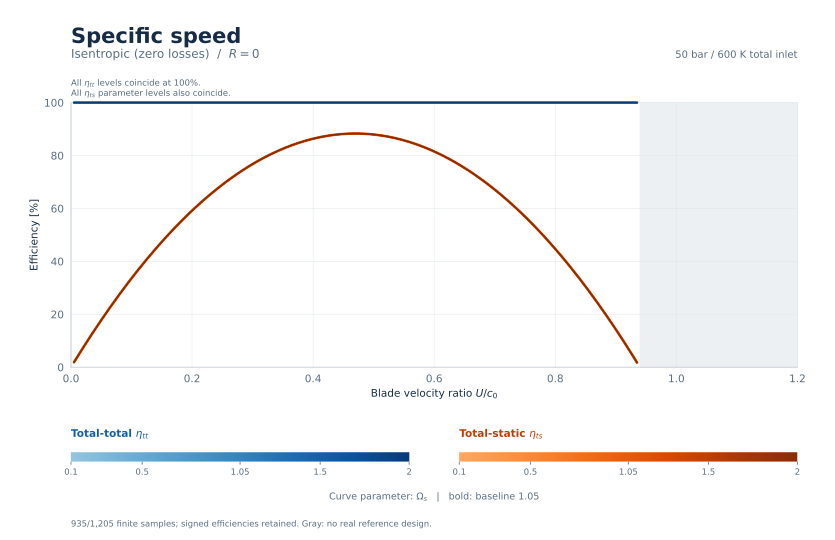</a>
</td>
<td width="33.333%" align="center" valign="top">
<a href="sensitivity_kacker_okapuu/figures/speed_r0_specific_speed.svg" title="Kacker–Okapuu: Specific speed, speed_r0">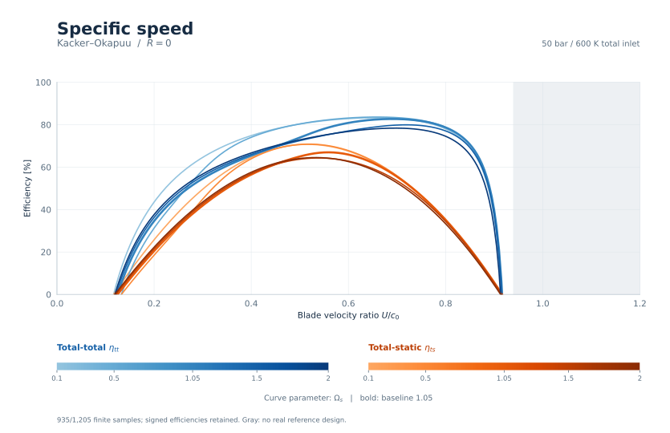</a>
</td>
<td width="33.333%" align="center" valign="top">
<a href="sensitivity_benner/figures/speed_r0_specific_speed.svg" title="Benner: Specific speed, speed_r0">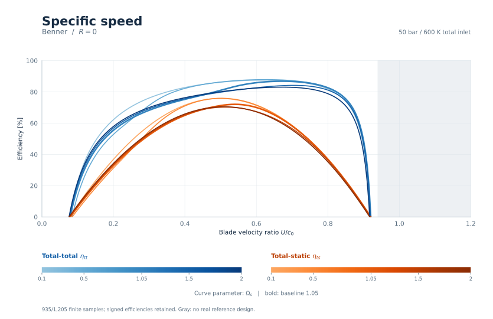</a>
</td>
</tr></tbody>
</table>

**Comparison.** At $U/c_0$=0.6, Benner minus KO spans 4.63 to 5.61 percentage points in total-total efficiency and 3.77 to 4.57 points in total-static efficiency across the common finite parameter levels.

## Specific speed: Blade velocity ratio at $R=0.5$

**Purpose.** Expose the coupled response of rotational speed, annulus shape, chord, Reynolds correction and hub shock at fixed mass flow.

<table width="100%" style="width:100%;table-layout:fixed">
<thead><tr>
<th width="33.333%" align="center">Isentropic (zero losses)</th>
<th width="33.333%" align="center">Kacker–Okapuu</th>
<th width="33.333%" align="center">Benner</th>
</tr></thead>
<tbody><tr>
<td width="33.333%" align="center" valign="top">
<a href="sensitivity_isentropic/figures/speed_r05_specific_speed.svg" title="Isentropic (zero losses): Specific speed, speed_r05"></a>
</td>
<td width="33.333%" align="center" valign="top">
<a href="sensitivity_kacker_okapuu/figures/speed_r05_specific_speed.svg" title="Kacker–Okapuu: Specific speed, speed_r05"></a>
</td>
<td width="33.333%" align="center" valign="top">
<a href="sensitivity_benner/figures/speed_r05_specific_speed.svg" title="Benner: Specific speed, speed_r05">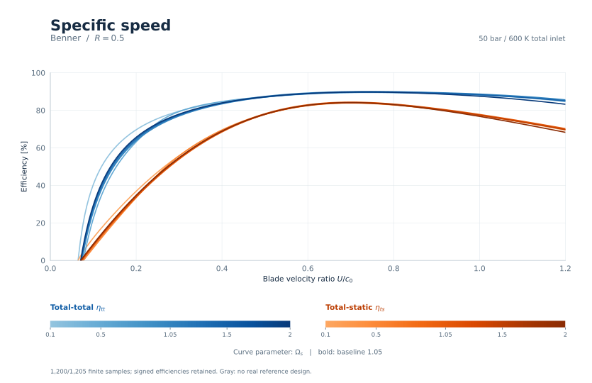</a>
</td>
</tr></tbody>
</table>

**Comparison.** At $U/c_0$=0.6, Benner minus KO spans 2.54 to 2.59 percentage points in total-total efficiency and 2.37 to 2.41 points in total-static efficiency across the common finite parameter levels.

## Specific speed: Reaction at $U/c_0=0.6$

**Purpose.** Expose the coupled response of rotational speed, annulus shape, chord, Reynolds correction and hub shock at fixed mass flow.

<table width="100%" style="width:100%;table-layout:fixed">
<thead><tr>
<th width="33.333%" align="center">Isentropic (zero losses)</th>
<th width="33.333%" align="center">Kacker–Okapuu</th>
<th width="33.333%" align="center">Benner</th>
</tr></thead>
<tbody><tr>
<td width="33.333%" align="center" valign="top">
<a href="sensitivity_isentropic/figures/reaction_specific_speed.svg" title="Isentropic (zero losses): Specific speed, reaction"></a>
</td>
<td width="33.333%" align="center" valign="top">
<a href="sensitivity_kacker_okapuu/figures/reaction_specific_speed.svg" title="Kacker–Okapuu: Specific speed, reaction">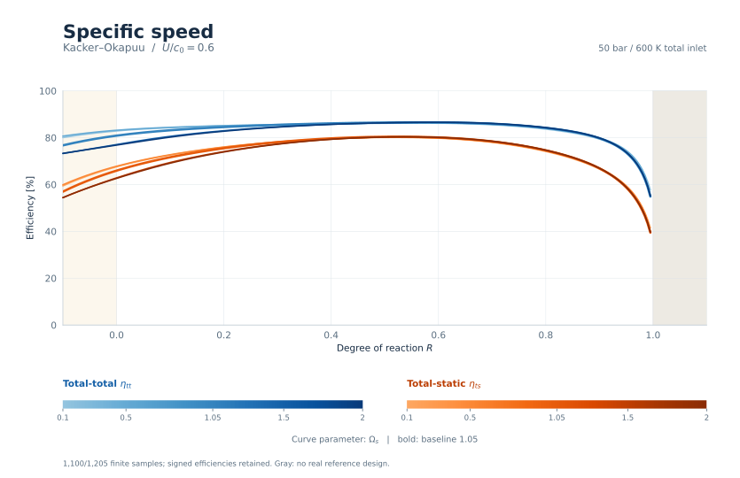</a>
</td>
<td width="33.333%" align="center" valign="top">
<a href="sensitivity_benner/figures/reaction_specific_speed.svg" title="Benner: Specific speed, reaction">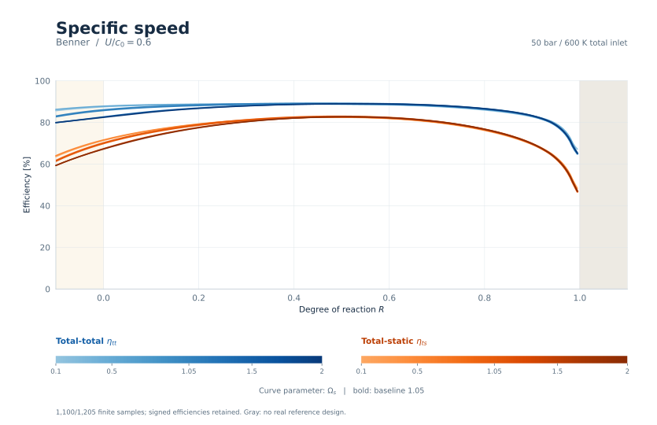</a>
</td>
</tr></tbody>
</table>

**Comparison.** At $R$=0.5, Benner minus KO spans 2.54 to 2.59 percentage points in total-total efficiency and 2.37 to 2.41 points in total-static efficiency across the common finite parameter levels.

## Mass flow: Blade velocity ratio at $R=0$

**Purpose.** Isolate size at fixed dimensionless design. Larger chord Reynolds numbers approach the finite Reynolds-correction limit.

<table width="100%" style="width:100%;table-layout:fixed">
<thead><tr>
<th width="33.333%" align="center">Isentropic (zero losses)</th>
<th width="33.333%" align="center">Kacker–Okapuu</th>
<th width="33.333%" align="center">Benner</th>
</tr></thead>
<tbody><tr>
<td width="33.333%" align="center" valign="top">
<a href="sensitivity_isentropic/figures/speed_r0_mass_flow.svg" title="Isentropic (zero losses): Mass flow, speed_r0">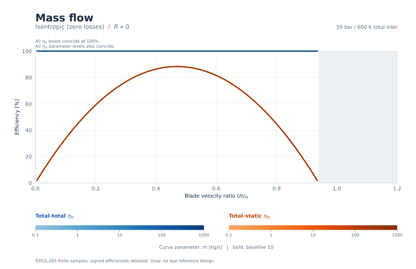</a>
</td>
<td width="33.333%" align="center" valign="top">
<a href="sensitivity_kacker_okapuu/figures/speed_r0_mass_flow.svg" title="Kacker–Okapuu: Mass flow, speed_r0">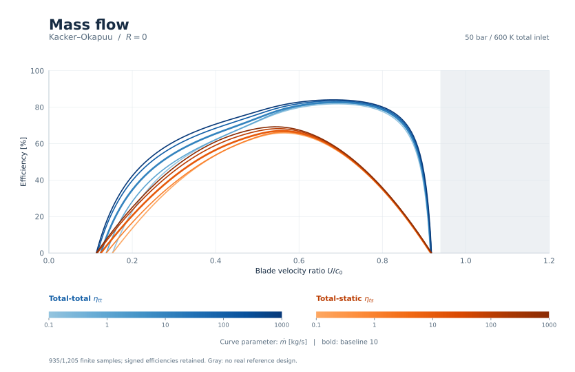</a>
</td>
<td width="33.333%" align="center" valign="top">
<a href="sensitivity_benner/figures/speed_r0_mass_flow.svg" title="Benner: Mass flow, speed_r0">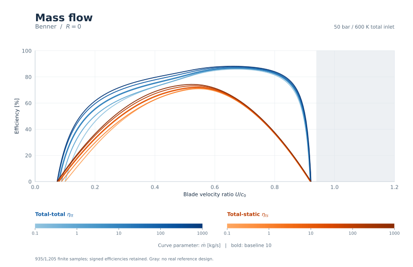</a>
</td>
</tr></tbody>
</table>

**Comparison.** At $U/c_0$=0.6, Benner minus KO spans 4.83 to 5.10 percentage points in total-total efficiency and 3.94 to 4.16 points in total-static efficiency across the common finite parameter levels.

## Mass flow: Blade velocity ratio at $R=0.5$

**Purpose.** Isolate size at fixed dimensionless design. Larger chord Reynolds numbers approach the finite Reynolds-correction limit.

<table width="100%" style="width:100%;table-layout:fixed">
<thead><tr>
<th width="33.333%" align="center">Isentropic (zero losses)</th>
<th width="33.333%" align="center">Kacker–Okapuu</th>
<th width="33.333%" align="center">Benner</th>
</tr></thead>
<tbody><tr>
<td width="33.333%" align="center" valign="top">
<a href="sensitivity_isentropic/figures/speed_r05_mass_flow.svg" title="Isentropic (zero losses): Mass flow, speed_r05">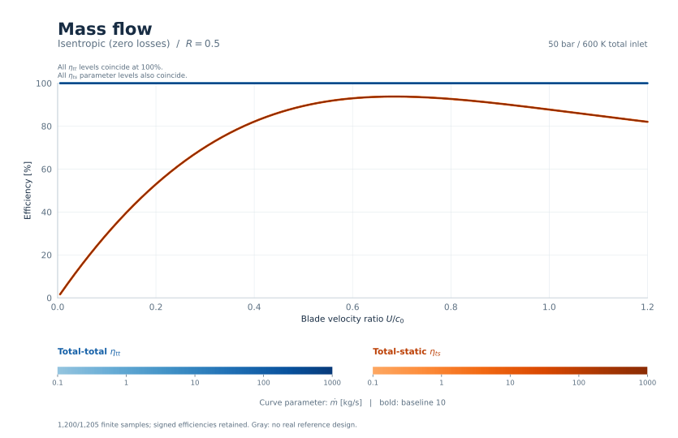</a>
</td>
<td width="33.333%" align="center" valign="top">
<a href="sensitivity_kacker_okapuu/figures/speed_r05_mass_flow.svg" title="Kacker–Okapuu: Mass flow, speed_r05">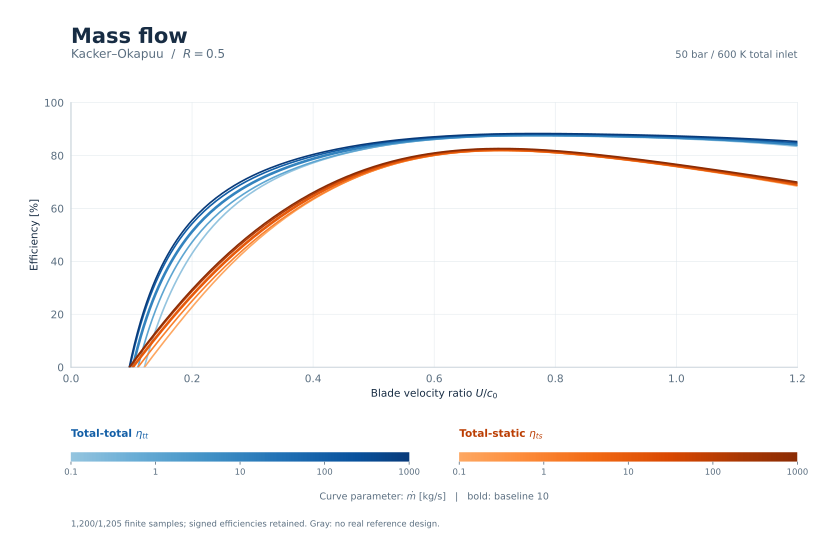</a>
</td>
<td width="33.333%" align="center" valign="top">
<a href="sensitivity_benner/figures/speed_r05_mass_flow.svg" title="Benner: Mass flow, speed_r05">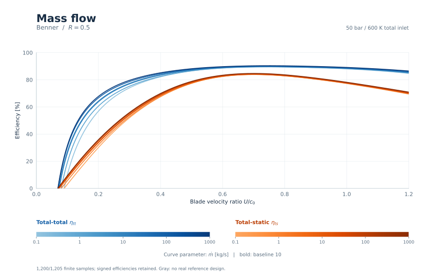</a>
</td>
</tr></tbody>
</table>

**Comparison.** At $U/c_0$=0.6, Benner minus KO spans 2.55 to 2.58 percentage points in total-total efficiency and 2.37 to 2.40 points in total-static efficiency across the common finite parameter levels.

## Mass flow: Reaction at $U/c_0=0.6$

**Purpose.** Isolate size at fixed dimensionless design. Larger chord Reynolds numbers approach the finite Reynolds-correction limit.

<table width="100%" style="width:100%;table-layout:fixed">
<thead><tr>
<th width="33.333%" align="center">Isentropic (zero losses)</th>
<th width="33.333%" align="center">Kacker–Okapuu</th>
<th width="33.333%" align="center">Benner</th>
</tr></thead>
<tbody><tr>
<td width="33.333%" align="center" valign="top">
<a href="sensitivity_isentropic/figures/reaction_mass_flow.svg" title="Isentropic (zero losses): Mass flow, reaction">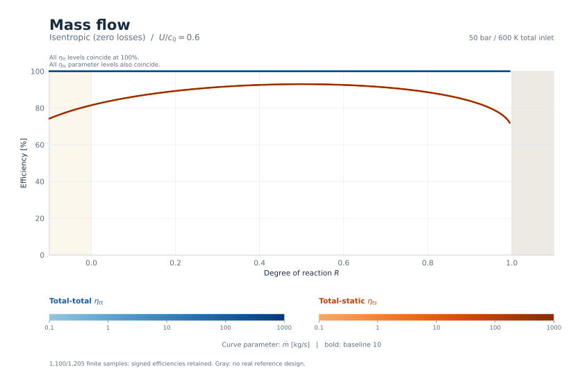</a>
</td>
<td width="33.333%" align="center" valign="top">
<a href="sensitivity_kacker_okapuu/figures/reaction_mass_flow.svg" title="Kacker–Okapuu: Mass flow, reaction">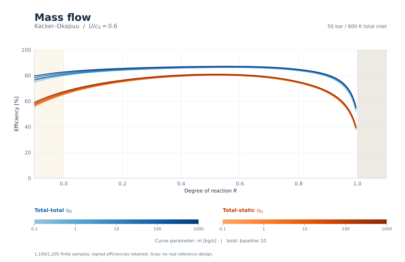</a>
</td>
<td width="33.333%" align="center" valign="top">
<a href="sensitivity_benner/figures/reaction_mass_flow.svg" title="Benner: Mass flow, reaction">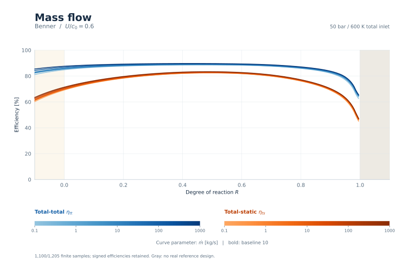</a>
</td>
</tr></tbody>
</table>

**Comparison.** At $R$=0.5, Benner minus KO spans 2.55 to 2.58 percentage points in total-total efficiency and 2.37 to 2.40 points in total-static efficiency across the common finite parameter levels.

## Isentropic expansion Mach number: Blade velocity ratio at $R=0$

**Purpose.** Change expansion pressure ratio and inspect the combined compressibility, shock and Reynolds response.

<table width="100%" style="width:100%;table-layout:fixed">
<thead><tr>
<th width="33.333%" align="center">Isentropic (zero losses)</th>
<th width="33.333%" align="center">Kacker–Okapuu</th>
<th width="33.333%" align="center">Benner</th>
</tr></thead>
<tbody><tr>
<td width="33.333%" align="center" valign="top">
<a href="sensitivity_isentropic/figures/speed_r0_isentropic_mach.svg" title="Isentropic (zero losses): Isentropic expansion Mach number, speed_r0">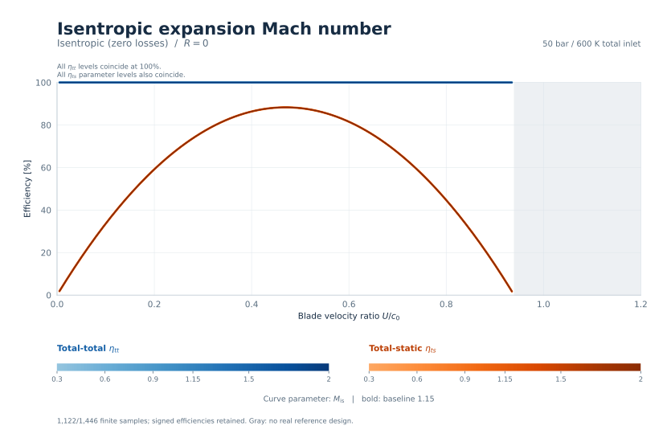</a>
</td>
<td width="33.333%" align="center" valign="top">
<a href="sensitivity_kacker_okapuu/figures/speed_r0_isentropic_mach.svg" title="Kacker–Okapuu: Isentropic expansion Mach number, speed_r0">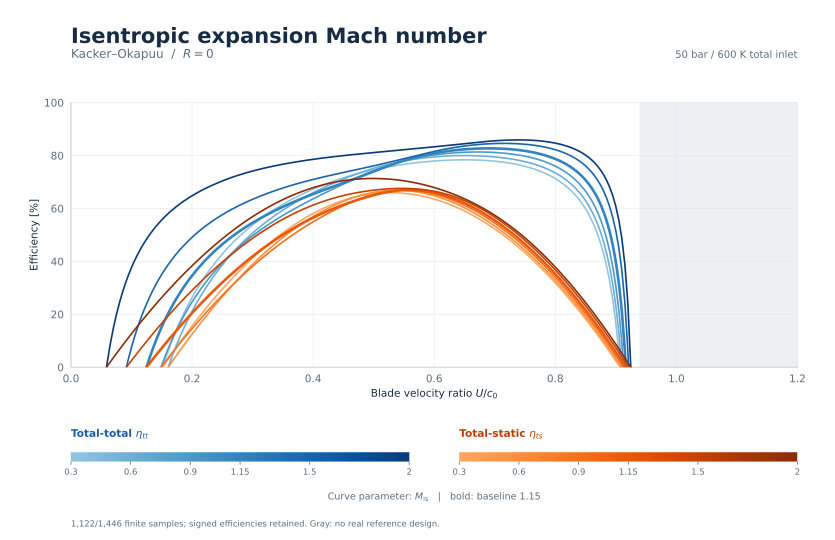</a>
</td>
<td width="33.333%" align="center" valign="top">
<a href="sensitivity_benner/figures/speed_r0_isentropic_mach.svg" title="Benner: Isentropic expansion Mach number, speed_r0">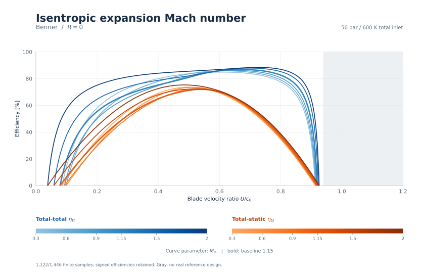</a>
</td>
</tr></tbody>
</table>

**Comparison.** At $U/c_0$=0.6, Benner minus KO spans 3.55 to 6.95 percentage points in total-total efficiency and 2.89 to 5.66 points in total-static efficiency across the common finite parameter levels.

## Isentropic expansion Mach number: Blade velocity ratio at $R=0.5$

**Purpose.** Change expansion pressure ratio and inspect the combined compressibility, shock and Reynolds response.

<table width="100%" style="width:100%;table-layout:fixed">
<thead><tr>
<th width="33.333%" align="center">Isentropic (zero losses)</th>
<th width="33.333%" align="center">Kacker–Okapuu</th>
<th width="33.333%" align="center">Benner</th>
</tr></thead>
<tbody><tr>
<td width="33.333%" align="center" valign="top">
<a href="sensitivity_isentropic/figures/speed_r05_isentropic_mach.svg" title="Isentropic (zero losses): Isentropic expansion Mach number, speed_r05"></a>
</td>
<td width="33.333%" align="center" valign="top">
<a href="sensitivity_kacker_okapuu/figures/speed_r05_isentropic_mach.svg" title="Kacker–Okapuu: Isentropic expansion Mach number, speed_r05">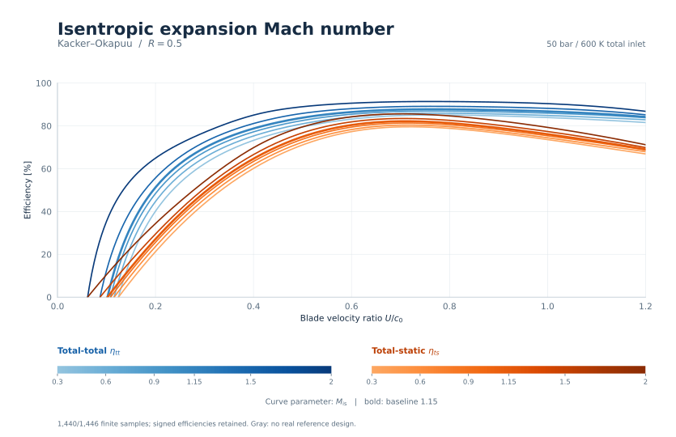</a>
</td>
<td width="33.333%" align="center" valign="top">
<a href="sensitivity_benner/figures/speed_r05_isentropic_mach.svg" title="Benner: Isentropic expansion Mach number, speed_r05">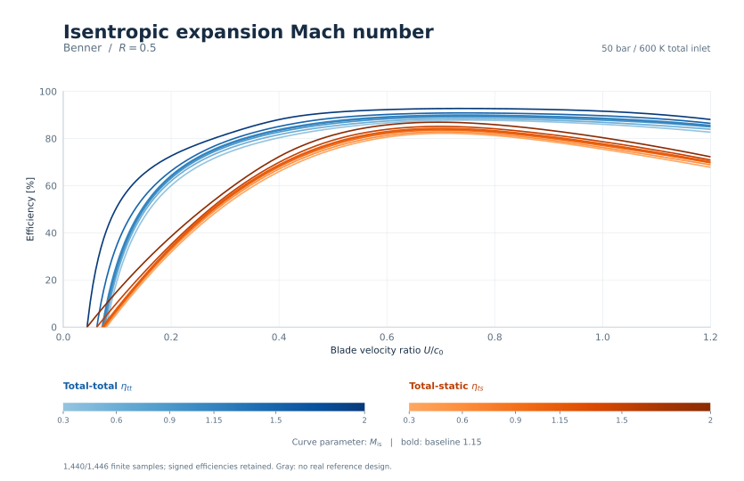</a>
</td>
</tr></tbody>
</table>

**Comparison.** At $U/c_0$=0.6, Benner minus KO spans 1.68 to 3.51 percentage points in total-total efficiency and 1.56 to 3.27 points in total-static efficiency across the common finite parameter levels.

## Isentropic expansion Mach number: Reaction at $U/c_0=0.6$

**Purpose.** Change expansion pressure ratio and inspect the combined compressibility, shock and Reynolds response.

<table width="100%" style="width:100%;table-layout:fixed">
<thead><tr>
<th width="33.333%" align="center">Isentropic (zero losses)</th>
<th width="33.333%" align="center">Kacker–Okapuu</th>
<th width="33.333%" align="center">Benner</th>
</tr></thead>
<tbody><tr>
<td width="33.333%" align="center" valign="top">
<a href="sensitivity_isentropic/figures/reaction_isentropic_mach.svg" title="Isentropic (zero losses): Isentropic expansion Mach number, reaction"></a>
</td>
<td width="33.333%" align="center" valign="top">
<a href="sensitivity_kacker_okapuu/figures/reaction_isentropic_mach.svg" title="Kacker–Okapuu: Isentropic expansion Mach number, reaction"></a>
</td>
<td width="33.333%" align="center" valign="top">
<a href="sensitivity_benner/figures/reaction_isentropic_mach.svg" title="Benner: Isentropic expansion Mach number, reaction"></a>
</td>
</tr></tbody>
</table>

**Comparison.** At $R$=0.5, Benner minus KO spans 1.68 to 3.51 percentage points in total-total efficiency and 1.56 to 3.27 points in total-static efficiency across the common finite parameter levels.

---

**Reproduce from saved figures.** No cases or plots are rerun:

```powershell
python -B loss_model_analysis/loss_model_audit/overall_stage/report.py --comparison-only
```

[Report and source-figure hashes](data/comparison_manifest.json)
